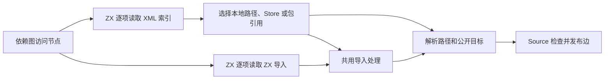

# 项目依赖边自举

## Intent

把项目依赖图已索引的 XML 引用与 ZX 导入遍历迁入 Source。统一普通源码、Store、编译库和原生目标的边发布，并保留原有搜索顺序、诊断位置与缓存输入。

## Data

起点为 `c00597a74`。原有两个 Zig 循环消费 Source 计划的批量结果，再逐项重新获取路径、角色和位置。登记目标的索引查找与包边界判定已在 Source，但 Zig 消费判定结果、修改邻接与边列表，并为编译库单独标记当前模块。

## Edges

XML 维持索引的逆向遍历，ZX 沿用头部记录次序。缺少 Store 先于包边界诊断，普通本地引用先报告包边界再报告未登记。文件和包导入保持原解析语义，已通过包边界的导入直接登记，声明的外部包可以跨包引用。源码边依旧先追加邻接再写边，命名调用连同目标一次写入。

## Answer

- 生成的 Source 循环直接借用 XML 属性列和 ZX 导入记录。删除 ZX 扫描的中间列和 Zig 消费循环。项目图中的 XML 扫描复用单个路径缓冲，路径过长时仅扩容到实际所需长度。
- 两类引用共用导入分派及图边的校验和发布。Source 决定何时登记邻接、记录编译库依赖和写入边。原生适配器借用原位置、写入现有存储或在必要时构造诊断。
- 平台绝对路径解析、同名文件与目录入口的选择、编译库目标的解析和内存分配仍由宿主持有。供 CLI 动态加载使用的 XML 通用收集器、未索引 AST 路径和初始引导回退仍保留原入口。

### 引导与性能

用 `c00597a74` 的 Source 工具构建候选，26 个步骤通过。候选 SHA-256 为 `6f226e9e99e6031ddec4ddb615e5c78d2459703fc52730b9048b4643f948ea11`。独立核对三个生成入口的 Zig，两个扫描循环和边发布均未生成临时分配。ZX 解析记录跨两个生成模块使用经过布局核对的借用视图。

固定 705 个入口和 16 个分区，关闭常驻生成器，交错三轮取中位数。三个工具均由 Source 构建并运行各自的 Source 分析和生成。9,894 个固定输入生成文件与所有权 memo 载荷逐字节一致。

| 对照     | 冷生成墙钟 | 冷生成 CPU | 冷进程树峰值 RSS | 冷系统记录峰值 RSS | 热生成墙钟 | 热生成 CPU |
| -------- | ---------: | ---------: | ---------------: | -----------------: | ---------: | ---------: |
| 固定基线 |     2.07 s |     9.00 s |         737.7 MB |           760.4 MB |     1.62 s |     6.40 s |
| 上阶段   |     1.93 s |     9.50 s |         524.5 MB |           546.6 MB |     1.43 s |     6.24 s |
| 候选     |     1.90 s |     9.42 s |         529.0 MB |           546.0 MB |     1.43 s |     6.26 s |

较上阶段，冷生成墙钟减少 0.03 秒，CPU 减少 0.08 秒，进程树峰值增加 4.4 MB，系统记录峰值减少 0.6 MB。较固定基线，冷生成墙钟减少 0.17 秒，CPU 累计增加 0.42 秒，进程树峰值减少 208.8 MB。无改动检查墙钟仍为 0.03 秒。

### 正确性核验

五份当前引导清单的 17,486 个生成文件逐字节一致。十次常驻请求的分析、复用、发射计数及产物哈希与上阶段一致，合法编辑的生成产物与对应冷生成一致。所有修改的 ZX 文件通过格式与 lint 检查。

初始 seed 的解析器构建和 RX 回归共通过 49 个步骤与 39 项测试。首次构建暴露出头部解析与边扫描属于不同生成模块，两者的名义类型需通过现有列视图桥接。修正后借用原导入数组，并在编译期检查字段布局。

正式候选通过 55 个构建步骤与 217 项测试，覆盖语义缓存、RX 推导、库链接与 Store 初值。
