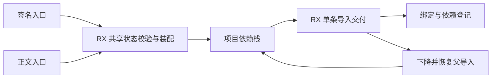
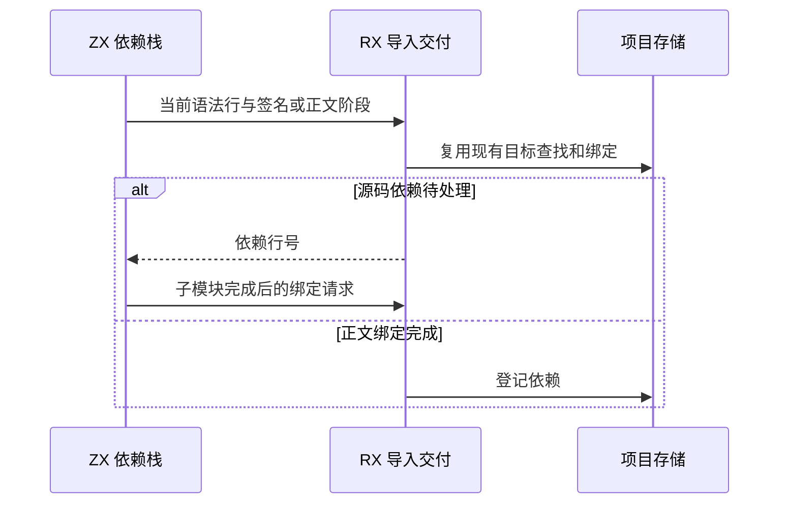

# 项目共享状态与导入交付自举

## Intent

让项目签名与正文使用同一条 Source 路径装配类型、原生模块和名义类型来源，并在依赖栈中决定每条导入何时绑定、何时下降及何时登记依赖。

## Data

正式入口 `analyzeSignatureEntries` 和 `analyzeWithCaches` 共用 `State.open`。三张表已分别通过 Source 生成和校验，验证成功后的写入次序仍由 Zig 决定。依赖栈由 `execution/load.rx` 驱动，单条导入却回到 `Project.visitImport`，在那里选择原生、旧式外部、内建、源码或编译库，处理降入与恢复，并在正文阶段登记依赖。

## Edges

保留三张表的验证顺序和失败诊断。名义来源读取新表持有的名称。导入继续借用原有语法行、包作用域和索引，沿用现有路由和查表规则。路径缓冲只活到当前导入结束。签名检查继续支持延后绑定 RX 入口，缓存命中和失败前缀沿用原规则。适配器提供借用视图、路径缓冲和实际列写入。

## Answer

由正式入口核对状态装配、单条导入交付和子模块恢复是否退出旧 Zig 分派。集中运行模块、签名与正文联结、语义缓存、原生和编译库导入回归并对照 Source 再生成产物。沿用固定输入的冷暖生成对照，记录墙钟、CPU 和内存。

[项目入口](../../packages/compiler/src/zx/modules/project.zig) · [共享状态](../../packages/compiler/src/zx/modules/project/state/open.rx) · [依赖栈](../../packages/compiler/src/zx/modules/project/execution/load.rx)

### 实现

`State.open` 把借用的共享视图交给同一个 RX 模块，依次确认类型、原生模块和名义来源，再建立项目拥有的表。名义来源使用刚建立的类型表。签名和正文共用这个入口，分配和已有列写入由原宿主操作完成。

项目依赖栈把导入语法行交给 `delivery/run.rx`。这个模块调用已有的目标与原生接口选择规则，经由 `target.rx`、`source.rx` 和 `bind.rx` 决定应用绑定、下降或恢复。正文在绑定成功后统一登记依赖，签名使用自己的发布入口。旧 `visitImport` 与 `resumeImport` 移入初始 seed 的调用链。正式路径在一次导入期间复用原有语法视图、实际状态表与路径缓冲，生成的交付流程使用空的临时分配器执行。

### 引导验证

Zig 0.17.0、ReleaseSmall、16 分区下，初始 seed 生成检验通过 **19/19** 构建步骤。上一轮通过验收的 Source 引导器构建本阶段工具，通过 **25/25** 步骤。候选 SHA-256 为 `5f294c41e19c06ac6ec5bf6ccd9621f3dc7c47fcb4e086c1ee266d573e050f1b`。候选重生的主清单、增长、集合和执行四套产物共 **16,092 份文件**与构建输入逐字节一致，比较排除记录工具身份的 `.zxc-inputs`。

### 回归与性能

模块记录、语义缓存、跨进程持久缓存、原生生成、编译库导入、RX 推导和联结边界共 **115/115 构建步骤、173/173 Zig 测试**通过。六组独立编译库运行、原生生成和五项持久缓存 CLI 检查也通过。

沿用 735 入口、16 分区的冻结清单。上一阶段和本阶段都由 Source 引导器构建，运行时均使用各自的 Source 分析及生成。交替运行三轮，以下为中位数，RSS 单位为字节。

| 工具     | 冷墙钟（秒） | 冷 CPU（秒） | 进程树峰值 RSS | 单进程峰值 RSS |
| -------- | -----------: | -----------: | -------------: | -------------: |
| 固定基线 |         2.82 |        12.43 |    884,768,768 |    934,051,840 |
| 上一阶段 |         2.62 |        13.06 |    661,143,552 |    681,394,176 |
| 本阶段   |         2.59 |        12.94 |    668,614,656 |    692,453,376 |

较上一阶段，冷墙钟下降 0.03 秒，CPU 下降 0.12 秒。进程树峰值增长 7.47 MB，单进程峰值增长 11.06 MB，采样的物理内存峰值中位数增长 15.17 MB，其中一轮候选落在上一阶段范围内。固定基线累计墙钟下降 0.23 秒，CPU 增长 0.51 秒，进程树峰值下降 216.15 MB。热生成墙钟由 1.93 秒变为 1.92 秒，CPU 由 8.33 秒变为 8.29 秒，无改动运行均为 0.03 秒。冻结的 11,753 份产物、冷暖结果和所有权缓存正文一致。

原始记录位于 `.zig-cache/verification-tmp/project-import-delivery/`。下一批从签名行发布和项目入口交付入手，继续迁移 Zig 持有的结果组装。当前宿主仍提供路径分配、借用列、物理状态写入和错误装配。
