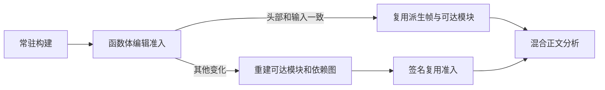
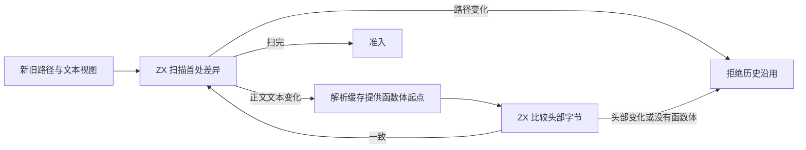

# 项目历史编辑准入自举

## Intent

把函数体编辑的历史准入和签名复用判断迁入 Source。常驻构建在适用时沿用已有项目派生数据和签名，其他编辑走原有重建路径。

## Data

基线为 `cb0114daa`。正式构建在 `shared_generation.run` 选取输入，随后由 `workflow/derive/run.rx` 按需读取签名。当前函数体准入由 Zig 驱动多轮 Source 扫描和 ZX 解析，签名准入分别调用顺序判断和文本扫描。

## Edges

沿用输入指纹、原始输入顺序、规范化解析路径和签名入口顺序。只解析文本发生变化且路径一致的记录。头部必须匹配到函数体左花括号为止。输入视图只借用现有列和文本。保留解析失败和分配失败的传播方式。初始 Zig 引导沿用原有实现。

## Answer

沿正式调用链核对宿主退出函数体编辑扫描与双重签名判定。集中核验函数体编辑、接口编辑、纯 RX 编辑、错误与恢复的历史行为，完成受影响入口回归、引导产物比对及固定性能对照。

### 正式路径

- `History.bodiesOnly` 交给 RX 校验输入身份并推进正文编辑。ZX 扫描同一组借用列，只有文本变化且路径匹配时才调用解析缓存。Zig 适配器只提供函数体起始位置并传回分配错误。原有可达模块选择使用此次准入结果沿用上一轮模块或重建可达图。
- 签名准入一次执行指纹、签名入口次序和完整源文件扫描。派生模块的 RX 显式决定复用或重新分析签名。宿主负责绑定签名表和错误诊断。
- 常驻历史父节点选择共用同一文本扫描。扫描返回可空行号，空值表示路径或数量变化，结束行表示文本一致。三个调用方共享列视图，确认生成路径没有新建中间堆对象。
- 初始引导继续保留原路径。签名顺序的非 64 位原生索引目前仍使用原有 Zig 兼容路径。

### 引导与性能

使用 `cb0114daa` 的 Source 引导器构建候选，通过 26 个步骤。候选 SHA-256 为 `6a6dbf977505c58ea85a0286519c3eb23e7c61dac732d2acbe87ea3f53441243`。

冻结 705 个入口、16 分区，关闭常驻生成器，对照交错三轮取中位数。各工具本体均来自 Source 自编译，并运行各自的 Source 分析和生成实现。冻结清单的 9,894 个生成文件及所有权 memo 载荷一致。本批源码的五份清单共 17,307 个文件逐字节一致。

| 对照     | 冷墙钟 | 冷 CPU | 冷进程树峰值 RSS | 冷系统记录峰值 RSS | 热墙钟 | 热 CPU |
| -------- | -----: | -----: | ---------------: | -----------------: | -----: | -----: |
| 固定基线 | 2.10 s | 9.00 s |         737.9 MB |           761.2 MB | 1.63 s | 6.42 s |
| 上阶段   | 1.96 s | 9.48 s |         529.8 MB |           544.8 MB | 1.44 s | 6.25 s |
| 候选     | 1.95 s | 9.42 s |         528.4 MB |           551.4 MB | 1.44 s | 6.25 s |

较上阶段，冷墙钟减少 0.01 秒，CPU 减少 0.06 秒。进程树峰值 RSS 减少 1.4 MB，系统记录峰值增加 6.6 MB。较固定基线，冷墙钟减少 0.15 秒，CPU 累计增加 0.42 秒，进程树峰值 RSS 减少 209.5 MB。无改动检查墙钟中位数 0.03 秒。

### 常驻构建正确性

九个真实常驻构建请求覆盖单文件正文、两文件正文、函数头、纯 RX、语法错误、修正后继续编辑、恢复和无改动。增量输出与同输入的冷生成逐字节一致，候选和上阶段在每次请求的分析、复用与发射计数相同。

沿混合推导入口核对了历史签名表。正文变化沿用上一轮派生帧，存储地址一致。帧变化且 ZX 输入相同时沿用签名，ZX 输入同时变化时重新分析。模块生成、语义缓存、RX 推导和 Store 运行的 207 项回归全部通过。

以同一个三模块项目交错计时，上阶段和候选各接收 192 次正文编辑和 192 次纯 RX 编辑。正文请求中位数从 0.91 ms 到 0.92 ms，P95 从 1.21 ms 到 1.20 ms。纯 RX 请求中位数从 0.70 ms 到 0.72 ms，P95 从 0.93 ms 到 0.97 ms。
