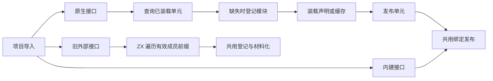

# 项目原生导入自举

## Intent

由 Source 决定项目原生单元的查找、登记、装载和复用，让旧外部函数按原顺序绑定并共用模块登记。保留指令语义、导入身份和已有所有权校验。

## Data

起点为 `52257437e`。原生接口的选址、声明分析及缓存恢复已有 Source 实现。项目仍由 Zig 决定何时登记和加载单元、写入复用表与失效校验。旧外部接口由 ZX 生成成员计划，再由 Zig 遍历行号、复制绑定名及发布。

## Edges

已有原生编号继续复用。新增原生行成功后再失效验证状态，随后装载完成也沿用原失效规则。旧外部接口先发布合法成员前缀，再报告命名冲突。函数物化错误保持在后续冲突之前。临时去重索引使用绑定暂存区，发布后的名字和命名空间由项目 arena 持有。

## Answer

- 原生接口 RX 管理复用与缺失处理。新模块的名称归属、登记决定和校验状态失效都交给 Source。Zig 承接映射表查询、原生表物理写入、声明解析宿主和缓存读写。
- 原生接口与内建接口共用上批的绑定选择及发布。签名和正文阶段均保留已有的调用成员和再导出语义。
- 旧外部函数按借用的声明行顺序去重、校验、物化并绑定。单一命名空间只复制一次，移除中间的行号和名称列表。初始 seed 仍通过 Zig 自足执行。

原生和内建导入仅共用顺序与效果相同的绑定阶段。原生单元缺失才触发登记和装载。旧外部成员的遍历、去重和命名规则由一个 ZX 函数处理。

### 引导与性能

用 `52257437e` 的 Source 工具构建候选，27 个引导步骤通过。候选 SHA-256 为 `586a6aefccc7407b659eacc4ae59b464399558168857bcef81aa2a28e2b1b6d2`。定向生成检查了原生登记、导入交付和旧外部绑定入口，确认从已有列借用名称和签名，分配用于新增登记的文本和去重索引。

固定 705 个入口和 16 个分区，关闭常驻生成器，交错三轮取中位数。三个工具均由 Source 构建，运行各自的 Source 分析和生成。9,894 个固定输入生成文件与所有权 memo 逐字节一致。

| 对照     | 冷生成墙钟 | 冷生成 CPU | 冷进程树峰值 RSS | 冷系统记录峰值 RSS | 热生成墙钟 | 热生成 CPU |
| -------- | ---------: | ---------: | ---------------: | -----------------: | ---------: | ---------: |
| 固定基线 |     2.10 s |     9.02 s |         737.5 MB |           760.4 MB |     1.63 s |     6.43 s |
| 上阶段   |     1.94 s |     9.52 s |         524.9 MB |           546.8 MB |     1.45 s |     6.26 s |
| 候选     |     1.98 s |     9.47 s |         522.6 MB |           549.6 MB |     1.46 s |     6.25 s |

较上阶段，冷生成墙钟增加 0.04 秒，CPU 减少 0.05 秒，进程树峰值减少 2.3 MB，系统记录峰值增加 2.8 MB。热生成墙钟增加 0.01 秒，CPU 减少 0.01 秒。较固定基线，冷生成墙钟减少 0.12 秒，CPU 累计增加 0.45 秒，进程树峰值减少 214.9 MB。无改动检查墙钟为 0.03 秒。

### 正确性核验

五份当前引导清单的 17,503 个生成文件逐字节一致。十次常驻请求的分析、复用、发射计数和产物哈希与上阶段一致，合法编辑的产物与对应冷生成一致。所有修改的 ZX 和 RX 文件通过格式与 lint 检查。

初始 seed 的解析器构建和 RX 回归共通过 50 个步骤与 39 项测试。

正式候选通过 90 个构建步骤与 184 项测试，覆盖原生声明与分配失败、原生链接、名义类型来源、语义缓存和模块记录。原生执行回归覆盖基础调用、混合调用和循环，每组均运行直接、链接和缓存三种路径。
