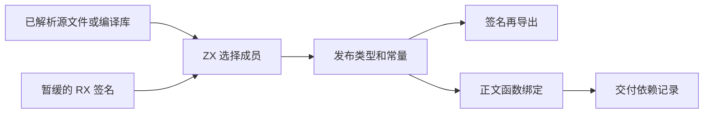
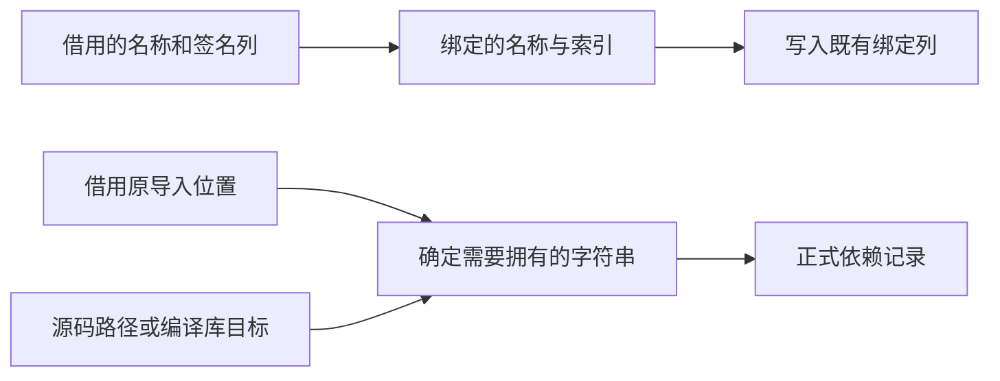

# 项目导入绑定自举

## Intent

把项目源文件、编译库及暂缓 RX 签名的导入绑定串到同一条 Source 流程。让索引化导入记录直接用原始名称列确定所有权并交付目标字段，保持项目缓存记录语义。

## Data

起点为 `487780f01`。普通与签名导入各自用 Zig 选择成员和发射容器。既有 Source 绑定规则已经查找名字，独立的发布入口写入各类绑定列。索引依赖记录由两次生成调用分别探测别名与复制名字，Zig 再复制编译库目标数据。

## Edges

签名优先使用已有成员签名，正文使用函数绑定列。纯类型导入只选类型。再导出目标与内部绑定保持原容器边界。一个签名被暂缓时，短期的成员描述放在导入帧内，正式结果继续持有归属区中的路径。源码依赖借用登记路径，编译库目标文本归属依赖记录。记录仅在原有绑定步骤成功后打开，失败由原项目 arena 回收。

## Answer

- 项目导入 RX 在同一条路径先执行选择，再发布绑定。签名再导出与正文记录按既有相位写入。暂缓的 RX 签名进入同一流程。
- ZX 直接选用借来的签名或函数列，并沿用既有的类型、常量和函数发布规则。定向生成发现额外的临时描述符分配，将其改成借用原列后保留现有作用域。
- ZX 统一未改名与改名导入的列分配、名称复制及编译库目标文本的归属。普通路径继续借用项目路径，宿主安装原生依赖行。
- 项目执行接口按职责拆分，生成时仍合成同名 `project_host`，保留 ABI 的逻辑路径。原生接口和旧外部函数的物化规则、实际 Zig 列操作及初始 seed 留在宿主。

### 引导与性能

用 `487780f01` 的 Source 工具构建候选，27 个引导步骤通过。候选 SHA-256 为 `f633e10fbd7346ea740ecc137141d534ef7ff8dd31a80e47a061c2e47c7e0c71`。定向生成核对了绑定和依赖记录入口。绑定直接选择借用的名称描述符，依赖记录仍只分配需要归属的字符串和名称列。

固定 705 个入口和 16 个分区，关闭常驻生成器，交错三轮取中位数。三个工具均由 Source 构建并运行各自的 Source 分析和生成。9,894 个固定输入生成文件与所有权 memo 逐字节一致。

| 对照     | 冷生成墙钟 | 冷生成 CPU | 冷进程树峰值 RSS | 冷系统记录峰值 RSS | 热生成墙钟 | 热生成 CPU |
| -------- | ---------: | ---------: | ---------------: | -----------------: | ---------: | ---------: |
| 固定基线 |     2.11 s |     8.98 s |         738.0 MB |           767.0 MB |     1.63 s |     6.43 s |
| 上阶段   |     1.95 s |     9.45 s |         524.9 MB |           547.9 MB |     1.44 s |     6.24 s |
| 候选     |     1.95 s |     9.48 s |         529.2 MB |           546.0 MB |     1.44 s |     6.26 s |

较上阶段，冷暖生成墙钟持平，冷 CPU 增加 0.03 秒，热 CPU 增加 0.02 秒。冷进程树峰值增加 4.3 MB，系统记录峰值下降 1.9 MB。较固定基线，冷生成墙钟减少 0.16 秒，CPU 累计增加 0.50 秒，进程树峰值减少 208.8 MB。无改动检查墙钟为 0.03 秒。

### 正确性核验

五份当前引导清单的 17,499 个生成文件逐字节一致。十次常驻请求的分析、复用、发射计数和产物哈希与上阶段一致，合法编辑的生成产物与对应冷生成一致。所有修改的 ZX 和 RX 文件通过格式与 lint 检查。

初始 seed 的解析器构建和 RX 回归共通过 50 个步骤与 39 项测试。

正式候选通过 127 个构建步骤、238 项 Zig 测试和 27 项 CLI 用例。覆盖模块记录、语义缓存、导入路径、RX 推导、库链接、Store 初值和编译库应用及拒绝。
