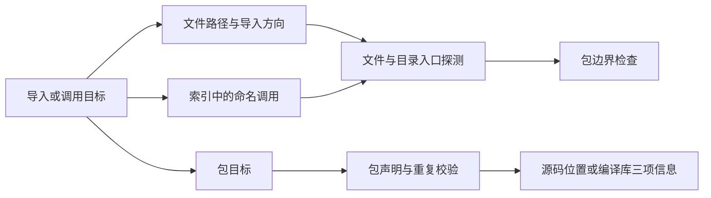

# 项目目标解析自举

## Intent

让项目导入与 RX 调用的索引查找、候选回退、路径归属和编译库目标写入由 Source 决定。保持诊断顺序、解析结果与分配失败清理。

## Data

起点为 `2542cc70a`。普通文件和包已有 Source 分类，但 Zig 仍消费分类结果、决定路径释放并复制编译库目标字段。索引化的命名调用使用 Zig 逐项尝试文件名与目录入口。

## Edges

命名调用依次尝试完整名称的文件和目录入口，再尝试省略成员名称的文件和目录入口。完整文件优先。命中的登记行随结果交付给调用方，省去重新查找。文件引用在选定路径后检查包边界。ZX 对 RX 的方向限制在本地文件、源包和再导出共用，编译库维持原有边界。

## Answer

- 索引命名路径由 ZX 选择，目录回退复用普通导入的探测函数。已经持有的候选路径直接移交。宿主用单个已有生命周期的结果槽回收部分成功后的路径。
- 文件定位与包边界拒绝的诊断由 ZX 决定。未采用的目录路径由生成代码释放，最终采用的路径保持原分配器和所有权。
- 包先检查声明形状，再检查重复，从已有输出分配器直接写入路径、实例名与导出名。宿主按写入顺序的逆序回收部分结果，保留源码与编译库分配器的区别。
- Zig 仍借用项目包表、承接平台词法路径操作、保存诊断位置及安装原生记录。CLI 的文件系统探测和监控登记继续走通用宿主入口，初始 seed 保留自足的路径流程。

### 引导与性能

用 `2542cc70a` 的 Source 工具构建候选，26 个步骤通过。候选 SHA-256 为 `6a63d4290df3e34d435fac6e4e4d9c0b5c35e541e6df5ad0b1e0b92cfd3bd157`。定向生成核对了六个入口。候选路径和编译库字段直接写入原生结果槽，生成代码中的分配限于实际路径和需要拥有的目标文本。

固定 705 个入口和 16 个分区，关闭常驻生成器，交错三轮取中位数。三个工具均由 Source 构建并运行各自的 Source 分析和生成。9,894 个固定输入生成文件与所有权 memo 逐字节一致。

| 对照     | 冷生成墙钟 | 冷生成 CPU | 冷进程树峰值 RSS | 冷系统记录峰值 RSS | 热生成墙钟 | 热生成 CPU |
| -------- | ---------: | ---------: | ---------------: | -----------------: | ---------: | ---------: |
| 固定基线 |     2.08 s |     9.01 s |         737.8 MB |           759.7 MB |     1.62 s |     6.39 s |
| 上阶段   |     1.94 s |     9.50 s |         526.7 MB |           549.2 MB |     1.45 s |     6.27 s |
| 候选     |     1.93 s |     9.46 s |         528.4 MB |           545.5 MB |     1.43 s |     6.25 s |

较上阶段，冷生成墙钟减少 0.01 秒，CPU 减少 0.04 秒，进程树峰值增加 1.8 MB，系统记录峰值减少 3.8 MB。较固定基线，冷生成墙钟减少 0.15 秒，CPU 累计增加 0.45 秒，进程树峰值减少 209.3 MB。无改动检查墙钟为 0.03 秒。

### 正确性核验

五份当前引导清单的 17,497 个生成文件逐字节一致。十次常驻请求的分析、复用、发射计数和产物哈希与上阶段一致，合法编辑的生成产物与对应冷生成一致。所有改动的 ZX 文件通过格式和 lint 检查。

初始 seed 的解析器构建和 RX 回归共通过 49 个步骤与 39 项测试。

正式候选通过 116 个构建步骤、221 项 Zig 测试和 27 项 CLI 测试。覆盖文件导入的解析、包边界、目录入口、分配失败，RX 项目推导、库链接、Store 初值、编译包运行和拒绝。
