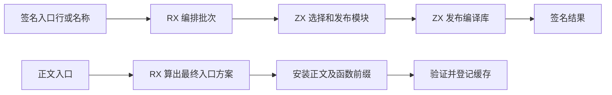
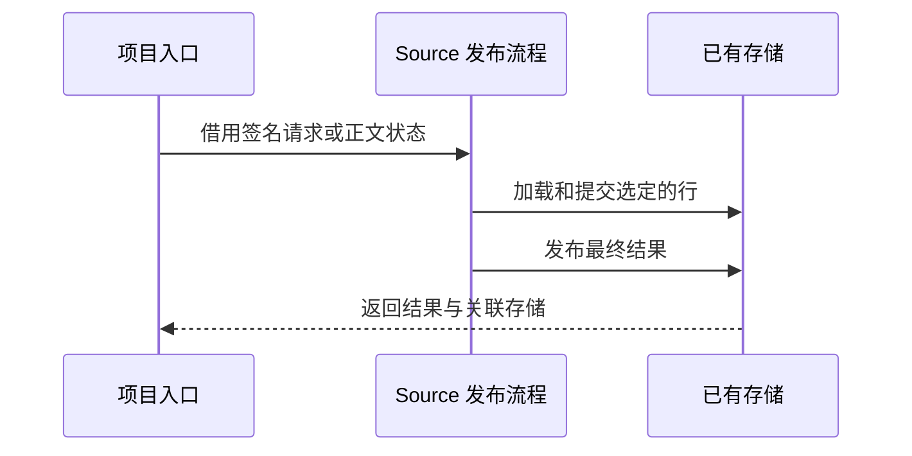

# 项目签名发布与入口结果自举

## Intent

将项目签名批次的入口选择、依赖加载、模块行与编译库发布迁入 Source。把正文入口已由 Source 产出的决策直接接到函数正文、函数表前缀和递归或原生入口的发布。

## Data

签名入口共用 `analyzeSignatureEntries`。预取调用提供已校验的行号，其他入口按名称查找。旧 Zig 循环逐项选择、加载和写入模块，再遍历编译库索引。正文入口的 `publication/finalize.rx` 计算交付方案，`publishEntry` 回到 Zig 决定如何安装函数及包装正文。

## Edges

保留请求顺序、库索引迭代顺序和第一个失败的来源。模块直接写入最终数组，表和签名成员继续借用已生存的存储。正文保留递归与原生入口包装、所有权字段、函数可见前缀和缓存写入顺序。宿主提供静态 ABI 的引用、分配和实际表写入。

## Answer

核对签名批次与正文发布从正式入口执行 Source，并复用旧的表和写入接口。集中验证签名与正文、模块导出、原生导入、编译库、所有权与缓存，再对照 Source 再生成与固定冷暖生成基线。

### 实现

签名批次的 RX 入口预留最终模块行，ZX 依请求顺序检查预取行号或按名称查找。有效项加载依赖并写入最终位置。首个缺失的入口停止批次，加载失败仍保留产生诊断的源码行。模块完成后，ZX 按原索引迭代顺序发布编译库。路径查找沿用原有规范化和索引，输入路径、预取行号和模块字段均从原存储借用。

单模块的签名发布由 RX 确定成员表长度，合并公开类型和常量，有再导出时检查默认入口，再提交四类绑定列。成员表继续使用原有 Source 写入规则，宿主直接提供最终数组。

正文入口将原有发布方案直接接入 RX。先安装需要复用的正文，设置可见函数前缀，再按方案生成递归或原生入口。入口包装完成后捕获项目 arena 的最终状态，验证和缓存发布都使用同一份结果。旧签名批次和入口分派保留在初始 seed 路径。小清单生成的三条新流程均无需临时堆分配。

[签名批次](../../packages/compiler/src/zx/modules/project/execution/signatures/run.rx) · [签名发布](../../packages/compiler/src/zx/modules/project/execution/signatures/publish.rx) · [正文入口发布](../../packages/compiler/src/zx/modules/project/execution/entry_publish.rx)

### 验收

Zig 0.17.0、ReleaseSmall、16 分区下，初始 seed 校验通过 **19/19** 步骤，Source 引导构建通过 **25/25** 步骤。候选摘要为 `f0b7e87b532b397196032f02f9928b9f3b58974b6526f2062e5bf9b3429e2fa9`。候选再生成的主清单、增长、集合和执行四套共 **16,110 份文件**与构建输入逐字节一致，比较排除记录工具身份的 `.zxc-inputs`。

模块记录、RX 推导、语义与持久缓存、编译库入口、编译库导入、原生生成、合约和联结边界通过 **122/122 构建步骤、179/179 Zig 测试**。六组独立编译库执行、五项入口发布、五项持久缓存及原生对象 ABI 的一项集成检查也通过。

固定 735 入口、16 分区的冻结清单沿用既有基线。上一阶段和候选工具均由 Source 引导器构建，测量均执行各自的 Source 分析和生成。两工具交替运行三轮。RSS 单位为字节。

| 工具     | 冷墙钟（秒） | 冷 CPU（秒） | 进程树峰值 RSS | 单进程峰值 RSS |
| -------- | -----------: | -----------: | -------------: | -------------: |
| 固定基线 |         2.82 |        12.43 |    884,768,768 |    934,051,840 |
| 上一阶段 |         2.64 |        13.02 |    665,255,936 |    684,474,368 |
| 本阶段   |         2.61 |        12.98 |    664,862,720 |    691,470,336 |

较上一阶段，冷墙钟减少 0.03 秒、CPU 减少 0.04 秒、进程树峰值减少 0.39 MB，单进程峰值增加 7.00 MB，采样的物理内存峰值中位数增加 4.21 MB。相对固定基线，冷墙钟减少 0.21 秒，CPU 累计增加 0.55 秒，进程树峰值下降 219.91 MB。热生成墙钟由 1.92 秒变为 1.93 秒，CPU 由 8.26 秒变为 8.28 秒。无改动运行均为 0.03 秒。冻结清单的 11,753 份产物和所有权缓存正文一致，候选冷暖生成逐字节一致。

原始记录位于 `.zig-cache/verification-tmp/project-entry-publication/`。本批退出 Zig 的签名批次遍历、成员发布决策和正文入口分派。宿主仍提供项目表、编译库索引的迭代句柄、路径规范化、列写入与资源交付。接续 genz 的普通调用、值调用与迭代调用的参数物化，优先复用同一套字段与求值序列。
