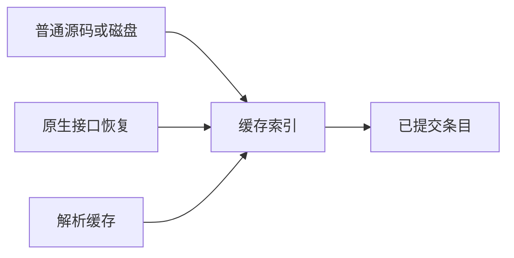

# 项目缓存索引与条目自举

## Intent · 最终目标

让正式编译器由 RX/ZX 决定索引条目的预留、定位、发布和旧条目替换。普通源码、原生接口和解析缓存共用索引规则，并沿原有入口检查构建时和常驻请求的复用。

## Data · 可用证据

起点为 `f9a10df1c`。索引的查找、扩容阈值及重建扫描已经由 Source 实现。普通及原生语义缓存还通过同一个 Zig 事务暂存桶下标，并用不透明地址传递旧条目。解析缓存也使用同一索引，仍由 Zig 提交新增行及缩短保留范围。[索引](../../packages/compiler/src/zx/modules/source_index/growing.zig) · [语义缓存](../../packages/compiler/src/zx/modules/semantic_cache/entries.zig) · [解析缓存](../../packages/compiler/src/zx/modules/parse_cache.zig)

## Edges · 边界与限制

索引沿用原来的探测和扩容算法、键的独立生命周期以及已发布条目的稳定地址。新增行在完成分配和验证后才可见。替换时保留原条目地址，在制定下一状态前先保持旧工件有效。宿主保留分配和工件区释放等资源操作。

## Answer · 验收

复用上阶段引导器与冻结清单。集中验证新位置登记、替换、扩容后的再定位、原生验证失败后重试、常驻解析保留和冷暖生成。

### 正式路径

`Project.indexUnits` 把项目行的路径列借给 Source。ZX 在同一次扫描中查找重复路径、写入键视图和登记桶，保留原有首个重复的诊断。路径字节沿用项目已有存储。[项目注册](../../packages/compiler/src/zx/modules/project.zig) · [路径登记](../../packages/core/src/bytes/index/unique.zx)

普通及原生语义缓存用同一个准备入口返回实际桶下标，通过 RX 交给提交阶段。扩容导致下标变化时重新定位。提交时读取桶编号，分流为新增或替换，旧工件在原生验证成功后才释放。Zig 负责分配未发布的键及条目，以及出错时释放这些资源。[普通缓存](../../packages/compiler/src/zx/modules/semantic_cache/slot/install.rx) · [原生缓存](../../packages/compiler/src/zx/modules/semantic_cache/using_native/load.rx)

解析、语义、常驻文件和生成缓存继续共用原索引。宿主把键和值写入已经预留的尾部，ZX 写桶并发布列长度。缩短范围时在原桶上重建，再提交保留列长度。引导 seed 沿用原生写入路径。编译库的已加载工件登记仍使用宿主哈希表，列为接续项。[共用索引](../../packages/compiler/src/zx/modules/source_index/growing.zig)

### 集中验收

- Zig 0.17.0、ReleaseSmall、16 分区。候选由上一阶段 Source 引导器构建，通过 25/25 个步骤。初始 seed 的生成目标通过 19/19 个步骤。候选 SHA-256 为 `c9ba6d737b11eef5067fa85f2f55b1e6cdafd5ea3cda0c35ff4eceb86ac50112`。
- 五份引导清单的 16,663 个文件逐字节一致。11 组回归的 78 项 Zig 测试和 27 项 Node 集成检查通过，覆盖内存分配失败、缓存跨进程恢复、依赖修复、原生 ABI、编译库消费和常驻重建。
- 常驻生成器先改变六次依赖边，每次生成结果与独立冷生成一致。随后触发缺失依赖，修复后还原至初始产物。两代工具的这些产物哈希均一致。

### 性能对照

固定清单含 735 个入口。两代工具均由 Source 构建，运行时使用各自的 Source 分析及生成。关闭常驻生成器后交替运行三轮，冻结清单的 11,753 个产物以及所有权 memo 载荷一致。下表记录中位数，RSS 为进程树采样峰值，单位为十进制 MB。

| 路径   | 比较            |  墙钟（秒） |     CPU（秒） |  峰值 RSS（MB） |
| ------ | --------------- | ----------: | ------------: | --------------: |
| 冷生成 | 上一阶段 → 候选 | 2.61 → 2.61 | 13.08 → 13.05 | 666.75 → 673.86 |
| 热生成 | 上一阶段 → 候选 | 1.92 → 1.92 |   8.26 → 8.26 | 645.45 → 646.92 |
| 无改动 | 上一阶段 → 候选 | 0.03 → 0.03 |   0.03 → 0.03 |     0.36 → 0.15 |
| 冷生成 | 固定基线 → 候选 | 2.82 → 2.61 | 12.43 → 13.05 | 884.77 → 673.86 |

冷生成的单进程峰值中位数为 685.05 → 700.45 MB，两代的样本范围重叠。前一轮对照的单进程差异方向相反，末轮与回归准备重叠，表中采用回归结束后单独运行的数据。候选相对固定基线累计减少 210.91 MB 的冷生成进程树峰值。常驻编辑中位数约为 0.058 秒，两代分别每次重解析一个 RX 文件并复用 910 项。

回测覆盖分析、Zig 源码生成及常驻编辑。完整编译器的冷构建和三阶段自编译仍在最终验收范围。
