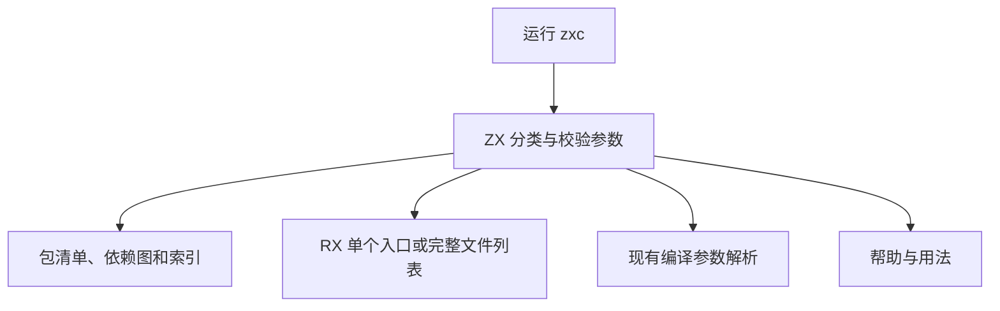

# CLI 入口参数和子命令自举

## Intent · 统一解释 CLI 参数

从 `a7a27fe87` 起，将顶层命令、包子命令与 `check-rx` 的参数解释交给 Source。
原生步骤接收已选的操作和路径、项目文件或版本范围。

## Data · 命令的实际入口

`main` 先取得进程参数，Source 识别命令及其参数个数。包清单和依赖图共用
结果交付。普通编译继续使用既有的 Source 参数解析。原生层读取文件和输出。

## Edges · 保持现有 CLI 契约

保留帮助触发条件、缺参和多参的错误、默认清单、嵌入索引及退出状态。
包安装与初始化的旗标继续由现有 Source 解析。Source 验证路径参数后原生
代码才打开文件。正式入口通过值 ABI 借用原参数文本。

## Answer · 验收与剩余

构建和验收使用同一 Source 引导器及 Zig 0.17.0 ReleaseSmall。本批
`test-package-manifest`、`test-package-index`、`test-rx-cli`、
`test-rx-project-cli`、`test-configuration-formatting` 和
`test-semantic-lint` 通过，共 105 个构建步骤、2,331 项 Node 用例。
16 组正式命令的退出状态、标准输出、诊断和生成 Zig 逐字节一致。
每组交替测量八次，墙钟中位数最多增加 0.150 毫秒，CPU 最多增加
0.062 毫秒，单进程峰值 RSS 最多增加 120 KiB。

两项口径本批均新增 100 行、删除 108 行，净减 8 行。固定起点
`4c11902b6` 至本批，非 seed 包源码新增 10,154 行、删除 10,957 行，
累计净减 803 行。全仓新增 11,666 行、删除 11,437 行，累计净增 229 行。
下一批贯通 CLI 生成代码到宿主定义的静态绑定，移除命令执行、
原生资源收集、发布和后端协议的专用 Zig 桥。
