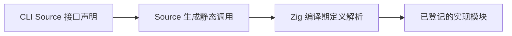
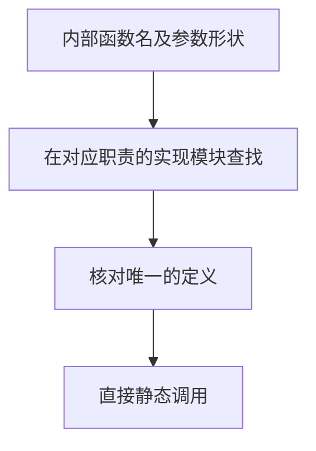

# CLI 原生定义绑定自举

## Intent

把 CLI 自身 Source 流程的依赖函数绑定交给 Source 生成和 Zig 编译期
定义解析，移除项目准备、库分析和发布、编译与检查中的逐函数转发。

## Data

批首为 `1018dab0d`。CLI 的九个内部接口从 `host.d.zx` 声明函数，
再在 Zig 的 `bindings.zig` 中重复登记 450 个同名转发。编译器和 genz
已有定义绑定机制，原有后端及软件包接口声明可以继续复用。

## Edges

启用项仅在 CLI 自身的 Source 构建清单中声明。查找在编译期进行，
从现有实现模块确定函数定义，提供同样的静态调用。九个模块继续
承担原有的包搜索、编译、文件写入和诊断交付。

## Answer

移除九个接口的逐函数转发，复用严格定义解析。初始 seed 与正式 Source
工具按相同 CLI 清单生成的 1,143 个文件逐字节一致。两种绑定清单用同一
正式 Source 工具交替冷生成五轮，墙钟中位数均为 0.15 秒，CPU 从
0.64 秒增至 0.65 秒，单进程峰值 RSS 增加约 0.13 MB。

安全构建编译仓库的 `quote.zx` 时，后台所有权分析尚未发布当前轮
结果，取槽位地址会触发上一轮 Zig 联合体标签检查。在独立缓存且
关闭产物缓存时也能复现。槽位改为复用同一块满足大小和对齐要求
的存储，生产方通过本轮的类型写入，消费方继续在获取就绪状态后
读取。队列、等待条件和各轮结果字段保持原契约。

修复后，原 `quote.zx` 入口在关闭缓存时通过。官方安全安装回归通过
应用构建、库迁移、原生声明与调用、压缩场景。额外用安全版直接生成
`service.rx` 时，槽位修复前后的安全构建都触发同一整数转换异常。

最终 ReleaseSmall 工具通过 RX CLI 和统一库联结共 104 个构建步骤，
46 项 Zig 测试、11 个 RX CLI 场景和 `watch` 均通过。Args 和 Store
两个执行入口生成的 Zig 与批首逐字节一致。1,200 个 RX 模块的固定
依赖图，墙钟和 CPU 中位数均为 0.22 秒，单进程峰值均为 73.6 MB。
本批初次运行的包清单、工作区、语义 lint 和属性检查也全部通过。
