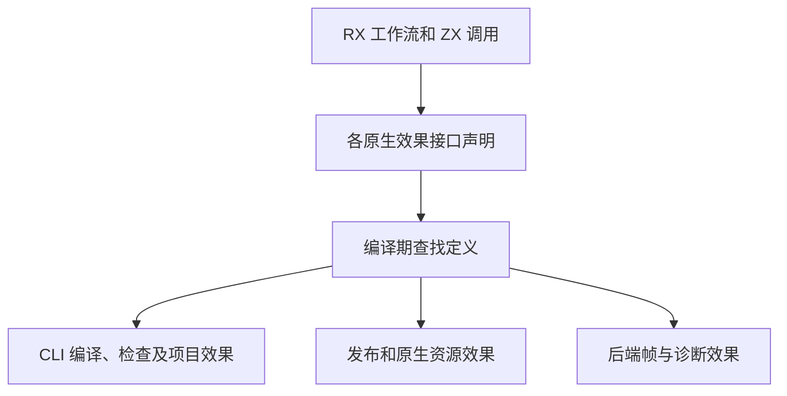

# CLI 原生效果定义绑定自举

## Intent · 让正式 Source 直接绑定效果定义

从 `34e8cbc6d` 起，贯通 CLI 的编译、检查、工作区、库发布、资源收集和
Zig 后端协议。在编译期按原生声明找到效果定义，移除各流程的 Zig 转发文件。
正交的原生接口和数据布局仍由各 Source 声明维护。

## Data · 改动从哪里生效

普通和 RX 编译、Gateway、检查、包项目和库流程共享 CLI 宿主。生成的
执行器经静态函数选择绑定对应定义。发布、原生资源和后端协议位于各自的
Zig 模块，同样直接绑定定义。删除九个 CLI 接口包装和一个后端协议包装，
合并了使用同一份生成类型的九个 ABI 导入。

## Edges · 原生 I/O 与静态类型

构建配置保留各个接口的类型身份，使用同一份生成 ABI。库侧的头文件和
适配器写入与应用侧有同名定义，库侧通过职责明确的内部名称区分。
文件、进程和平台 ABI 继续由原有 Zig 定义提供。

## Answer · 构建、行为与性能

两侧由相同 Source 引导器生成，使用 Zig 0.17.0 ReleaseSmall。
macOS ARM64 可执行文件的 `__TEXT.__text` 段逐字节相同，SHA-256
为 `e143fc6b86ca2f4d27951348ddeb518b19fa62fc9ff999400f15eca07ce66871`。
`__TEXT.__const` 中的 32 字节差异对应构建缓存指纹。

包清单、版本索引、安装与 watch、原生包、库发布、RX CLI、Gateway、
语义 lint、配置格式、后端协议和产物发布共覆盖 61 项 Zig 测试和
2,422 项 Node 用例。首次验收中有 5 项旧用例要求 ZX 导入 RX，批首
可执行文件在原用例上复现相同诊断。将这些用例的跨 RX 调用放回 RX，
Store 类型从 ZX 导出。聚焦重跑的 10 项全部通过，发布、搬迁、原生
消费者、离线恢复及 Store 初始化断言均保留。

同一引导器交替冷生成七组。在重置输出树和生成缓存的条件下，CLI
和后端分别生成 1,117 和 50 个 Zig 文件。计时为中位数。

| 清单     |  墙钟变化 |  CPU 变化 | 峰值 RSS 变化 |
| -------- | --------: | --------: | ------------: |
| CLI      | +0.239 ms | +0.940 ms |      −400 KiB |
| 后端协议 | +0.102 ms | −0.420 ms |       −32 KiB |

16 组实际 CLI 命令的退出状态、输出和生成 Zig 一致。较批首，
墙钟最多增加 0.254 毫秒，CPU 最多增加 0.017 毫秒，峰值 RSS
最多增加 16 KiB。与固定 CLI 性能基线 `fcde84a9f` 比较，
三项中位数最大增量分别为 0.111 毫秒、0.084 毫秒和 96 KiB。

本批非 seed 包源码新增 80 行、删除 289 行，净减 209 行；全仓
Zig 新增 102 行、删除 391 行，净减 289 行。从固定起点
`4c11902b6` 比较，两项累计分别为新增 10,154、删除 11,166 行
及新增 11,687、删除 11,747 行。累计包含同期全部提交。
