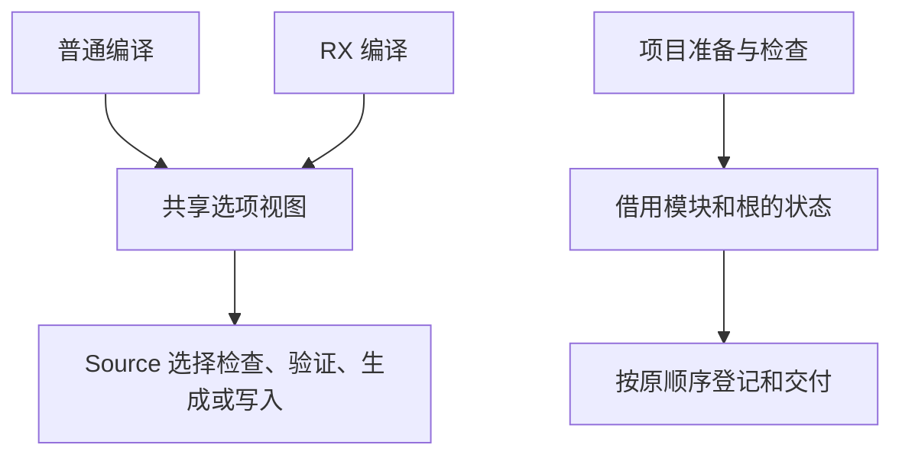

# CLI 编译选项和项目准备自举

## Intent · 共用正式编译与项目检查的只读输入

从 `fcde84a9f` 起，沿 CLI 的 ZX、RX 构建与项目检查，合并重复的
编译选项查询和项目准备状态读写。复用编译器已有的列借用和目标
解析，保留原输入、路径和选项诊断。

## Data · 正式入口

- 普通编译由 `compilation/state.zig` 进入 Source，RX 执行由
  `rx/compile.zig` 进入 Source。两路逐项回调读取已解析选项。
- 项目构建与检查各自收集文档、类型和根，再通过专用宿主读取
  数量、分支和登记状态。

## Edges · 保持行为

选项视图在入口创建并借用至本次调用结束。保留 watch 的实际运行
状态、文档的物理路径核验和读取失败顺序。文件系统及后端进程通过
现有 API 执行。

## Answer · 验收

由候选 CLI 执行 ZX、RX、Gateway 及导入路径场景，对照固定生成
清单和受影响的 CLI 性能，核对远端快照的两种 Zig 净变化。

普通编译、RX 应用、Gateway 与原生后端由 Source 读取入口选项，
删去逐项 Zig 查询。RX 应用装载返回实际入口，分析返回 Store
数量。项目检查在预留调用空间时交付模块和源码数量，项目准备
随同请求传入包作用域状态。

首轮 CLI 回归因宿主句柄少传一层引用而崩溃。已恢复现有 ABI
的指针布局，原生状态仍由原调用者持有。

候选与批首在相同 Zig 0.17.0 和 ReleaseSmall 配置下构建。ZX 导入路径、
RX 项目与 Store、Gateway、watch、格式化及语义 lint 的 119 个构建
步骤通过。共 314 项 Node 用例和 11 项 RX CLI 场景通过。

使用现有小型 ZX、RX 文件交错比较两份 CLI。首轮预热后采集八轮，
两份工具生成的 Zig 和项目检查输出一致。RSS 单位为 MB。

| 场景        | 墙钟中位数（毫秒） | CPU 中位数（毫秒） |      峰值 RSS |
| ----------- | -----------------: | -----------------: | ------------: |
| ZX 生成     |      3.426 → 3.386 |      2.856 → 2.816 | 7.258 → 7.094 |
| RX 生成     |      3.988 → 4.096 |      3.666 → 3.809 | 9.421 → 9.257 |
| RX 项目检查 |      3.110 → 3.211 |      2.102 → 2.118 | 6.406 → 6.439 |

本批改动位于 CLI，编译器引导路径的验收沿用上一批。非 seed 包
源码 Zig 新增 77 行、删除 111 行，净减 34 行。全仓新增 78 行、
删除 111 行，净减 33 行。
