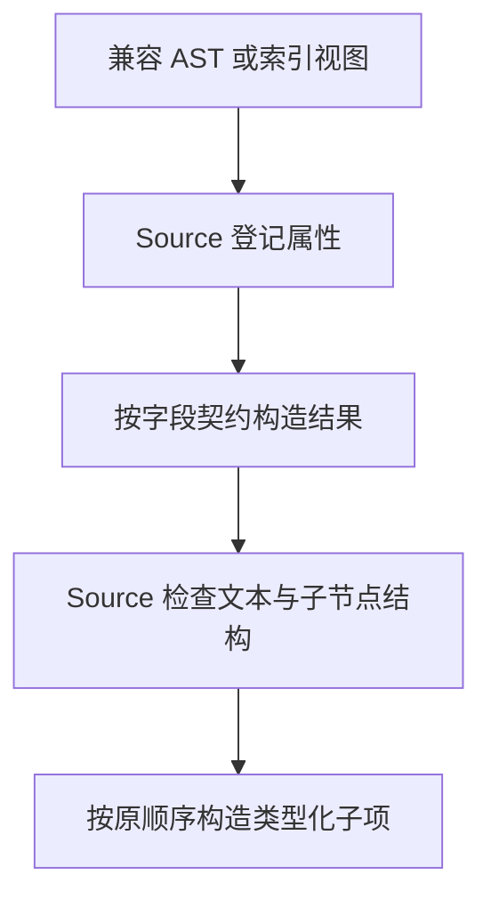
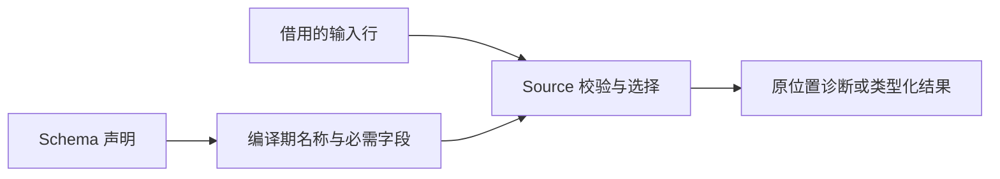

# RX Schema 解码自举

## Intent

让正式 RX Schema 使用 Source 处理属性登记、结构判定与分支选择。保留
DSL 公开的类型化结果、诊断顺序和两种 XML 输入视图。

## Data

批首为 `c13c4a276`。XML 解析与 AST 结果写入已经由 Source 执行。
正式 Schema 仍在 DSL Zig 模板中匹配属性、挑选子节点分支以及判断子节点
边界。兼容 AST 提供属性和文本行，索引视图提供原始范围与链接。

## Edges

属性顺序先决定未知和重复诊断。随后按声明顺序检查缺失字段与值类型，保留
首个错误。子项超出上限时应指向第一个多出的元素。字段值、AST 和索引列
都继续借用，不预构造中间属性对象数组。

## Answer

正式 RX 普通模块、Store 和 Gateway 共用 Source 的结构规则。通用 DSL
使用原有的 AST 类型和默认解码方式，初始 seed 同样沿用默认规则。

- Source 按输入顺序登记属性槽，定位第一个未知或重复属性，再按声明顺序
  找到第一个缺失的必需字段。Zig 通用实例化按同一声明顺序转换并填写字段，
  保留更早的非法值诊断及其属性值位置。
- 属性登记和属性角色校验共用借用列。兼容 AST 直接借原行的名称、值及种类；
  索引视图直接借解析后的属性范围及解码区。移除角色检查逐项组装三张临时
  属性表的 Zig 循环。
- Source 判定列表与定长子节点数量、选择普通 Schema 联合分支，并在两种
  视图中寻找第一个含内容的文本节点。索引视图按原链接顺序读取，并保留
  格式化仅询问是否存在内容时的短路。

通用 Zig 实例化仍负责将静态字段、联合和子节点填入调用方所需类型。
自定义视图仍可调用通用规则，保留既有公开接口。Module 的兼容 AST 默认
输入扫描、If 和 Gateway 的专用分派、以及 Module、If、Switch 的声明和
分支列准备仍有手写 Zig 实现。

### 验证

批首 Source 引导器构建候选通过 30 个步骤及 39 项 RX 测试。初始 seed
构建引导器和解析器通过 52 个步骤。两条路径执行相同的五阶段 Source
清单，17,743 个生成文件逐字节一致。

候选正式编译器通过 124 个步骤、423 项 Zig 测试，以及 112 项 CLI 和
lint 用例、55 次属性执行、6 项属性语义拒绝。用批首与候选 CLI 对同一
批 40 个既有文件执行普通 `lint`，两版的退出码、输出及诊断逐字节一致。

### 性能

批首和候选均由 Source 引导器生成并执行 Source。固定清单含 705 个入口，
以 16 分区关闭常驻生成器，同机交错三轮。9,894 个生成文件与所有权 memo
逐字节一致。

| 版本     |  冷墙钟 |  冷 CPU | 冷进程树采样峰值 RSS |  热墙钟 |  热 CPU |
| -------- | ------: | ------: | -------------------: | ------: | ------: |
| 固定基线 | 2.10 秒 | 9.01 秒 |             738.6 MB | 1.64 秒 | 6.48 秒 |
| 批首     | 1.95 秒 | 9.54 秒 |             529.9 MB | 1.45 秒 | 6.27 秒 |
| 候选     | 1.97 秒 | 9.50 秒 |             523.6 MB | 1.46 秒 | 6.29 秒 |

较批首，冷墙钟增加 0.02 秒，CPU 减少 0.04 秒，进程树采样峰值 RSS
减少 6.3 MB，单进程峰值增加 2.4 MB。相对固定基线，冷墙钟减少
0.13 秒，CPU 增加 0.49 秒，进程树采样峰值 RSS 减少 215.0 MB。
三版无改动路径均为 0.03 秒。

两版 CLI 从同一入口检查 1,203 个模块，交错五轮，输出一致。墙钟和
CPU 中位数均为 0.25 秒，单进程峰值 RSS 均约 78.7 MB。
