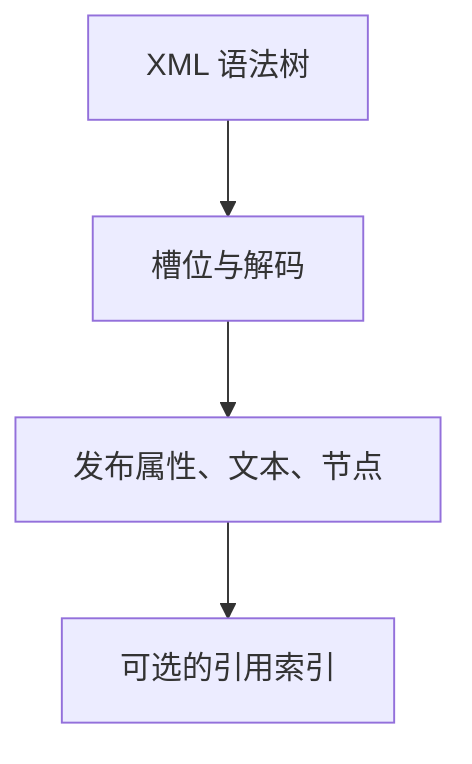
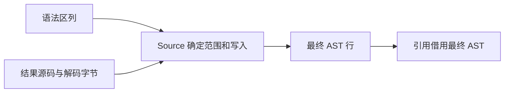

# RX XML 结果发布自举

## Intent

让正式 XML 解析入口用 Source 写入节点、属性、文本和引用索引。维持公开
AST 兼容、位置精度和源码借用关系。

## Data

批首为 `4a9d1843b`。解析器、槽位计算、实体解码和引用扫描已由 Source
执行。当前物理结果的四个写入循环分别在 XML 转换器及引用索引构建器中。

## Edges

两种源码所有权入口共用发布。原始值和不需要解码的值借用结果源码，需要解码
的值借结果区中的同一解码缓冲。最终树和引用指向结果区，解析索引和工作列
可随解析区释放。保留根位置、子节点与文本顺序、可空引用和诊断范围。

## Answer

用已有借用列绑定把 Source 写入接到最终分配位置，贯通三类 XML 行和索引
引用，删除旧 Zig 逐行转换。集中验收 XML、RX 和 CLI 的行为、生成一致性
与固定性能输入，并验证借用源码和分配失败的回归。

### 迁移结果

- Source 编排槽位计算、属性写入、文本写入及节点写入，按原顺序发布子节点和
  文本范围。Source 同时计算被引用的实际源码范围。
- 引用索引的记录直接引用最终节点与属性行，保留空属性和角色标记。节点、
  文本以及引用行的旧 Zig 转换循环已退出正式入口。
- 借用列的写入只交付切片和指针描述符。Zig 保留对象分配、列绑定和索引外壳
  的交付。解析临时区释放后，AST 仍由结果区及调用方保留的源码支撑。

### 验证

- 批首 Source 引导器构建候选，30 个步骤、39 项 RX 测试通过。
- 候选引导器生成正式分析和 CLI，108 个步骤、275 项 Zig 测试和 45 项
  CLI 用例通过。覆盖 XML 实体、CRLF 位置、表达式边界、子节点顺序、
  分配失败和 watch。
- 初始 seed 构建引导器与解析器通过 52 个步骤。初始 seed 产出的引导器
  与候选均走 Source，五份清单的 17,727 个生成文件逐字节一致。

### 性能

采用原固定清单的 705 个入口、16 分区，关闭常驻生成器。同机交错三轮取
中位数，三版引导器均由 Source 生成并执行 Source。批首与候选的 9,894 个
生成文件及所有权 memo 逐字节一致。

| 版本     |  冷墙钟 |  冷 CPU | 冷进程树峰值 RSS |  热墙钟 |  热 CPU |
| -------- | ------: | ------: | ---------------: | ------: | ------: |
| 固定基线 | 2.10 秒 | 9.03 秒 |         737.3 MB | 1.63 秒 | 6.41 秒 |
| 批首     | 1.97 秒 | 9.52 秒 |         524.0 MB | 1.45 秒 | 6.26 秒 |
| 候选     | 1.96 秒 | 9.49 秒 |         524.7 MB | 1.46 秒 | 6.30 秒 |

较批首，冷墙钟减少 0.01 秒、CPU 减少 0.03 秒，进程树与单进程的峰值
RSS 各增加约 0.6 MB。相对固定基线，冷墙钟减少 0.14 秒，CPU 增加
0.46 秒，进程树峰值 RSS 减少 212.7 MB。无改动路径为 0.03～0.04 秒。

用批首和候选 CLI 交错运行五轮。显式传入 1,202 个模块时，墙钟和 CPU
中位数均为 0.22 秒。从入口装载 1,203 个模块且引用含数字实体时，墙钟
中位数均为 0.26 秒，CPU 从 0.26 秒变为 0.25 秒，单进程峰值约 81.5 MB。
两种输入的候选输出均与批首一致。
