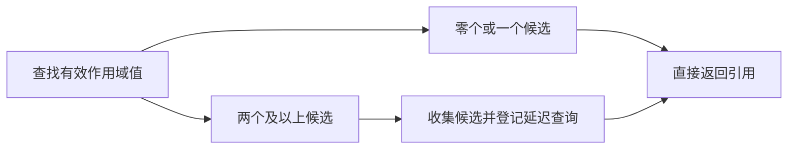
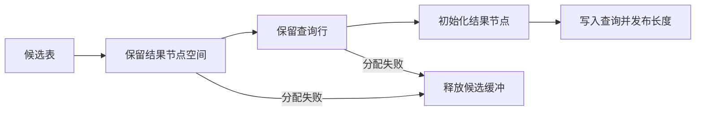

# RX 作用域候选与延迟查询自举

## Intent

从 `99e99fdda` 接续。让作用域读取在 RX 中直接返回唯一值，或把多个候选交给延迟绑定查询。将结果节点的初始化、查询写入和可见长度交给 Source。

## Data

作用域查找先扫描至第二个有效候选，之后才分配候选表。现有 Zig 入口读回候选数，创建未知节点，再追加带跨度的查询行。追加出错时回退节点长度并回收候选表。查询持有的候选表与约束共用一个 arena。[作用域读取](../../packages/compiler/src/rx/analysis/inference/scope/read.rx) · [延迟绑定](../../packages/compiler/src/rx/analysis/inference/bindings.zig)

## Edges

保持候选顺序、Void 跳过、来源跨度、arena 归属和分配顺序。先保留节点容量，再保留查询行。二者都成功后初始化并提交，从而在分配失败时保持两个可见前缀。候选表写入时使用真实长度，沿用已有缓冲。

## Answer

RX 在读取处根据第二个候选是否存在选择直接返回或登记延迟查询。ZX 收集后返回实际候选数，查询只接管这一段切片。候选缓冲保持在原有约束 arena，成功路径共享底层存储，失败路径由宿主统一回收。

按原顺序预留节点和查询行之后，RX 复用普通节点的初始化与发布流程，再写入候选、结果节点和原跨度。两次物理预留都成功后才修改可见长度，撤下正式路径的 Zig 查询追加及节点长度回退。初始 seed 的兼容路径保留原追加与回退。节点列绑定由普通追加与查询创建共用。

读取入口移到执行引导清单，使它可以调用该清单中的物理预留接口。只读规则继续依赖普通作用域模型，延迟查询的类型归在读取入口的执行路径。

### 行为与引导验证

- 读取、节点追加及绑定传播三条入口的定向生成通过，生成结果直接将候选切片填入查询列。源码与生成代码的检查确认两处预留都先于节点初始化和查询提交。
- 以上一批 Source 工具构建候选，27 个引导步骤通过。双工具对同一份源码运行主编译器、执行、宿主、集合和增长清单，共 17,695 个生成文件逐字节一致。10 个常驻编辑和错误恢复场景与上一批一致。
- 153 项正式 Zig 回归及 17 项 CLI 集成通过，覆盖绑定读取、作用域诊断、项目和分配失败。
- 初始 seed 通过 50 个步骤和 39 项 RX 测试。候选引导器 SHA-256 为 `ee8cd98ee185f7e01a86d366c89a726bd276e8681cd342ddd581f53abd77e11c`。

### 性能

固定 705 个入口和 16 个分区，关闭常驻生成器，三轮交错取中位数。三套工具都由 Source 构建，并运行各自的 Source 分析与生成。候选与上一批的 9,894 个冻结生成文件及所有权 memo 一致。各工具冷、热生成输出分别一致。

| 对照     | 冷生成墙钟 | 冷生成 CPU | 冷进程树峰值 RSS | 冷系统记录峰值 RSS | 热生成墙钟 | 热生成 CPU |
| -------- | ---------: | ---------: | ---------------: | -----------------: | ---------: | ---------: |
| 固定基线 |     2.04 s |     8.93 s |         737.1 MB |           793.7 MB |     1.60 s |     6.31 s |
| 上一批   |     1.94 s |     9.44 s |         524.1 MB |           554.8 MB |     1.43 s |     6.22 s |
| 候选     |     1.93 s |     9.41 s |         528.5 MB |           548.0 MB |     1.45 s |     6.25 s |

较上一批，冷生成墙钟减少 0.01 秒、CPU 减少 0.03 秒，进程树峰值增加 4.4 MB，系统记录峰值减少 6.8 MB。热生成墙钟增加 0.02 秒、CPU 增加 0.03 秒，无修改生成墙钟同为 0.03 秒。较固定基线，冷生成墙钟减少 0.11 秒、CPU 累计增加 0.48 秒，进程树峰值减少 208.6 MB。本次对照覆盖引导生成阶段。
