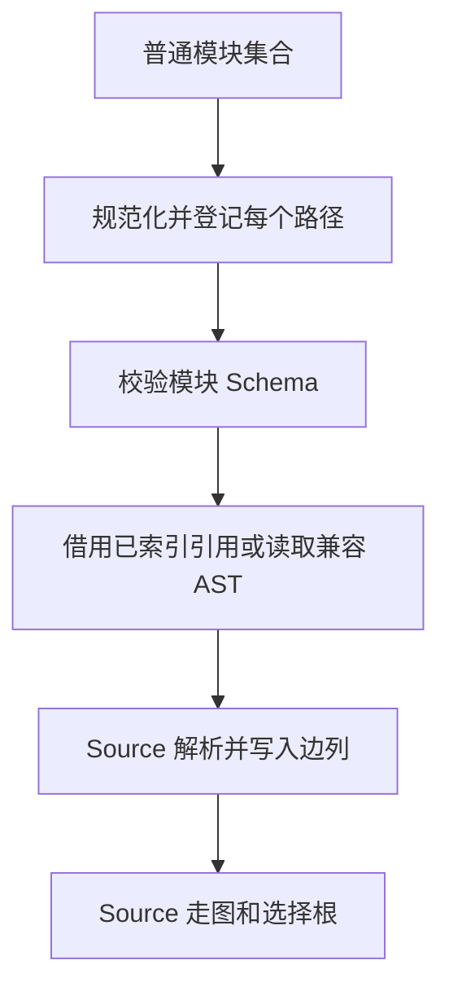

# RX 依赖图准备与边发布自举

## Intent

沿普通模块集合校验和 `check-rx` 收口构图准备。Source 推进注册与边结果
提交，保持诊断顺序、依赖次序和根选择的既有行为。

## Data

批首为 `8e72e0cbc`。`modules.validateAs` 先规范化并登记路径，再校验
对应模块的 Schema。随后 `module_graph.validate` 取图边，调用 Source
走图。索引化 XML 直接借用引用列，兼容 AST 由游标分批提供属性。从
`dependency_graph/prepare.zig` 进入 Source 时，旧宿主仍负责路径扩容后的
重试与前缀推进。

## Edges

规范化、重复注册和 Schema 诊断必须按原模块顺序产生。图边继续使用旧的
顺序和诊断引用编号。边列写入已预留的物理尾部。路径缓冲以编译用临时区
持有，重试沿用同一引用，兼容游标和索引化 XML 共用这一规则。

## Answer

批内复用上次通过验收的 Source 引导器。先完成两种引用模式共用的边批次
提交及扩容重试，再贯通集合登记。收口时集中运行 RX 模块图和 CLI 的入口
回归，比较固定清单的生成结果与性能。通过后沿正式调用关系核对退出的
Zig 循环与保留的物理存储。

### 迁移结果

- 路径规范化、重复登记与规范路径的发布由 ZX 执行。RX 按模块顺序登记
  并接续 Schema 校验，保持第一个诊断的来源及位置。索引借用返回结果的
  规范路径列，省去先写入索引键再写入结果的第二份切片描述符。
- 索引化引用和兼容 AST 批次共用 Source 边写入。ZX 扩容后重试当前引用，
  已写前缀继续留在原列尾，无需在 Zig 切片、重新定位或重进生成函数。
- 宿主提供 XML Schema 的类型解码、诊断位置、兼容 AST 游标及物理列
  预留。初始 seed 保留自己的注册逻辑。
- 执行清单原先漏跟踪了 Source 图和依赖图的源码目录。补齐这几处以及
  共享路径规则的依赖后，接口变化会重新生成执行产物。

### 引导验证

由批首 Source 引导器构建候选并运行 RX 库回归，30 个构建步骤和 39 项
测试通过。初始 seed 的引导器构建与解析器生成通过 52 个步骤。两条路径
得到的引导器均执行 Source 生成，五份清单的 17,679 个生成文件逐字节一致。

候选引导器生成正式分析和 CLI，文本解析、推导、路径、项目构建和 watch 的
105 个构建步骤、260 项 Zig 回归与 45 项 CLI 用例通过。

### 性能

使用固定 705 个入口、16 分区，关闭常驻生成器。同机交错三轮，三版引导器
均由 Source 生成并执行 Source。固定清单的 9,894 个生成文件与所有权 memo
均逐字节一致。

| 版本     |  冷墙钟 |  冷 CPU | 冷进程树峰值 RSS |  热墙钟 |  热 CPU |
| -------- | ------: | ------: | ---------------: | ------: | ------: |
| 固定基线 | 2.09 秒 | 9.04 秒 |         737.6 MB | 1.63 秒 | 6.46 秒 |
| 批首     | 1.95 秒 | 9.53 秒 |         523.9 MB | 1.44 秒 | 6.27 秒 |
| 候选     | 1.99 秒 | 9.53 秒 |         525.0 MB | 1.44 秒 | 6.26 秒 |

冷生成较批首墙钟增加 0.04 秒，CPU 持平，进程树峰值 RSS 增加 1.1 MB，
单进程峰值增加 3.8 MB。相对固定基线，墙钟减少 0.10 秒，CPU 增加
0.49 秒，进程树峰值 RSS 减少 212.6 MB。三版无改动路径均为 0.03 秒。

用批首和候选 CLI 交错执行五轮 `check-rx`。输入有 1,202 个模块，包含
612 字节的依赖路径，实际触发边解析的临时缓冲扩容。两版均通过，输出一致。
中位墙钟由 0.23 秒降至 0.22 秒，CPU 均为 0.22 秒，单进程峰值 RSS 由
73.6 MB 降至 73.5 MB。
