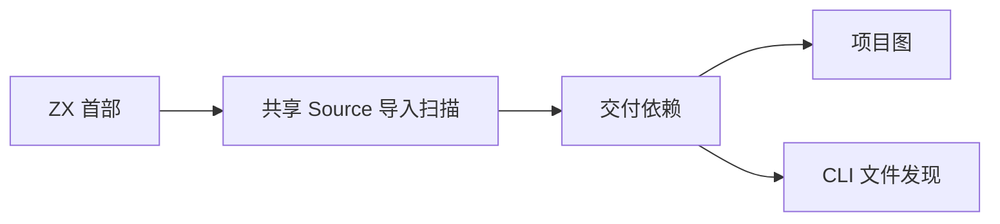
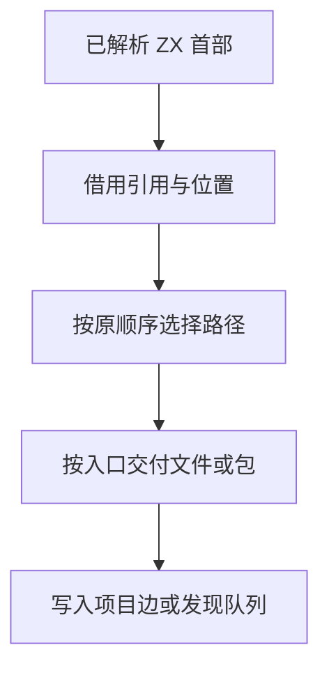

# RX 依赖引用交付合并自举

## Intent

让正式项目图与 CLI 文件发现共用 Source 的 ZX 首部导入扫描。
保留各入口的依赖顺序、诊断坐标、文件发现和编译库查找语义。

## Data

批首为 `c91143fa9`。项目图原有的 Source 导入扫描从索引化的 ZX 首部借用导入列。
CLI 文件发现用独立循环逐项经过 Zig 读取相同导入并推进发现队列。

## Edges

ZX 首部保留声明顺序。在文件发现中保留原有首行诊断位置，项目图继续
保留源码字节偏移。文件是否注册、是否真实存在以及编译库读取沿用各
入口的 I/O 和索引。初始 seed 继续用原生首部读取。

## Answer

项目图和文件发现从同一个 ZX 导入扫描入口取得首部位置与原路径。
文件发现移除逐条回调读取和暂存解析结果的 Zig 状态。项目图继续选择
文件、包与原生目标，CLI 继续按文件系统和锁定库解析。原始树和索引化
RX 的参数合并试验产生了堆分配，固定清单直接复现 OutOfMemory。本批
将交付范围限于共享的 ZX 首部扫描，复用原始 RX 调用形态。

- 433 项 Zig、39 项 RX、11 个 RX CLI 场景通过。并行回归中一次
  `watch` 读取旧产物，批首和候选随后分别运行同一用例，都通过
  修改传递依赖、恢复错误、删除及重建导入四类操作。
- 初始 seed 与批首 Source 引导器生成的五组清单共 17,788 个文件一致。
  固定性能清单的 9,894 个文件和所有权 memo 一致。
- 冷生成墙钟 1.96 秒、CPU 9.51 秒，进程树峰值 525.7 MB。较批首增加
  0.01 秒墙钟和 0.02 秒 CPU，进程树峰值减少 0.9 MB，单进程峰值减少
  3.7 MB。较固定基线墙钟减少 0.12 秒、CPU 增加 0.49 秒、进程树峰值
  减少 212.0 MB。两档均使用 Source 工具与 Source 分析和生成。
- 1,200 个 RX 模块的固定依赖图，入口检查的输出完全一致，五轮交替运行的
  墙钟和 CPU 中位数均为 0.22 秒，单进程峰值均为 73.6 MB。
