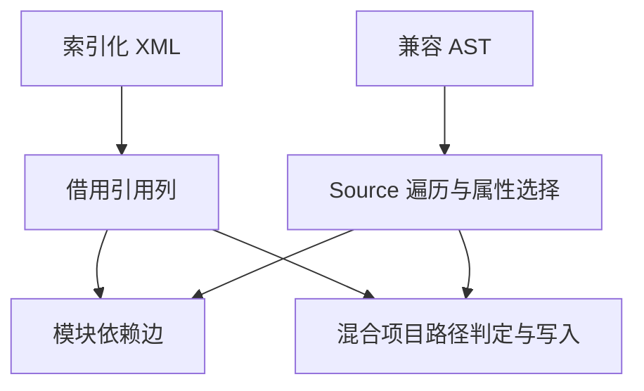

# RX 依赖引用读取自举

## Intent

收口模块依赖校验和混合项目图共用的 RX 引用读取。兼容 AST 的遍历和目标
选择迁入 Source，混合项目图共用索引化 XML 的路径解析和结果写入。

## Data

批首为 `97fb86d44`。正式 XML 索引的引用顺序与类型已由 Source 计算。模块依赖准备和
混合项目图仍对兼容 AST 执行 Zig 游标、属性选择和路径分派。混合图的
旧索引批次另有独立的准备与写入代码。

## Edges

保留两种路径的访问顺序、属性优先级、缺失提示与原始位置。兼容视图直接借
AST 行及其文本，跨层仅保存待访问的切片描述符，保留原分配器和释放边界。
索引化路径继续借现有列。可输入的 AST 深度仍由原 API 决定。

## Answer

依次贯通兼容树的借用读取、依赖校验和混合项目边收集，删除同职责的 Zig
遍历、路径重试及旧索引批次。集中运行 RX 校验、推导与 CLI 回归，并用
最近的 Source 引导器、固定性能输入和对应长路径核对结果与开销。

### 迁移结果

- 兼容 AST 由 Source 按先父后子顺序推进，按同一引用规则读主属性和备用
  属性。祖先栈复用可增长的切片描述符存储，节点、属性和值均借用原对象。
- 普通模块图从 Source 读取批次，直接填充旧的栈上属性视图。定位失败引用
  时复用同一遍历，取得原 AST 节点和属性。索引化输入继续直接借用引用列。
- 混合项目图的索引和兼容输入共用 Source 的路径解析、扩容、包路由和结果
  提交。兼容输入保留原先对命中包项重新判定导入类别的行为。旧 Zig 重试、
  逐项分派和独立索引批次生成入口退出。
- CLI 文件装载走同一个公共收集入口。Source 直接交付每条解析后的引用，
  CLI 保持自己的文件入队、包作用域与 I/O 错误。编译器的图收集器继续
  直接调用原有的图写入操作。
- Zig 仍借出物理 AST 行、预留和发布图边列，以及提交带位置的诊断。初始
  seed 和显式兼容游标接口保留原 Zig 实现。

### 验证

- 用批首 Source 引导器构建候选和运行 RX 库测试，30 个步骤、39 项测试
  通过。包含三节点图的 512 种组合，以及兼容 AST 的依赖顺序、诊断位置和
  分配失败释放。
- 用同一批首引导器构建正式分析与 CLI，105 个步骤、260 项 Zig 回归和
  45 项 CLI 用例通过，覆盖推导、文本、项目装载和 watch。
- 初始 seed 生成引导器与解析器通过 52 个步骤。用该引导器、批首和候选
  执行 Source 生成，五份清单的 17,704 个文件逐字节一致。

### 性能

同机交错测量固定 705 个入口和 16 分区，关闭常驻生成器。三版引导器均由
Source 生成并执行 Source。三轮取中位数，批首和候选的 9,894 个生成文件
及所有权 memo 逐字节一致。

| 版本     |  冷墙钟 |  冷 CPU | 冷进程树峰值 RSS |  热墙钟 |  热 CPU |
| -------- | ------: | ------: | ---------------: | ------: | ------: |
| 固定基线 | 2.11 秒 | 9.05 秒 |         738.4 MB | 1.63 秒 | 6.42 秒 |
| 批首     | 1.93 秒 | 9.43 秒 |         528.6 MB | 1.45 秒 | 6.28 秒 |
| 候选     | 1.96 秒 | 9.52 秒 |         529.7 MB | 1.44 秒 | 6.29 秒 |

较批首，冷墙钟增加 0.03 秒，CPU 增加 0.09 秒，进程树峰值 RSS 增加
1.1 MB，单进程峰值减少 2.5 MB。较固定基线，冷墙钟减少 0.15 秒，
CPU 增加 0.47 秒，进程树峰值 RSS 减少 208.7 MB。无改动路径为
0.03～0.04 秒。

批首与候选 CLI 交错五轮校验含 612 字节依赖路径的完整模块集合。显式
提供 1,202 个模块时，墙钟和 CPU 中位数均为 0.23 秒。由 `--entry`
装载 1,203 个模块时，墙钟和 CPU 中位数均为 0.26 秒，单进程峰值均为
78.8 MB。两组的输出均与批首一致。
