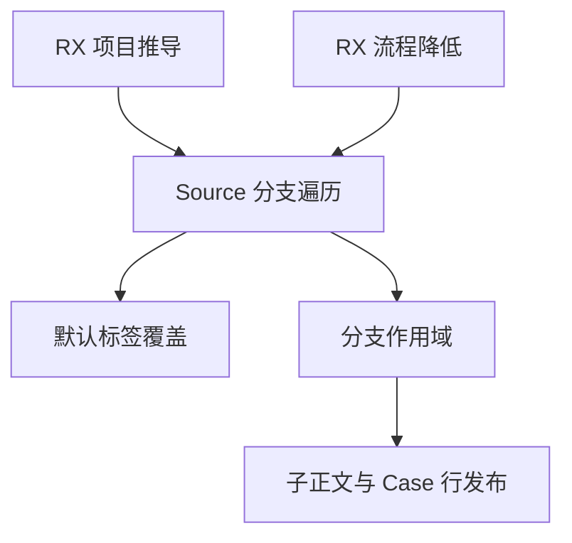

# RX 分支覆盖与退出恢复自举

## Intent · 完成 Switch 分支的状态交接

从 `ad4007878` 继续。普通与最终约束收集、流程降低共用 Source
分支状态。默认分支的布尔覆盖预读、非空事实的保存及作用域退出
按原顺序执行。

## Data · 正式调用路径

- 推导从 `project/constraints/traversal.zig` 进入共用遍历。
  默认分支通过 `condition/cases.zig` 向后逐行读取布尔标签。
- 降低从 `flow_compile/traversal.zig` 进入同一遍历。分支退出
  同时关闭子正文、恢复作用域并写入最终 Case 行。
- 上一批已提供原帧游标、绑定长度与标签列的借用视图。复用
  固定 705 入口生成清单、RX 推导回归与 seed 生成对照。

## Edges · 资源边界

保留先前标签的解析和诊断顺序。只有布尔覆盖仍可能缩小到单一
取值时才预读。标签的语法树继续由原解析区管理，退出失败时沿用
现有资源释放路径。帧分配与最终 IR 的存储由现有类型负责。

## Answer · 验收标准

- Source 在一次分支遍历中处理已访问标签与默认分支向后预读。原
  `rx_condition_coverage` 独立生成入口、默认分支 Zig 调用和
  专用帧退出回调退出正式调用链。Zig 执行单项标签解析、保存已解析
  标签、写回覆盖结果以及发出 Case 行。初始 seed 仍走自己的覆盖循环。
- 编译器 372 项、RX 推导 138 项及初始 seed 构建通过。执行清单
  经 seed 工具和候选 Source 工具生成，两种结果合计 17,885 个文件
  逐字节一致。增量恢复、重复入口诊断和 7,711 条快照记录通过。
- 本批非 seed 包源码 Zig 新增 109 行、删除 114 行，净减 5 行。
  全仓新增 111 行、删除 117 行，净减 6 行。

本批工具由 `ad4007878` 的 Source 引导器生成。三份 Source 工具对
同一份 705 入口、16 分区清单交错测量三轮。同版本主线对照的 9,894
个生成产物和所有权 memo 内容一致。

| 工具             | 冷墙钟（秒） | 冷 CPU（秒） | 进程树峰值 RSS（MB） | 单进程峰值 RSS（MB） | 热墙钟 / CPU（秒） |
| ---------------- | -----------: | -----------: | -------------------: | -------------------: | -----------------: |
| 固定基线         |         2.15 |         9.04 |                737.7 |                760.2 |        1.62 / 6.36 |
| 批首 `ad4007878` |         1.94 |         9.44 |                527.6 |                553.1 |        1.43 / 6.22 |
| 本批候选         |         1.94 |         9.38 |                523.9 |                551.0 |        1.41 / 6.13 |

较上一批，冷生成墙钟持平，CPU 减少 0.06 秒，进程树和单进程
峰值分别减少 3.7 MB 和 2.1 MB。较固定基线，冷墙钟减少
0.21 秒，CPU 增加 0.34 秒，两个内存峰值分别下降 213.8 MB 和
209.2 MB。未变输入跳过生成。
