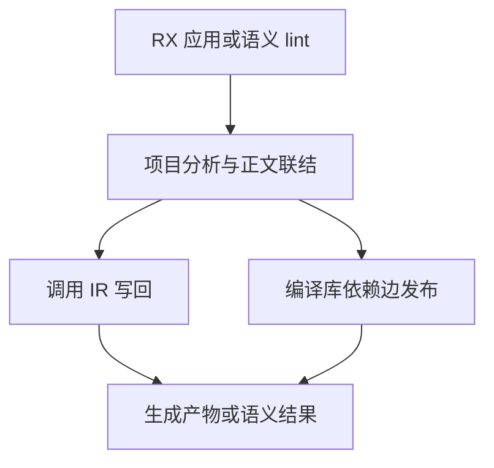

# RX 单行列借用与安全构建修复

## Intent

恢复 ReleaseSafe 编译器对普通 RX 应用的生成和语义检查，保留调用写回和
依赖发布的 Source 实现。

## Data

基于 `e3efb09da` 的安全安装版，`workflow.rx`、`service.rx` 和
`state.rx` 在关闭产物缓存时均因整数转换 panic 中止。`check-rx`
通过，直接生成和语义 lint 都能触发问题。汇编将中止点定位到
`program.linking.call.host.publish`。优化前 LLVM IR 中，四个实参的
借用描述只有一个指针字段，生成的写入接口从同一地址读取指针和长度。

## Edges

Zig 的固定宽度 `[0..1]` 在未明确接收类型时产生单元素数组指针。
擦除类型前先赋给 `[]u32`，把地址及已知长度交给 Source。编译库依赖
的单项标志也同样用 `[]bool` 借用。切片引用原表，无额外存储分配或元素复制。
Source 的容量检查、写入顺序及错误交付均沿用现有契约。

## Answer

在 Zig 0.17.0 构建的 ReleaseSafe 安装版中，三个入口均可无缓存生成，
输出的主 Zig 文件和 ABI 文件共六份，与上一批通过验收的 ReleaseSmall
工具逐字节一致。将原服务及其依赖复制到临时目录并格式化后，语义 lint 通过。
原始回归文件保持原样。46 项应用入口回归通过，覆盖普通模块、Args、Store
和结果策略。现有编译库测试覆盖已发布依赖、共享和隔离 Store、重新发布及
错误边界，共 17 项通过。磁盘项目增量和错误恢复共 9 项通过。

切片的元素数静态为一。原有安全检查得到了正确的长度，分配和数据复制路径
没有变化。此修复以安全构建、产物一致和执行回归作为验收。净减计划的阶段
性能采用原先两批的同配置实测。
