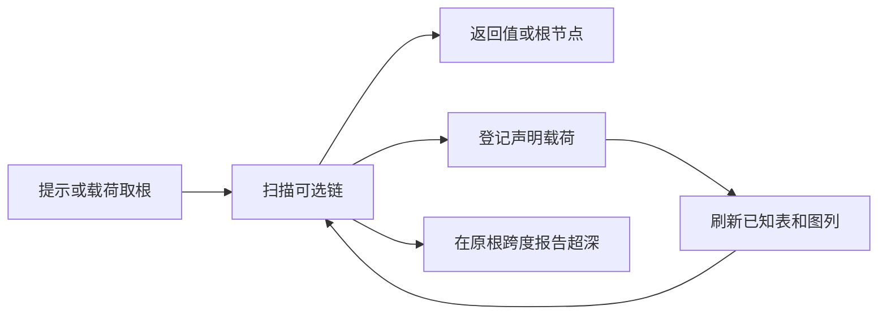

# RX 可选提示与载荷取根自举

## Intent

从 `bc682dbd1` 接续。把可选类型提示和载荷取根的跨登记循环、剩余预算及深度诊断交给 Source。读取视图与非空查询继续共用。

## Data

现有 ZX 扫描在遇到未登记的声明载荷时让出，Zig 按当时根节点的跨度登记类型，然后用登记后的节点和预算继续。提示允许开放形状；载荷取根限制嵌套深度并返回根编号。[原生推进](../../packages/compiler/src/rx/analysis/inference/optional.zig) · [ZX 扫描](../../packages/compiler/src/rx/analysis/inference/optional/lookup.zx)

## Edges

保持初始预算、登记返回的剩余预算以及开放类型的标量提示。登记按原根位置归属，刷新在下一轮前发生。初始 seed 继续使用原实现。

## Answer

提示与载荷取根在同一 RX 循环运行。ZX 返回当前阶段、节点和剩余预算。在遇到未登记的声明载荷时，RX 先登记，再刷新借用视图，并从登记返回的节点与预算继续。提示保留开放类型上已有的标量提示，载荷取根返回扫描到的最终根。超出预算时使用共享诊断文字及当时的根节点跨度。

定向生成发现，以复合对象接收登记返回值时，生成器会把循环游标和查询结果放入临时分配。改用现有登记方式分别返回节点和读取实际剩余深度，生成结果沿用标量游标和借用视图，在零容量临时分配器下运行。非空读取、非空回放和可选查询共用借列实现。

旧 Zig 查询循环与结果分派已退出正式路径。原生层继续提供物理视图、已知类型登记入口及诊断交付。初始 seed 维持原规则。

### 行为与引导验证

- 可选查询、非空读取和约束求解的定向生成通过。最终生成的查询与游标路径没有临时堆分配调用。
- 由上一阶段 Source 引导，27 个构建步骤通过。主编译器、执行、宿主、集合和增长五份清单共 17,687 个生成文件逐字节一致。10 个常驻编辑和错误恢复场景与上一阶段一致。
- 153 项正式 Zig 回归、17 项 CLI 集成和 39 项初始 seed 测试通过。现有回归覆盖可选参数、可选结果、跨模块登记和分配失败。
- 候选引导器 SHA-256 为 `304879aad4f3b1566135b782100edeb31c71cbfcf6a8e5f734f6c5e42af6c3a6`。

### 性能

固定 705 个入口和 16 个分区，关闭常驻生成器，三轮交错取中位数。三套工具都由 Source 构建，并运行各自的 Source 分析与生成。候选与上一批的 9,894 个冻结生成文件及所有权 memo 一致。各工具冷、热生成输出分别一致。

| 对照     | 冷生成墙钟 | 冷生成 CPU | 冷进程树峰值 RSS | 冷系统记录峰值 RSS | 热生成墙钟 | 热生成 CPU |
| -------- | ---------: | ---------: | ---------------: | -----------------: | ---------: | ---------: |
| 固定基线 |     2.06 s |     8.95 s |         737.5 MB |           793.0 MB |     1.62 s |     6.32 s |
| 上一批   |     1.93 s |     9.43 s |         523.6 MB |           544.3 MB |     1.44 s |     6.20 s |
| 候选     |     1.95 s |     9.52 s |         530.3 MB |           549.9 MB |     1.45 s |     6.15 s |

较上一批，冷生成墙钟增加 0.02 秒、CPU 增加 0.09 秒，进程树峰值增加 6.7 MB，系统记录峰值增加 5.6 MB。热生成墙钟增加 0.01 秒、CPU 减少 0.05 秒，无修改生成墙钟同为 0.03 秒。较固定基线，冷生成墙钟减少 0.11 秒、CPU 累计增加 0.57 秒，进程树峰值减少 207.2 MB。本次对照覆盖引导生成阶段。
