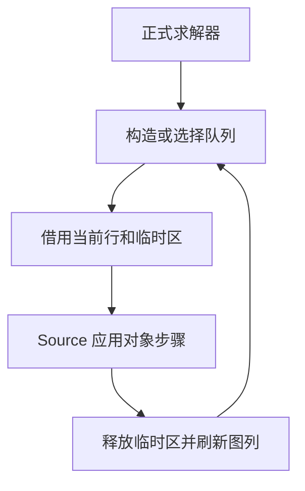

# RX 对象求解入口与行工作区自举

## Intent

从普通及最终求解轮贯通对象构造、字段选择和展开就绪查询，同时接入
序列回放与最终赋值校验。退出按队列和逐行启动生成代码的专用 Zig 入口，
继续使用原始图列、对象就绪缓存与带跨度的诊断。

## Data

从 `aef53020c` 接续。正式路径由约束求解器经 Zig 启动两个 Source 回放入口，
再经 Zig 启动逐行构造和选择。构造中的展开就绪通过独立 Source 入口二次进入。
序列回放与最终赋值校验也各自经一次 Zig 转发。

## Edges

普通轮先构造后选择。最终轮先选择，图变化即返回普通轮，随后才处理构造。
每行继续先用固定栈缓冲，溢出用临时 arena。行完成或失败时释放该行工作区，
就绪缓存另用原有生命周期。图变化后重借列，保留所有跨度和失败先后关系。
列表元素登记仍先使用首个元素的跨度，元组登记保持成员顺序。最终校验按原先
端点顺序完成类型解析，然后检查赋值。

## Answer

用现有 Source 引导器核对生成形态和错误顺序。集中运行 RX 推导、CLI 和 seed
回归，比较固定输入的产物和性能。沿原调用链确认旧回放和按行启动入口退出。

### 迁移结果

正式求解器直接组织构造、选择、序列重放和最终赋值校验。构造与选择共用行工作区、
图列、缓存上下文和写入后刷新。最终轮由 Source 读图修订并决定是否重启。展开就绪
直接复用 Source 查询入口。退役七个独立生成入口，删除回放及校验的专用宿主。

Zig 继续借用物理列并管理每行临时区。对象就绪缓存更新仍通过原生资源边界
进入已迁移的快照更新。复杂赋值端点仍使用现有类型解析工作区，序列成员登记
复用原有赋值批量入口。

窄范围生成先定位到索引表达式同时要求图节点编号为 `u32` 和 `u64`。
在 ZX 构造查询时显式扩宽索引，保留图编号类型。最终校验直接借用左右两列，
消除共享记录类型产生的临时装箱。针对三个正式入口的生成检查未见新增临时分配
和数组复制。

### 行为与产物

- Source 引导构建 27 步通过。候选 SHA-256 为
  `9b1ad0d04c2058e61e742e9715e79636666096242d828e126dbe231cf5e0a579`。
- 153 项 Zig 回归、17 项 CLI 集成、39 项 seed 回归通过。
- 五份清单的 17,620 个引导产物逐字节一致，10 项常驻编辑结果一致。

- 固定性能输入的 9,894 个产物及所有权 memo 逐字节一致。

### 性能

沿用 705 个入口、16 个分区和关闭常驻生成器的配置。三个工具均由 Source
生成并运行 Source 分析和生成，交错三轮取中位数。峰值为进程树 RSS。

| 版本     |  冷墙钟 |  冷 CPU |   冷峰值 |  热墙钟 |  热 CPU |
| -------- | ------: | ------: | -------: | ------: | ------: |
| 固定基线 | 2.11 秒 | 9.01 秒 | 737.9 MB | 1.64 秒 | 6.45 秒 |
| 批首     | 1.98 秒 | 9.48 秒 | 530.6 MB | 1.45 秒 | 6.28 秒 |
| 候选     | 1.97 秒 | 9.47 秒 | 525.5 MB | 1.44 秒 | 6.25 秒 |

较批首冷生成墙钟、CPU 各减少 0.01 秒，进程树峰值减少 5.1 MB，
系统记录峰值减少 7.6 MB。相对固定基线，冷生成墙钟减少 0.14 秒，CPU
增加 0.46 秒，进程树峰值减少 212.4 MB。无改动路径墙钟为 0.03 秒。
