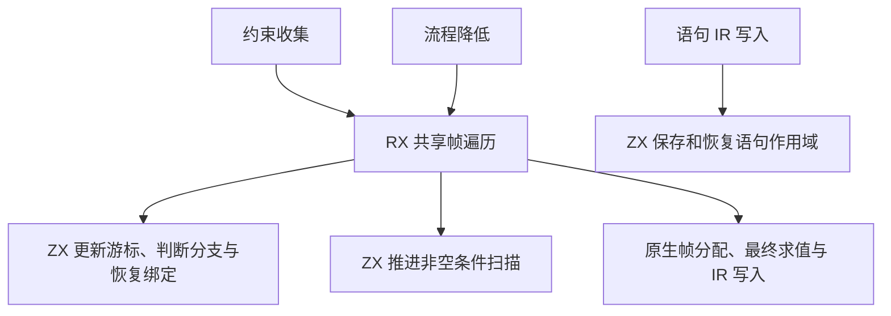

# RX 帧与作用域状态自举

## Intent · 让 Source 推进 RX 遍历状态

从 `63668fe78` 继续正式 RX 约束收集、流程降低和语句 IR 写入。把帧的访问位置、任务绑定恢复、分支识别与语句作用域写入交给 Source。非空条件遍历在同一次 Source 调用中推进到结束。

## Data · 正式入口和数据流

原来约束收集与流程降低每步通过专用 Zig 回调写游标、读写可见绑定数，并按当前帧查找默认分支。语句降低另外维护一套作用域保存与恢复回调。非空条件的 Source 规划器每返回一批，Zig 决定如何继续扫描或发布。

## Edges · 数据所有权与执行边界

- 共用帧遍历借用游标和绑定长度槽。帧变更后更新地址，重用原有调用、任务、分支和诊断顺序。
- 语句 IR 通过一次临时分配保存作用域的绑定长度和可选值，Source 使用通用列读取和写入。作用域仍跟随原语句构建区释放。
- 条件遍历借用正式解析器的节点与事实列表尾部。主清单和执行清单的节点类型经编译期布局检查后共享同一份切片。Source 管理扫描状态。Zig 提交长度，在空间用尽时追加，并为需要规范化的路径分配文本。
- 原生仍执行实际帧分配、表达式求值、部分分支标签覆盖、并行代码生成和 IR 写入。seed 保留自身入口，并与正式路径共用单项调用写入、Case 处理和 Task 输出操作。

## Answer · 验收

- 使用 Zig 0.17.0、ReleaseSmall、主清单 16 分区。候选工具由上一批 Source 引导器生成。Seed 解析器及引导器构建完成，同一清单的 main、execution、host、collections、growth 共 17,884 个生成文件逐字节一致。
- 编译器 372 项回归和实际 RX 项目推导 138 项回归通过。常驻生成请求验证缓存恢复、声明变更、重复入口和大小变化。7,707 条快照记录的路径、版本和时间范围通过对照。
- 本批非 seed 包源码 Zig 新增 146 行、删除 216 行，净减 70 行。全仓 Zig 新增 150 行、删除 217 行，净减 67 行。

固定 705 个入口的清单以 16 分区进行三轮交错测量，三种工具均运行
Source 后端。候选、批首及固定基线各自保留其 Source 引导器来源。
批首与候选的 9,894 个可比文件和所有权 memo 内容一致。

| 工具             | 冷墙钟（秒） | 冷 CPU（秒） | 进程树峰值 RSS（MB） | 单进程峰值 RSS（MB） | 热墙钟 / CPU（秒） |
| ---------------- | -----------: | -----------: | -------------------: | -------------------: | -----------------: |
| 固定基线         |         2.11 |         9.04 |                737.7 |                760.4 |        1.64 / 6.47 |
| 批首 `63668fe78` |         1.94 |         9.51 |                529.7 |                544.8 |        1.45 / 6.29 |
| 本批候选         |         1.95 |         9.49 |                528.9 |                556.6 |        1.45 / 6.28 |

本批冷生成墙钟增加 0.01 秒、CPU 减少 0.02 秒、进程树峰值下降
0.8 MB，单进程峰值增加 11.7 MB。较固定性能基线，冷墙钟减少
0.16 秒、CPU 增加 0.45 秒，进程树和单进程峰值分别下降 208.8 MB
和 203.8 MB。未变输入保持 0.03 秒并跳过生成。
