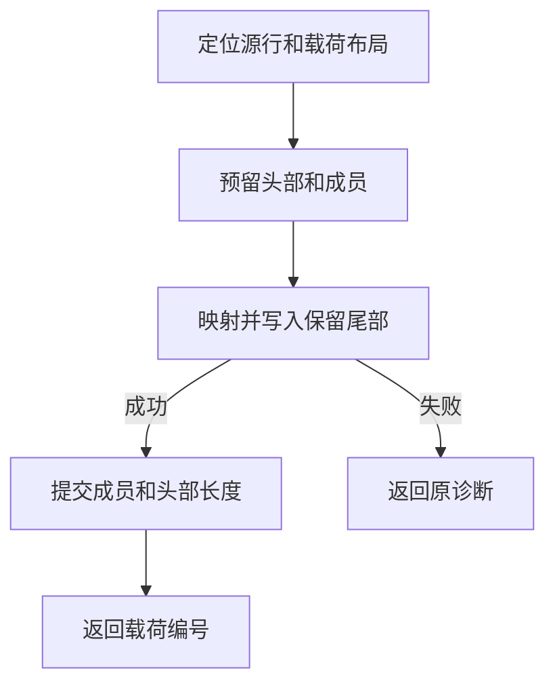
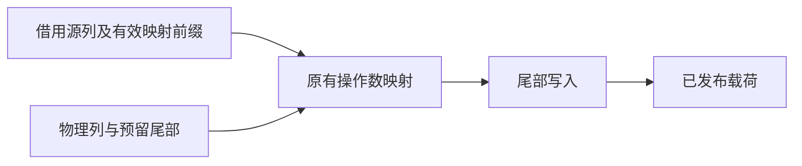

# RX 操作数列事务自举

## Intent

让定长和变长表达式载荷通过同一 Source 流程完成列预留、映射与提交。移除
按载荷类别直接调用生成器的 Zig 写入路径，复用通用列尾描述。

## Data

批首是 `9326262a8`。表头长度、变长成员的起点和可写尾部均来自列存储。
定长载荷与序列、集合、变换、作用域、匹配、对象使用相同的预留与提交结构，
区别在于列分组、成员数量和映射算法。

## Edges

原预留顺序为头部、成员和对象求值顺序。每组先检查所有列的长度上限，再依原
列次序预留容量。映射只能读已完成的源行前缀，映射失败时列长度仍指向旧前缀。
成功后按成员、求值顺序、头部提交。复用原增长策略和作用域，无新增堆中转。

## Answer

核对七种正式载荷入口、旧入口退出和原子提交。对照引导产物与受影响回归，
在相同固定工作负载下记录冷、热生成及内存，独立核对 seed。

### 迁移结果

定长、序列、集合、变换、作用域、匹配和对象沿同一 Source 流程预留、
映射和提交。定长载荷的运算符与迭代元数据也由 Source 写入预留尾部。
Zig 保留物理列绑定，通用内存接口提供按列预留和长度写回。保留原分组检查、
预留与提交顺序，退出七个独立生成入口。初始 seed 继续使用现有映射。

列范围描述及已借用的视图在一次表达式联结内复用。生成代码检查未发现中转
堆分配或数组复制。实际列容量增长仍沿用各列原有策略。

### 行为与产物

- Source 引导构建 27 步通过。候选 SHA-256 为
  `e197296f258f79c7b5a631eca7ec3a8b95c0e01d9e898088cbb6c1920081cb37`。
- 五份清单共 17,667 个引导产物逐字节一致，10 项常驻编辑结果一致。
- 1,062 个构建步骤、1,313 项 Zig 回归和 66 项 CLI 用例通过，覆盖
  类型表合并、RX 控制流、并行 Task 和分配失败。独立 seed 的 39 项回归通过。
- 固定性能输入的 9,894 个生成文件与所有权 memo 逐字节一致。

### 性能

固定 705 个入口、16 分区，关闭常驻生成器。三版工具均由 Source 生成并
执行 Source，交错运行三轮取中位数。峰值为采样进程树 RSS。

| 版本     |  冷墙钟 |  冷 CPU |   冷峰值 |  热墙钟 |  热 CPU |
| -------- | ------: | ------: | -------: | ------: | ------: |
| 固定基线 | 2.07 秒 | 8.96 秒 | 737.5 MB | 1.66 秒 | 6.42 秒 |
| 批首     | 1.92 秒 | 9.41 秒 | 525.1 MB | 1.46 秒 | 6.26 秒 |
| 候选     | 1.99 秒 | 9.47 秒 | 527.4 MB | 1.43 秒 | 6.25 秒 |

较批首，冷生成墙钟增加 0.07 秒，CPU 增加 0.06 秒，进程树峰值增加
2.3 MB，系统记录的单进程峰值增加 5.5 MB。较固定基线，冷生成墙钟
减少 0.08 秒，CPU 增加 0.51 秒，进程树峰值减少 210.1 MB。无改动
路径为 0.03 秒。候选首轮冷墙钟为 3.22 秒，其余两轮为 1.99 和 1.92 秒。
