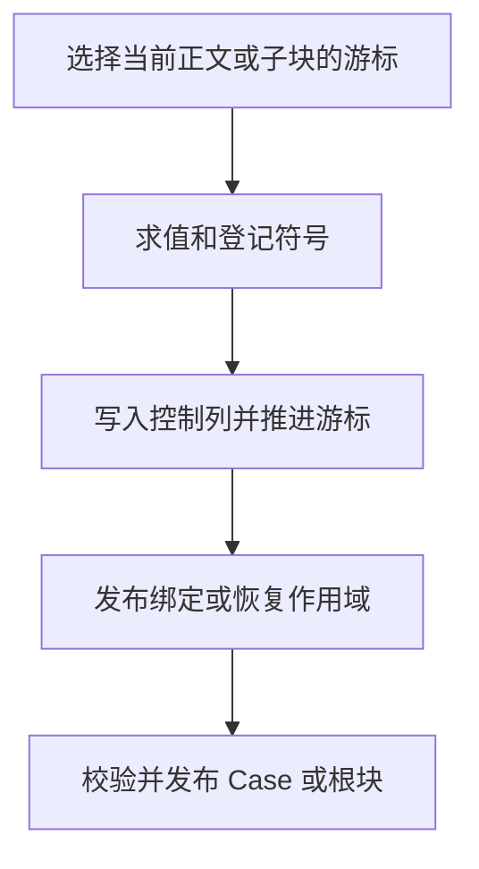
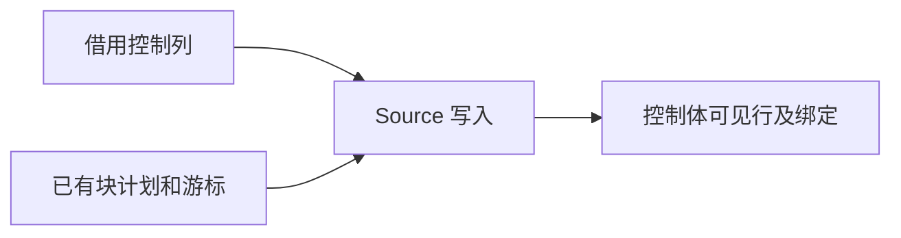

# RX 正文控制列发布自举

## Intent

让 Return、Task、Call、Parallel、Case 和 Store getter 共用控制列发布，
由 Source 写入载荷、推进游标、发布绑定和核对完成的块。

## Data

正式正文入口已经按事件调用 Source，控制列仍由各动作分别调用 Zig
适配器，适配器再调用七个独立的生成入口。根块的隐式 Return 与校验也
在正文结束后由 Zig 处理。批首为 `e4bcf1b84`。

## Edges

沿用原控制列布局、基础容量及符号生命周期。Call 先求值和登记符号，
再写控制行。Parallel 绑定容量预留成功后才发布控制行，最后提交已写
绑定。Case 完成检查先于行发布和作用域恢复。Store getter 写入同一控制
游标。seed 保留自身的直接写入。

## Answer

沿正式正文入口核对七个独立入口退出，检查作用域、并行、返回、Store
运行与 seed 回归。用同一固定输入核对生成结果、所有权与性能。

### 迁移结果

控制表和游标由同一份借用视图提供。正常路径直接执行 Source 控制行写入、
Case 完成校验、普通与并行 Call 结果写入及根块隐式返回，退出旧 Zig
写入交接和七个独立生成入口。Store getter 共用相同的绑定写入。Zig
继续分配实际列和作用域缓冲，并交付表达式和符号分析结果。
新发布路径不增加跨模块的堆中转。

### 产物与性能

- Source 引导构建 27 步通过，工具 SHA-256 为
  `5fd5c5a210c7ed945577b397f0a78df4dd3b2322fa3e8a529ba17f0675bd218c`。
- 17,657 个引导生成文件逐字节一致，10 项常驻编辑结果一致。
- 1,062 个步骤、1,313 项 Zig 回归与 66 项 CLI 用例通过。覆盖直连及
  并行结果、嵌套控制流、Store getter、库初始化和错误清理。39 项独立
  seed 回归通过。

固定 705 个入口、16 分区，关闭常驻生成器。三版工具由 Source 生成并
执行 Source，交错运行三轮取中位数。9,894 个生成文件与所有权 memo 一致。

| 版本     |  冷墙钟 |  冷 CPU | 冷进程树峰值 RSS |  热墙钟 |  热 CPU |
| -------- | ------: | ------: | ---------------: | ------: | ------: |
| 固定基线 | 2.09 秒 | 9.03 秒 |         738.3 MB | 1.63 秒 | 6.42 秒 |
| 批首     | 1.95 秒 | 9.49 秒 |         530.4 MB | 1.47 秒 | 6.29 秒 |
| 候选     | 2.02 秒 | 9.62 秒 |         527.4 MB | 1.46 秒 | 6.26 秒 |

较批首，冷生成墙钟增加 0.07 秒、CPU 增加 0.13 秒，采样进程树峰值
下降 3.0 MB，系统记录的单进程峰值上升 3.7 MB。较固定基线，
冷墙钟下降 0.07 秒、CPU 增加 0.59 秒，采样进程树峰值下降 210.9 MB。
无改动路径为 0.03 秒。

### 净变化

本批非 seed 包源码 Zig 新增 139 行、删除 252 行，净减 113 行。全仓 Zig
新增 139 行、删除 259 行，净减 120 行。
