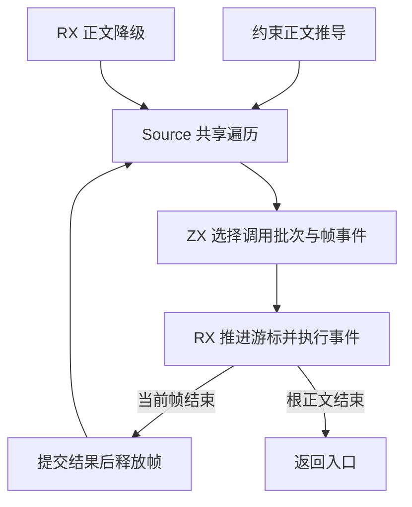
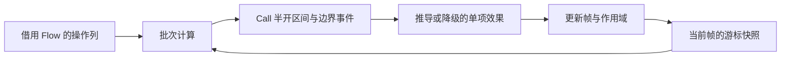

# RX 正文遍历自举

## Intent

让项目约束推导与 RX 降级共用 Source 正文遍历。将连续调用分段、游标推进、
任务及分支的打开和关闭顺序从正式 Zig 循环迁出，保留两个入口各自的结果写回。

## Data

批首为 `b6607fc2f`，Source 工具沿用项目约束生命周期阶段的验收产物。
约束正文入口经 Walker 读取已准备的 Flow，降级入口在同一 Flow 上写入 IR。
两个入口原先每批调用一个独立的生成入口选择下一步，再回到 Zig 分派。

## Edges

连续调用先推进父帧游标，再按原顺序执行，随后处理边界事件。关闭操作成功后
才销毁当前帧。错误时由原有栈清理释放其拥有的表达式、并行结果和临时缓冲。
推导的并行任务打开子帧，降级的并行任务继续以独立正文执行。两者保留原有诊断。

## Answer

使用相同清单对照两版工具的引导产物，运行受影响的 RX、CLI 和 seed 回归。
检查生成 Zig 中的游标读取、调用执行顺序与临时分配。按固定输入比较生成时间和内存。

### 迁移结果

正式路径从两个入口直接进入同一个生成的 Source 循环。ZX 根据当前区域和 Flow
操作列选择下一事件。RX 安排游标写回、连续调用、边界效果及帧释放。初始 seed
继续独立运行原有循环。独立的每批 Zig 到生成入口往返已退出。

两个入口保留栈存储、调用批次中的单次求值、作用域恢复、IR 写回和错误释放。
宿主适配只选择推导或降级的单项效果，遍历事件由 RX 决定。下一步可将各项
任务、并行及分支效果内部的阶段与作用域写回进一步迁入 Source。

### 行为与产物

- Source 引导构建 27 步通过。候选工具 SHA-256 为
  `1da215006b13ef1df93b81a6718dff471c322c48c65371c3beca1986acc1abfd`。
- 五份清单共 17,662 个生成文件逐字节一致，10 项常驻编辑结果一致。
- Source 回归 923 步和 956 项 Zig 测试通过，覆盖顺序与并行 Task、分支、
  Store 执行及分配失败。CLI 项目与 Task 的 49 项用例通过。
- 独立 seed 的 39 项回归通过。生成形态检查未发现遍历新增堆分配、
  元素复制或临时对象装箱。
- 固定性能输入的 9,894 个生成文件与所有权 memo 逐字节一致。

### 性能

同一冻结输入的 705 个入口、16 分区，关闭常驻生成器。三版工具均由 Source
生成并执行 Source 实现，交错运行三轮取中位数。峰值为采样进程树 RSS。

| 版本     |  冷墙钟 |  冷 CPU |   冷峰值 |  热墙钟 |  热 CPU |
| -------- | ------: | ------: | -------: | ------: | ------: |
| 固定基线 | 2.11 秒 | 9.02 秒 | 737.3 MB | 1.64 秒 | 6.45 秒 |
| 批首     | 1.95 秒 | 9.51 秒 | 527.8 MB | 1.44 秒 | 6.27 秒 |
| 候选     | 1.97 秒 | 9.50 秒 | 527.9 MB | 1.44 秒 | 6.26 秒 |

较批首冷墙钟增加 0.02 秒，CPU 减少 0.01 秒，进程树峰值增加 0.1 MB，
系统记录的单进程峰值增加 0.5 MB。相对固定基线冷墙钟减少 0.14 秒，
CPU 增加 0.48 秒，进程树峰值减少 209.4 MB。无改动路径墙钟为 0.03 秒。
