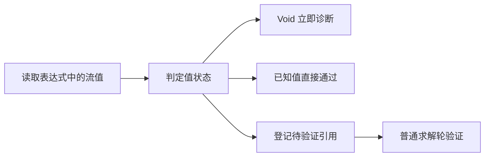

# RX 流值校验与绑定回放自举

## Intent

从 `4e9d78d91` 接续。把流值立即校验、待验证引用的登记、首个缺失诊断和普通轮与最终轮的延迟绑定回放连入 Source。移除求解器对两条 Zig 阶段转发的依赖。

## Data

表达式读到 Void 立即报错，Pending 写入待验证队列。普通求解轮按行检查引用，随后检查绑定冲突、重放延迟查询。最终轮使用终局冲突条件。一次合并可能改变候选根或移动类型图的列。[流值校验](../../packages/compiler/src/rx/analysis/inference/bindings.zig) · [回放流程](../../packages/compiler/src/rx/analysis/inference/bindings/advance.rx) · [求解顺序](../../packages/compiler/src/rx/analysis/inference/solve/propagate.rx)

## Edges

保持扫描和诊断顺序，待验证记录保存原节点编号和来源跨度。回放只在选出唯一有效候选时合并，成功后刷新借用视图。最终轮保持原有入口次序。Zig 保留实际容量和诊断交付，初始 seed 继续走原规则。

## Answer

表达式的流值校验由同一 RX 入口判定。已知值直接通过；待定值在预留后写节点和跨度，最后增加待验证队列的可见长度。缺失引用与缺失查询共用 Source 的诊断消息。

普通轮刷新绑定列后先校验待验证引用，再进入冲突与查询回放。最终轮保持长度校验后的回放位置。发现唯一候选时，RX 调用图合并，然后明确刷新拓扑供下一轮扫描。缺失及冲突各使用原跨度和文字。两个求解阶段的 Zig 转发、原生诊断分派及三个单独的规则引导入口已从正式路径撤下。执行清单跟踪推导源码，旧规则仅供兼容 seed 使用。

### 行为与引导验证

- 表达式校验与完整求解器的定向生成通过。缺失诊断由 ZX 读取常量，RX 决定何时给出诊断。
- 由上一批 Source 工具构建候选，27 个引导步骤通过。主编译器、执行、宿主、集合和增长五份清单的 17,683 个生成文件逐字节一致。10 个常驻编辑和错误恢复场景与上一批一致。
- 153 项正式 Zig 回归、17 项 CLI 集成和 39 项初始 seed 测试通过。回归覆盖流值缺失、并行重叠、作用域诊断与分配失败。
- 候选引导器 SHA-256 为 `fd8ccea16b146a78d8d78f8c9a5a274348736ffcd240e8fe0b62983466a8f86f`。

### 性能

固定 705 个入口和 16 个分区，关闭常驻生成器，三轮交错取中位数。三套工具都由 Source 构建，并运行各自的 Source 分析与生成。候选与上一批的 9,894 个冻结生成文件及所有权 memo 一致。各工具冷、热生成输出分别一致。

| 对照     | 冷生成墙钟 | 冷生成 CPU | 冷进程树峰值 RSS | 冷系统记录峰值 RSS | 热生成墙钟 | 热生成 CPU |
| -------- | ---------: | ---------: | ---------------: | -----------------: | ---------: | ---------: |
| 固定基线 |     2.03 s |     8.91 s |         737.4 MB |           759.8 MB |     1.58 s |     6.29 s |
| 上一批   |     1.91 s |     9.41 s |         530.1 MB |           551.2 MB |     1.41 s |     6.17 s |
| 候选     |     1.93 s |     9.39 s |         524.4 MB |           545.6 MB |     1.41 s |     6.18 s |

较上一批，冷生成墙钟增加 0.02 秒、CPU 减少 0.02 秒，进程树与系统记录峰值均减少 5.7 MB。热生成墙钟持平、CPU 增加 0.01 秒，无修改生成墙钟同为 0.03 秒。较固定基线，冷生成墙钟减少 0.10 秒、CPU 累计增加 0.48 秒，进程树峰值减少 213.0 MB。本次对照覆盖引导生成阶段。
