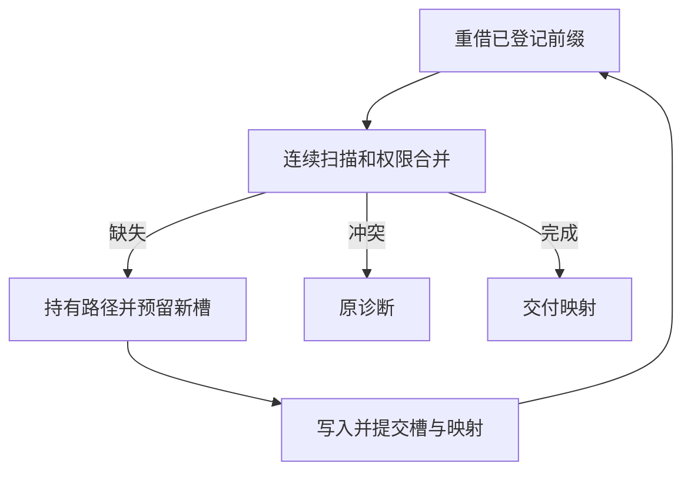

# RX 程序 Store 槽登记自举

## Intent

把 Call 绑定和 Store 读取共用的程序槽登记迁入 Source，包括已登记槽的
权限合并、新槽登记、映射写入及扩容后的续扫。

## Data

批首为 `c1d9f46f1`。两个入口已使用 ZX 查找现有槽，Zig 的
`program/store/bind.zig` 负责续扫、追加和缺失行的映射。
另有初始 seed 的独立查找。上一批的 ReleaseSafe 独立推导测试在批首和
候选均能复现同一组 Store 失败。

## Edges

保留按源行顺序分配编号、合并读写权限、首个类型冲突及已提交前缀。
复制槽路径一次，使程序输出可独立持有身份。现有槽不分配。
扩容后重借有效列，原有五列的容量增长保持同一顺序。

## Answer

两个入口合并到 `bind.rx`。Source 推进重借、扫描、冲突和续跑。现有槽
直接合并权限并写入映射，新槽由 Source 持有路径、写入五个列、提交长度，
随后写出编号。原有 Zig 的查找续扫、按来源重读、槽写入和映射更新退出
正式路径，独立读取生成入口也已移除。宿主只借用当前列并逐列预留物理容量。
初始 seed 继续使用既有的查表和追加。

生成代码按值推进游标和单行槽数据。通用的路径复制使用结果区分配器，主
登记流程使用拒绝分配的临时分配器。槽路径保持原有的一次必要复制。

Source 引导构建 30 步和 39 项 RX 回归通过。独立 seed 构建通过 52 步，
两条引导路径的五份清单共 17,796 个文件逐字节一致。冻结清单的 9,894 个
生成文件和所有权 memo 与上一阶段 Source 保持一致。候选引导器 SHA-256
为 `ed28076cbc6dffa1c4e5123d012853326eec51ae506ab35d10d2ff2f08270093`。

ReleaseSmall 共通过 84 个构建步骤和 138 项推导测试。46 项应用入口、
8 项原生 Store、17 项编译库和 8 项权限边界检查也全部通过。复用候选
生成配置单独构建 ReleaseSafe CLI，原生 Store 和编译库的 25 项检查
全部通过。

### 性能

固定输入、16 分区，关闭常驻生成器，每种配置交错运行三轮，取中位数。
候选由上一阶段的 Source 引导器生成，上一阶段对照由项目依赖目标选择与
边发布阶段的 Source 引导器生成。固定基线沿用声明准备阶段，三版均启用
Source。

| 版本     |  冷墙钟 |  冷 CPU | 冷进程树峰值 RSS |  暖墙钟 |  暖 CPU |
| -------- | ------: | ------: | ---------------: | ------: | ------: |
| 固定基线 | 2.10 秒 | 9.00 秒 |         737.3 MB | 1.64 秒 | 6.43 秒 |
| 上一阶段 | 1.98 秒 | 9.52 秒 |         524.7 MB | 1.46 秒 | 6.29 秒 |
| 候选     | 1.97 秒 | 9.44 秒 |         525.4 MB | 1.46 秒 | 6.30 秒 |

较上一阶段，冷墙钟减少 0.01 秒，CPU 减少 0.08 秒，进程树峰值增加
0.8 MB，系统记录的单进程峰值增加 3.9 MB。较固定基线，冷墙钟减少
0.13 秒，CPU 增加 0.44 秒，进程树峰值减少 211.8 MB。

### 独立推导的安全构建

用批首之前的剥离符号安全版匹配汇编，越界发生在混合项目正文的
`bindMixedZXPreparation`。导入绑定用读到的默认函数编号访问仅有一行的
共享函数表。此处还没有进入 RX 程序槽登记。临时探针在同一用例观察到
完成表登记的默认函数为空，随后崩溃位置改变。在函数入口和公开接口发布处
加入探针后，同一组定向用例拿到有效的默认函数编号并通过，包括分配失败
测试。由于探针改变了复现结果，常规安全构建仍需在正文结果发布与读取
之间定位根因。
