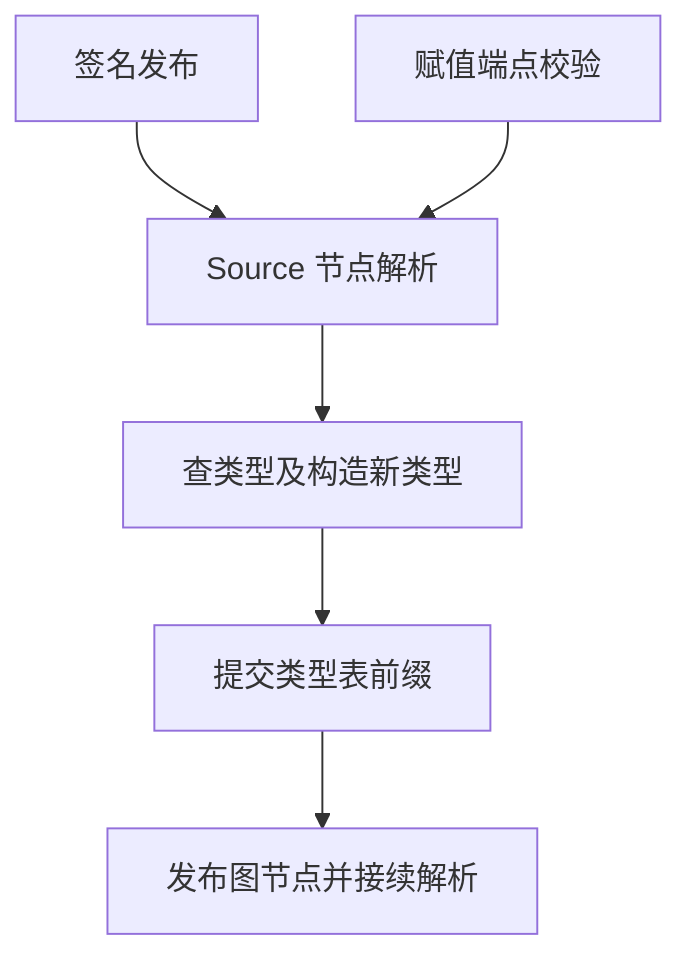

# RX 签名与赋值端点类型解析自举

## Intent

从签名发布及最终赋值校验两条正式链路接入同一个节点解析流程。贯通解析栈、
类型构造、类型表前缀提交和图节点发布，退出原生发起单节点解析和构造的入口。

## Data

批首为 `cc9087a43`。签名和赋值扫描已有批量已知类型快捷路径。复杂节点
经 Zig 进入独立 Source 解析，构造时再经 Zig 进入另一 Source 入口，随后
通过类型表的通用列发布写入。

## Edges

两条路径继续共用帧和值的工作区。已知节点直接从图读取。构造使用原有短命的
栈缓冲和溢出 arena。类型候选可借用现有成员，新增类型写入原持久区。
保留诊断位置、已完成子节点、失败前缀和列扩容后刷新。

## Answer

以现有引导器检验借用与生成形态，用原有 Source、seed、RX 和 CLI 回归集中验收。
与上一版及固定性能基线对照生成产物、时间和内存。

### 迁移结果

签名发布和最终赋值校验复用一个 Source 节点解析入口。解析在已知节点处直接
取类型。普通节点沿栈解析成员，查找或构造类型后提交类型表前缀，随后更新图节点
和对象修订。复杂端点完成后重借可能已扩容的类型列。

旧单节点解析和类型构造的独立生成入口退出。候选规范化、查重、列容量与
发布复用 ZX 类型构造及类型合并实现。单行的标量进入现有列视图，成员与名称
通过原切片借用。原生继续保留栈缓冲到堆缓冲的扩容、列视图绑定、诊断与临时区释放。

生成检查中，跨原生边界传递整条构造记录引入临时装箱。改为传递现有标量和列
后，三个受影响入口的生成代码无新增装箱或整列复制。独立编译的 ABI 视图用
既有结构校验转换，保留共享列。

### 行为与产物

- Source 引导构建 27 步通过。候选 SHA-256 为
  `6252a264f8a7b90d92a5c84ae5dc5260e8a7fe2d6ee24c6cd70b3edfcc9abf32`。
- 153 项 RX 与 XML 相关 Zig 回归、17 项 CLI 集成和 39 项 seed 回归通过。
- 共享列发布的 123 项类型表合并回归通过，覆盖前缀、名义类型与分配失败。
- 五份引导清单 17,654 个产物逐字节一致，10 项常驻编辑结果一致。
- 固定清单的 9,894 个产物及所有权 memo 逐字节一致。

### 性能

705 个入口、16 分区，关闭常驻生成器。三个工具由 Source 构建并运行 Source，
交错三轮取中位数。时间为生成耗时，峰值为进程树 RSS。

| 版本     |  冷墙钟 |  冷 CPU |   冷峰值 |  热墙钟 |  热 CPU |
| -------- | ------: | ------: | -------: | ------: | ------: |
| 固定基线 | 2.07 秒 | 8.99 秒 | 738.0 MB | 1.62 秒 | 6.38 秒 |
| 批首     | 1.97 秒 | 9.50 秒 | 523.5 MB | 1.44 秒 | 6.26 秒 |
| 候选     | 1.99 秒 | 9.48 秒 | 524.4 MB | 1.44 秒 | 6.20 秒 |

较批首冷生成墙钟增加 0.02 秒、CPU 减少 0.02 秒，进程树峰值增加 0.9 MB，
系统记录峰值减少 8.3 MB。较固定基线冷生成墙钟减少 0.08 秒、CPU 增加
0.49 秒，进程树峰值减少 213.6 MB。无改动路径墙钟仍为 0.03 秒。
