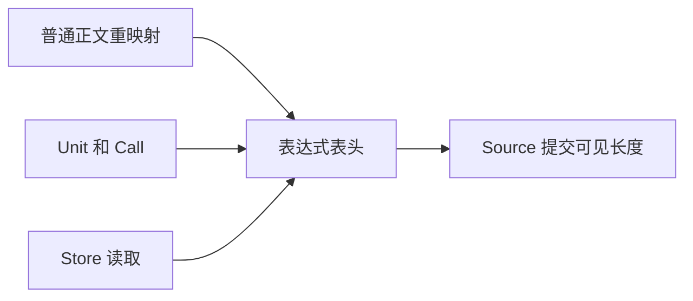
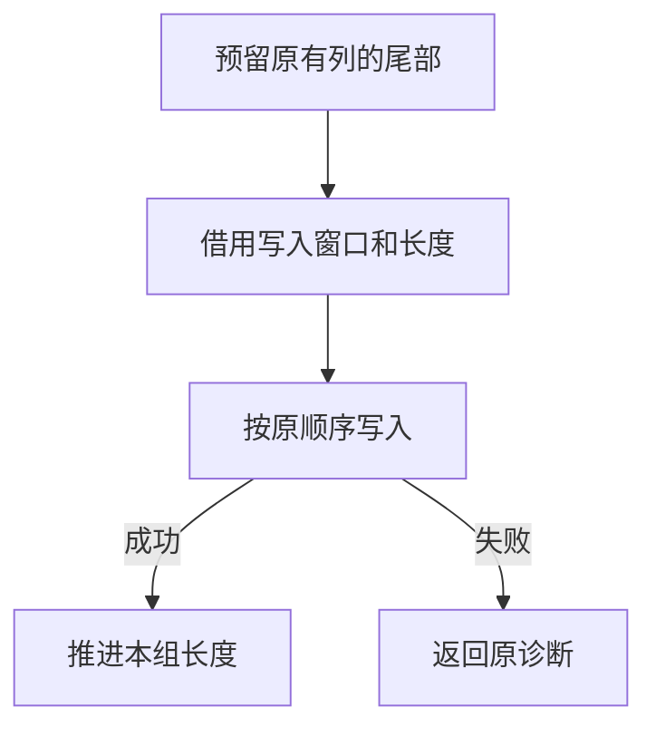

# RX 表达式列提交自举

## Intent

把普通表达式联结、Unit、直接 Call 和 Store 读取的可见列长度交给各自的
Source 写入流程提交，移除正式路径中的 Zig 提交回调和专用长度写回。

## Data

批首为 `dc0476ac0`。普通联结依次写入符号、字面量、操作数和表头；Unit、
Call 和 Store 读取写入同一个表达式表。当前四个入口都在写入后由 Zig 修改
长度，已在 Source 处理的操作数列是可复用的做法。

## Edges

保留容量预留和原有错误顺序。每组写入成功后才推进可见长度，后续步骤可以
读取已经提交的前缀。借用描述符只包含原列长度的地址，不复制行或文本。
初始 seed 保留单独的物理写入。单行可写缓冲仍采用显式切片描述。

## Answer

普通联结的符号、字面量和表头分别在写入后由 Source 提交，移除
`commitLinkSymbols`、`commitLinkLiterals` 和 `commitExpressionLink`。
Unit、直接 Call 和 Store 读取也将列长度提交纳入同一写入流程。Call 保留
操作数、Store 槽及表头的提交次序。符号、表头和 Store 读取复用核心的
等长列发布，长度各异的字面量遍历原有字段布局。Zig 继续预留实体列和绑定
借用视图。Store 槽的登记续扫及新增槽位的写入留在下一批。

Source 引导构建 30 步通过，39 项 RX 回归通过。初始 seed 的独立构建
通过 52 步，使用两条引导路径对照五份当前清单，17,794 个生成文件
逐字节一致。在冻结清单上，候选与上一阶段 Source 工具的 9,894 个
生成文件及所有权 memo 逐字节一致。候选引导器 SHA-256 为
`f8fd2e1bea8795a56e761832a589a9d74e769c3eb3163c371a286b3ebfa80f89`。

ReleaseSafe CLI 通过 46 项应用入口、9 项磁盘项目和 25 项编译库及
权限边界检查。独立推导套件的 ReleaseSmall 候选通过全部 138 项。
保留调试信息的 ReleaseSafe 套件编译使 Zig 进程崩溃。剥离调试信息后，
批首和候选的两个 Store 生命周期用例均返回相同失败，随后权限用例在
长度为一的列上触发越界检查。该安全构建问题保留给下一批定位。

### 性能

固定输入、16 分区、关闭常驻生成器。候选由项目依赖目标选择与边发布
阶段的 Source 引导器生成，对照沿用该工具及声明准备阶段的固定工具。
运行时三版均启用 Source。每组交错运行三轮，墙钟、CPU 和进程树
峰值 RSS 均取中位数。

| 版本     |  冷墙钟 |  冷 CPU | 进程树峰值 RSS |  暖墙钟 |  暖 CPU |
| -------- | ------: | ------: | -------------: | ------: | ------: |
| 固定基线 | 2.09 秒 | 9.02 秒 |       738.1 MB | 1.63 秒 | 6.43 秒 |
| 上一阶段 | 1.94 秒 | 9.50 秒 |       524.8 MB | 1.45 秒 | 6.27 秒 |
| 候选     | 1.94 秒 | 9.52 秒 |       523.3 MB | 1.45 秒 | 6.28 秒 |

较上一阶段，冷墙钟持平，CPU 增加 0.02 秒，进程树峰值减少 1.5 MB，
系统记录的单进程峰值增加 7.2 MB。较固定基线，冷墙钟减少 0.15 秒，
CPU 增加 0.50 秒，进程树峰值减少 214.8 MB。无改动路径维持 0.03 秒。
候选首轮冷墙钟为 3.14 秒，另外两轮为 1.93 秒和 1.94 秒。
