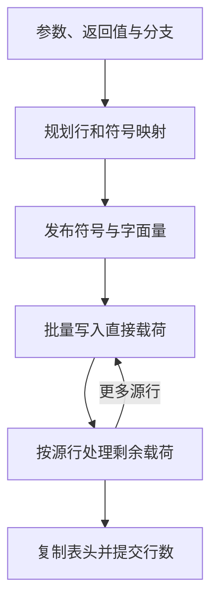

# RX 表达式联结与列发布自举

## Intent

让语句参数、返回值、分支和循环谓词的 IR 表达式联结共用 Source 流程。
移除逐批推进和剩余载荷分派的手写 Zig 循环，复用现有列表示。

## Data

批首是 `3d0e7174d`。Source 已有有效行规划、符号和字面量列写入、载荷快路径
及表头发布。Zig 负责在这些入口之间传递映射和列视图，逐批分派复合载荷，
最后提交表达式行。现有临时区按表达式复用。

## Edges

保留先规划，再依次发布符号、字面量、载荷及表头的顺序。列预留失败和映射错误
继续经现有诊断交付。按原批大小复用缓冲，复合载荷仍按原源行顺序执行，且只能
引用已处理的前缀。字符串名称与字面量沿用根结果的借用条件。只有完整写入后才
增加可见表达式行数。

## Answer

从普通正文、并行 Task 和循环谓词核对正式入口。对照引导产物、既有运行和
失败测试。沿用固定性能输入，检查新流程的堆分配、冷和热生成以及峰值内存。

### 迁移结果

Source 直接连接行规划、符号、字面量、载荷和表头。正式路径退役五个独立
生成入口。两个 Source 循环分别推进载荷批次和批内剩余行。字面量仍走批量
快路径，复合载荷按原源行顺序借用已确定的映射。表头复制完成后才提交行数。

Zig 持有一次联结的借用视图、目标列预留和长度提交。定长或变长载荷的原子
操作仍使用现有列宿主。初始 seed 的独立遍历继续执行相同结果。主流程复用
原联结临时区和 16 行批缓冲，生成检查未发现新载荷循环引入堆分配或数组复制。

### 行为与产物

- Source 引导构建 27 步通过，候选工具 SHA-256 为
  `0b003faebc3d0c54e1a6a5b23a217fc1bbb58974756676c356e5bcc1bfa57789`。
- 五份清单共 17,699 个引导产物逐字节一致，10 项常驻编辑结果一致。
- 1,029 个构建步骤、1,190 项 Zig 回归和 66 项 CLI 用例通过，覆盖字面量、
  分支、并行 Task、分配失败和编译库调用。39 项 seed 回归通过。
- 固定性能输入的 9,894 个生成文件和所有权 memo 逐字节一致。

### 性能

固定 705 个入口、16 分区，关闭常驻生成器。三版工具由 Source 生成并执行
Source 实现，交错运行三轮取中位数。峰值为采样进程树 RSS。

| 版本     |  冷墙钟 |  冷 CPU |   冷峰值 |  热墙钟 |  热 CPU |
| -------- | ------: | ------: | -------: | ------: | ------: |
| 固定基线 | 2.07 秒 | 8.96 秒 | 738.3 MB | 1.61 秒 | 6.35 秒 |
| 批首     | 1.92 秒 | 9.47 秒 | 524.7 MB | 1.41 秒 | 6.20 秒 |
| 候选     | 1.95 秒 | 9.40 秒 | 530.9 MB | 1.42 秒 | 6.18 秒 |

较批首，冷生成墙钟增加 0.03 秒，CPU 减少 0.07 秒，进程树峰值增加
6.3 MB，系统记录的单进程峰值减少 10.3 MB。相对固定基线，冷生成墙钟
减少 0.12 秒，CPU 增加 0.44 秒，进程树峰值减少 207.4 MB。无改动路径
仍为 0.03 秒。
