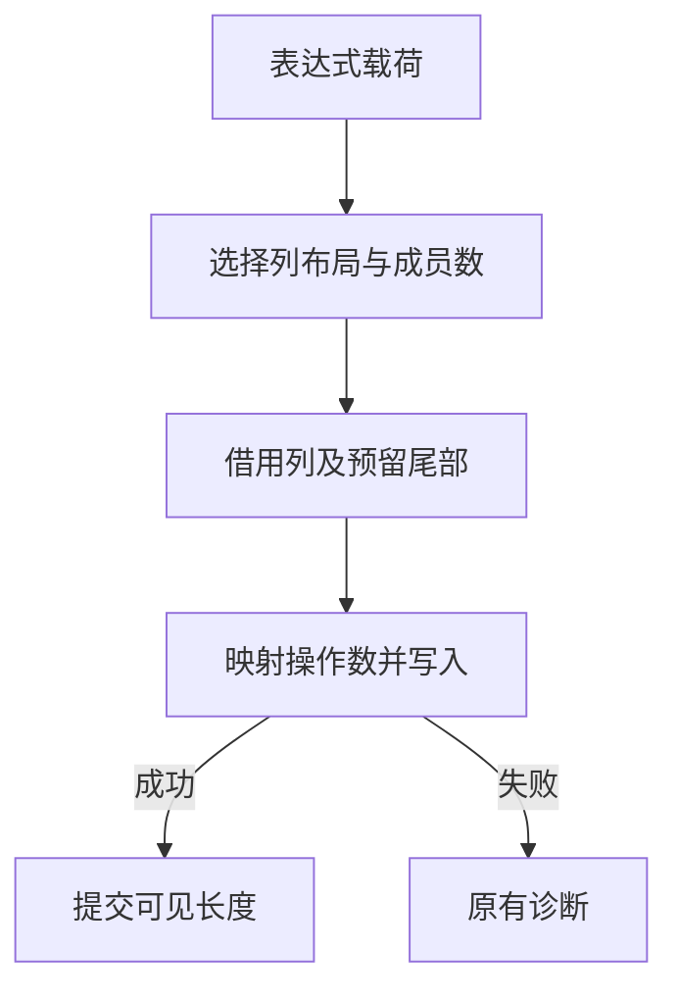
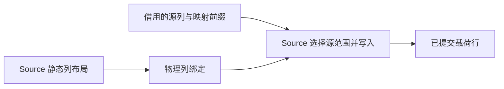

# RX 表达式载荷列绑定自举

## Intent

沿正式 RX 表达式联结路径，迁移各类载荷的列选择、成员范围计算及写入视图。
以同一套物理列绑定替代各分支专用的 Zig 视图组装。

## Data

批首为 `c34eb7c75`。正式链路已有 Source 预留、映射和长度发布，Zig
仍为定长载荷、序列、集合、变换、作用域、匹配和对象逐类组装输入。
共享列描述支持按容量预留和按成功前缀发布。

## Edges

保留列预留顺序、引用映射前缀、空载荷快速返回，以及映射失败时的原有
长度。物理容量及借用寿命由宿主管理。静态列布局仅在 Zig 编译期转换成
描述表，运行时沿用原列，不复制输入数组。空成员组保留原位写入的范围信息。

## Answer

从 RX 联结入口验证七类载荷、对象与 Store 初始化器共享的列发布以及
失败返回。核对专用适配退出、原有回归和同配置性能，再登记逐批与累计
Zig 变化。

### 已退出的职责

从正式表达式联结中删除七类专用的 Zig 载荷视图组装。Source 选择表头和成员列，
从共享的表达式表借用源下标和成员范围，再写入统一预留的尾部。宿主保留物理
列绑定和借用寿命。布局在编译工具本体的 Zig 编译期固化，运行中直接查表。
定长和复合载荷继续保持原引用映射与错误顺序，Store 初值沿用同一列组接口。
检查生成 Zig，两个范围的临时对象已改为扁平参数，热路径无新增堆分配。

### 引导产物和性能

- Source 引导构建 27 步通过。候选工具 SHA-256 为
  `dd6c9cad6b049933a53b92406f19f60762cc213eed6e319498a20b0407b4e2ed`。
- 五份清单的 17,677 个生成文件逐字节一致，10 项常驻编辑结果一致。
  39 项独立 seed 回归通过。
- 1,062 个构建步骤、1,313 项 Zig 回归和 66 项 CLI 用例通过，覆盖 RX 推导、
  运行、属性、并行 Task、类型合并及 Store 库联结。
- 固定输入的 9,894 个生成文件与所有权 memo 逐字节一致。705 个入口及
  16 分区，关闭常驻生成器，由 Source 生成的三版工具执行 Source，交错
  运行三轮取中位数。

| 版本     |  冷墙钟 |  冷 CPU | 冷进程树峰值 RSS |  热墙钟 |  热 CPU |
| -------- | ------: | ------: | ---------------: | ------: | ------: |
| 固定基线 | 2.34 秒 | 9.53 秒 |         737.1 MB | 1.82 秒 | 6.66 秒 |
| 批首     | 2.11 秒 | 9.71 秒 |         539.7 MB | 1.60 秒 | 6.40 秒 |
| 候选     | 2.23 秒 | 9.81 秒 |         528.4 MB | 1.62 秒 | 6.35 秒 |

较批首，冷生成墙钟增加 0.12 秒、CPU 增加 0.10 秒、采样进程树峰值
减少 11.3 MB，系统记录的单进程峰值减少 5.2 MB。较固定基线，冷墙钟
减少 0.11 秒、CPU 增加 0.28 秒、采样进程树峰值减少 208.7 MB。
两版无改动路径均为 0.04 秒。候选首轮冷墙钟 3.38 秒，保留在采样结果中。

### 净变化

本批非 seed 包源码 Zig 新增 106 行、删除 284 行，净减 178 行；
全仓 Zig 新增 107 行、删除 284 行，净减 177 行。
