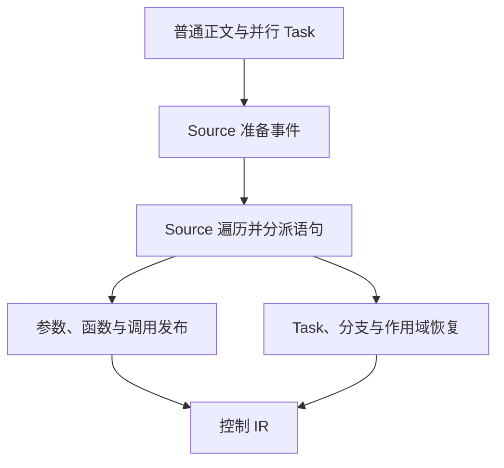

# RX 语句执行与联结自举

## Intent

将 RX 降级后的语句事件、调用参数与函数登记交由 Source 推进。普通正文和并行
Task 共用正式入口，退出 Zig 的事件循环和编译期阶段表。

## Data

批首是 `0b096d57f`。原实现先生成事件列表，再由 Zig 遍历并写入控制 IR。
Call 和 Task 效果借用编译期阶段数组。共享函数检查、Store 槽映射、IR
表达式与控制列写入已经有正式实现，本批复用这些操作。

## Edges

先完整准备语句事件，再开始写入。保留根和分支游标的物理位置、诊断顺序、
出错时的绑定恢复及函数表已提交前缀。并行结果在所有分支完成后一次发布。
函数尾部先登记，再联结初始化器，最后登记入口。共享函数只在未核验快照时
补做初始化器检查。

## Answer

对照正式入口、生成形态、引导产物与已有回归。固定输入比较冷、热生成的墙钟、
CPU 和峰值 RSS，单独构建并检查 seed。

### 迁移结果

普通正文和并行 Task 经过同一个 Source 入口生成并执行语句事件。根与分支游标、
返回值借用、Task 的绑定恢复和并行结果汇合沿用原顺序。普通和并行 Call 共用
参数、getter、Store 槽映射和调用发射。共享函数检查保留原快路径，新增函数按
尾部、初始化器和入口的顺序登记。

旧语句事件循环与编译期阶段表退出正式路径。两个独立计划生成入口由同一个
执行入口替代。宿主继续管理已分配的游标与实体列，负责原子求值和写入。
初始 seed 仍以独立遍历驱动同一批原子操作。

生成的执行循环借用已有事件清单和 Call ID 列，未发现新增临时分配或数组复制。
事件规划仍保留原有预先生成顺序。在同一 ZX 规划函数中准备首帧，去掉跨调用
传递嵌套配置时的一次临时装箱。

### 行为与产物

- Source 引导构建 27 步通过，候选 SHA-256 为
  `b31f1d423e31ab0e256a6e3a9f4401ef2ae139e3f6b2c89294983302f9343c72`。
- 五份清单的 17,706 个引导产物逐字节一致，10 项常驻编辑结果一致。
- 1,025 个构建步骤和 1,190 项 Zig 回归通过，包含编译库 RX 调用、Store
  初始化器联结、并行 Task 与分配失败。49 项 CLI 项目与 Task 用例及
  39 项 seed 回归通过。
- 固定性能输入的 9,894 个生成文件及所有权 memo 逐字节一致。

### 性能

固定 705 个入口、16 分区，关闭常驻生成器。三版工具均由 Source 生成并使用
Source 实现。交错执行三轮，取中位数。峰值为采样进程树 RSS。

| 版本     |  冷墙钟 |  冷 CPU |   冷峰值 |  热墙钟 |  热 CPU |
| -------- | ------: | ------: | -------: | ------: | ------: |
| 固定基线 | 2.09 秒 | 9.02 秒 | 737.6 MB | 1.66 秒 | 6.46 秒 |
| 批首     | 1.95 秒 | 9.49 秒 | 523.7 MB | 1.48 秒 | 6.27 秒 |
| 候选     | 1.96 秒 | 9.47 秒 | 525.5 MB | 1.48 秒 | 6.28 秒 |

较批首，冷生成墙钟增加 0.01 秒，CPU 减少 0.02 秒，进程树峰值增加
1.8 MB，系统记录的单进程峰值增加 1.0 MB。相对固定基线，冷墙钟减少
0.13 秒，CPU 增加 0.45 秒，进程树峰值减少 212.0 MB。无改动路径墙钟
仍为 0.03 秒。
