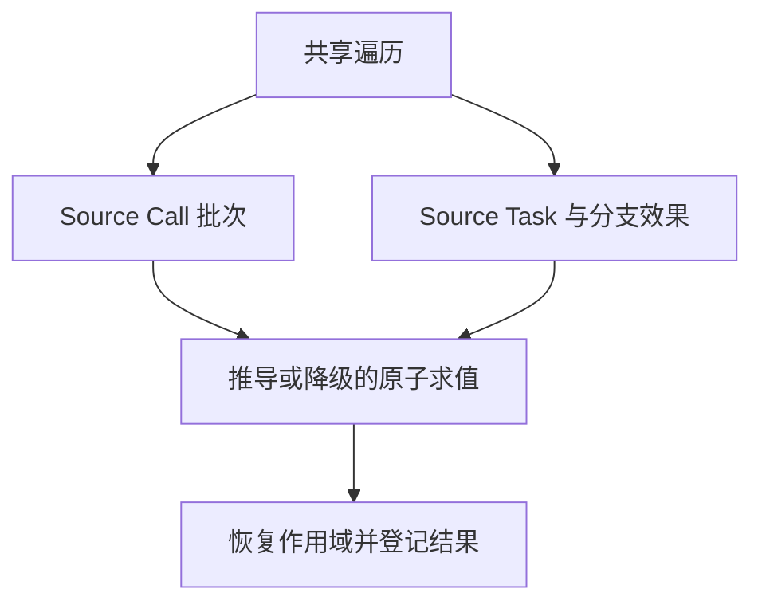

# RX 调用与帧效果自举

## Intent

让共享正文遍历直接推进 Call、Return、Task 和条件分支的效果。类型推导和
降级保留各自的值表示、诊断与存储。撤出依赖阶段枚举表和整段 Zig 调度的入口。

## Data

批首是 `339e198c5`。两个正文入口共用生成的 RX 遍历，单个事件内仍经 Zig
执行。Call 原先按批交给 Zig，推导和降级各自读取一份阶段表。Task 输出和
Case 的求值、作用域恢复也有相同的边界。并行 Task 的降级拥有独立正文和临时区。

## Edges

Call 保留 getter 的可见范围、解析复用、遗漏输入的处理和发布顺序。并行
分支在每个 Call 发布后立即检查原有副作用约束。Task 输出先求值再恢复外部
作用域。Case 标签、收窄条件与入栈按原顺序执行。出错时继续由拥有临时资源
的一层清理。未迁出的专用宿主职责随验收记录更新。

## Answer

以正式调用链退出旧调度、同输入产物一致和已有关联回归为验收条件。持续使用固定
Source 性能基线，记录冷生成、热生成与峰值内存。初始 seed 独立核对。

### 迁移结果

Call 批次由 RX 按原行顺序推进。两个入口共用绑定数快照、准备输入、getter、
参数或 unit、恢复和发布的顺序。降级仍在发布后立即验证并行 Call，源行与
目标 IR 行的对应关系保持原样。Return 的求值与标记或写入由 RX 顺序连接。

普通 Task 先完成正文、再求值输出，恢复绑定后发布。推导的并行 Task 在恢复
外部返回状态前登记任务输出。Case 在标签求值或默认标签处理之后收窄作用域，
再安装子帧。降级的并行 Task 由独立 Source 入口推进正文、效果检查、捕获、
降级、所有权与发布，沿用原临时区和递归入口。

移除旧约束阶段表、旧降级阶段表及两个生成入口。宿主仍处理实际的表达式求值、
Scope 与 IR 列写入、分支退出事务和捕获布局绑定。初始 seed 用原顺序直接调用
相同的原子操作。

### 行为与产物

- Source 引导构建 27 步通过，候选工具 SHA-256 为
  `1a229fc4f428c55059fac3261639476a2330f3d7073c6d4c6fdc8849949af203`。
- 五份清单共 17,685 个生成文件逐字节一致，10 项常驻编辑结果一致。
- 1,016 个构建步骤和 1,164 项 Zig 回归通过，覆盖并行 Task 的推导、真实
  线程执行、失败顺序与分配清理。49 项 CLI 项目与 Task 用例和 39 项 seed
  回归通过。
- 生成代码检查未发现新增堆分配、元素复制或临时对象装箱。
- 固定性能输入的 9,894 个生成产物与所有权 memo 逐字节一致。

### 性能

固定 705 个入口、16 分区，关闭常驻生成器。三版工具均由 Source 生成并
运行 Source，交错运行三轮取中位数。峰值为采样进程树 RSS。

| 版本     |  冷墙钟 |  冷 CPU |   冷峰值 |  热墙钟 |  热 CPU |
| -------- | ------: | ------: | -------: | ------: | ------: |
| 固定基线 | 2.10 秒 | 9.04 秒 | 737.6 MB | 1.64 秒 | 6.44 秒 |
| 批首     | 1.98 秒 | 9.49 秒 | 524.4 MB | 1.43 秒 | 6.27 秒 |
| 候选     | 1.95 秒 | 9.50 秒 | 530.0 MB | 1.46 秒 | 6.26 秒 |

较批首，冷生成墙钟减少 0.03 秒、CPU 增加 0.01 秒，进程树峰值增加
5.6 MB（1.1%），系统记录的单进程峰值也增加 5.6 MB。热生成墙钟增加
0.03 秒、CPU 减少 0.01 秒。较固定基线，冷生成墙钟减少 0.15 秒、CPU 增加
0.46 秒、进程树峰值减少 207.6 MB。无改动路径墙钟仍为 0.03 秒。
