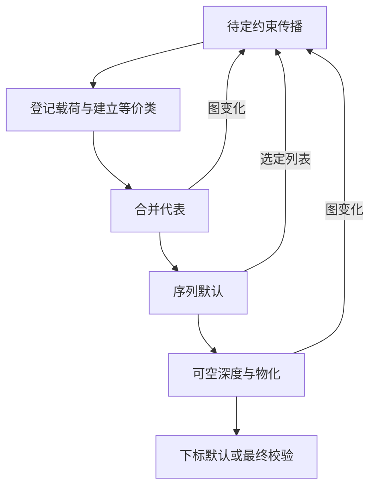

# RX 赋值类与物化自举

## Intent

让 RX 求解器直接推进赋值载荷收集、等价类建立、代表传播、序列默认和可空物化。
共享图视图、赋值边、来源跨度与同一个可复用的 arena。删除阶段间专用 Zig 入口。

## Data

批首为 `fbeea3b93`。上一独立批次退出长度和下标回放宿主，非 seed 包源码
净减 194 行，全仓 Zig 净减 97 行。固定起点以来分别净减 110 行、净增 125 行。

## Edges

顺序保持为先登记未知载荷，再形成等价类。传播改变图时立即重启。图稳定后
先尝试序列，再解可空深度与物化，最后才为未知下标施加默认列表。
物化保留下标待定遮罩和来源跨度。块分配继续由原有 arena 管理，旧 seed 保留。

## Answer

对照 Source 与 seed 的行为和诊断。使用同一固定输入核验生成产物与性能。
按已格式化的 Git 快照复算本批、相邻批次与远端累计差异。

### 迁移结果

求解器直接调用 Source，复用同一轮的赋值边、载荷、等价类、节点图与 arena。
Source 决定登记载荷、传播后重启、序列默认、可空深度诊断、下标遮罩与物化。
物化拆为创建容器及合并，复用代表传播的合并入口。删除四个赋值及序列 Zig
适配文件和六个独立生成入口。保留 Zig 的实体存储预留、跨度读取及原有图操作，
原 seed 逻辑继续独立构建。

移除深度结果的嵌套传递，序列默认明确构造两字段结果。三个受影响入口的生成检查
未发现临时装箱或数组复制。既有序列算法需要的工作区继续由原 arena 分配。

### 行为与产物

- Source 引导构建 27 步通过。候选 SHA-256 为
  `eb780347c946a0007b766fb684b1420b1c319f50a8f8d7c1a17f53e122fa23e0`。
- 153 项 Zig 回归、17 项 CLI 集成和 39 项 seed 回归通过。
- 五份引导清单的 17,632 个产物逐字节一致，10 项常驻编辑结果一致。

- 冻结性能输入的 9,894 个产物及所有权 memo 逐字节一致。

### 性能

705 个入口、16 分区，关闭常驻生成器。三组工具由 Source 生成，运行
同一批 Source 输入，交错三轮取中位数。时间为生成耗时，峰值为进程树 RSS。

| 版本     |  冷墙钟 |  冷 CPU |   冷峰值 |  热墙钟 |  热 CPU |
| -------- | ------: | ------: | -------: | ------: | ------: |
| 固定基线 | 2.09 秒 | 8.96 秒 | 738.0 MB | 1.63 秒 | 6.37 秒 |
| 批首     | 1.93 秒 | 9.40 秒 | 524.3 MB | 1.40 秒 | 6.12 秒 |
| 候选     | 1.92 秒 | 9.44 秒 | 524.6 MB | 1.43 秒 | 6.21 秒 |

较批首冷墙钟减少 0.01 秒、CPU 增加 0.04 秒，进程树峰值增加 0.3 MB，
系统记录峰值减少 6.0 MB。较固定基线冷墙钟减少 0.17 秒、CPU 增加
0.48 秒，进程树峰值减少 213.4 MB。无改动路径墙钟为 0.03 秒。

### 净变化

本批全仓 Zig 新增 278 行、删除 465 行，净减 **187** 行。非 seed 包源码
新增 176 行、删除 455 行，净减 **279** 行。从固定起点 `4c11902b6`
比较完整 Git 快照，全仓 Zig 新增 2,472 行、删除 2,534 行，净减 **62** 行。
非 seed 包源码新增 2,092 行、删除 2,481 行，净减 **389** 行。
