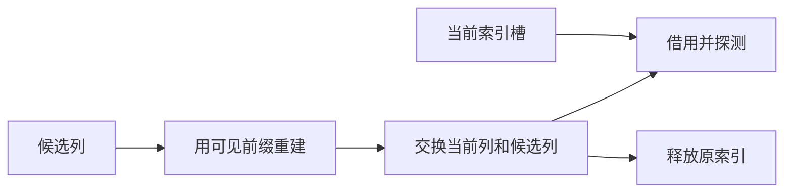

# RX 赋值约束前缀与索引接管自举

## Intent

从 `2cec69c27` 接续。单条和批量登记共用 Source 的已写前缀和图修订提交，Source 接管替换索引的分配、重建、交换和旧缓冲释放。

## Data

约束行依次写入键、端点、散列槽和来源跨度。单条每次提交一个新增行；批量遇到扩容、类型登记或错误时先提交已经写完的前缀。旧宿主分别更新长度、图修订、索引及索引视图。[单条登记](../../packages/compiler/src/rx/analysis/inference/assignment/registration/advance_single.rx) · [批量登记](../../packages/compiler/src/rx/analysis/inference/assignment/registration/advance_batch.rx) · [旧宿主](../../packages/compiler/src/rx/analysis/inference/assignment/registration/host.zig)

## Edges

保留原有探测、增长阈值、容量、分配器和节点跨度。重建失败只释放候选索引，现有索引和行前缀继续可用。重建成功后下一轮从同一索引槽借用。实际行扩容和按来源登记已知节点继续使用原有 Graph 入口。

## Answer

两条正式入口共用 `publish_prefix`。它先提交可见长度，再按本轮新增行数更新图修订。批量游标走到扩容、已知类型登记或错误分支前先发布已完成前缀。

移除三个专用宿主回调，队列和散列表直接借用所属 Graph 的槽位。候选缓冲由通用分配操作同时填好空槽，随后由 ZX 重建已有键。RX 在重建成功后交换两个缓冲并释放旧索引。出错仅释放仍在候选槽的分配。新的索引视图在每次探测前从原槽借用，交换只移动描述符。Zig 保留物理行扩容、注册已知节点的入口及失败后的资源释放。

### 行为与引导验证

- 单条和批量入口定向生成及 RX/ZX lint 通过。生成的索引登记代码只通过显式资源操作分配候选列。
- 由上一阶段的 Source 工具构建候选，27 个引导步骤通过。主编译器、执行、宿主、集合和增长的 17,691 个生成文件逐字节一致。10 个常驻编辑和错误恢复场景的结果与上一批一致。
- 正式路径通过 153 项推导与表达式 Zig 回归及 17 项磁盘项目和 Store CLI 集成，含分配失败覆盖。
- 初始 seed 的 50 个步骤及 39 项 RX 测试通过。候选 Source 引导器 SHA-256 为 `5b3fa6543ce2c1fa6681009b0881ae64d602cacca6444e645f20aa34c9c420af`。

### 性能

固定 705 个入口和 16 个分区，关闭常驻生成器，三轮交错取中位数。三套工具都由 Source 构建，并运行各自的 Source 分析与生成。候选与上一批的 9,894 个冻结生成文件及所有权 memo 一致。各工具冷、热生成的输出也分别一致。

| 对照     | 冷生成墙钟 | 冷生成 CPU | 冷进程树峰值 RSS | 冷系统记录峰值 RSS | 热生成墙钟 | 热生成 CPU |
| -------- | ---------: | ---------: | ---------------: | -----------------: | ---------: | ---------: |
| 固定基线 |     2.07 s |     9.01 s |         739.4 MB |           759.6 MB |     1.63 s |     6.39 s |
| 上一批   |     1.93 s |     9.50 s |         525.3 MB |           549.9 MB |     1.43 s |     6.25 s |
| 候选     |     1.93 s |     9.46 s |         533.9 MB |           551.0 MB |     1.44 s |     6.31 s |

较上一批，冷生成墙钟持平、CPU 减少 0.04 秒，采样的进程树峰值增加 8.6 MB，系统记录峰值增加 1.0 MB。三轮均无子进程。热生成墙钟增加 0.01 秒、CPU 增加 0.06 秒，无修改生成墙钟同为 0.03 秒。较固定基线，冷生成墙钟减少 0.14 秒、CPU 累计增加 0.45 秒，进程树峰值减少 205.5 MB。本次对照覆盖引导生成阶段。
