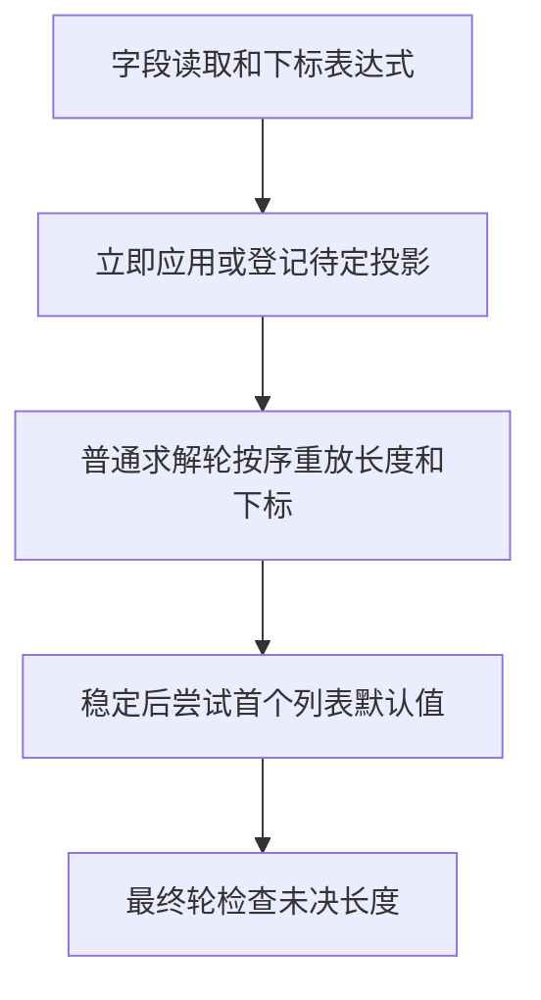

# RX 长度与下标投影自举

## Intent

让 Source 从正式求解入口直接处理长度和下标，连同默认列表、声明类型登记、
投影结果合并和最终报错。退出两套专用回放宿主，复用图列和带来源位置的图操作。

## Data

批首为 `93d704f8c`。计划固定起点 `4c11902b6` 到批首，全仓 Zig 增 222 行，
非 seed 包源码 Zig 增 84 行。此前字段选择与对象构造两批均为净减，
之后的提交已抵消累计净减。

## Edges

保留图修订顺序、仅对第一个未知下标目标推断列表、元组下标诊断的原始范围。
临时图和待定行继续使用原有分配器，图变动后重新借用受影响的列。
保留初始 seed 的独立行为。待定记录在图节点和容量均准备好后发布。

## Answer

使用已有 Source 引导器构建候选。对照相同输入的生成文件、RX 回归、seed
和固定性能基线。核对专用 Zig 调用退出后，用 Git 快照计算本批及主线累计变化。

### 迁移结果

普通与最终求解器直接调用 Source。长度、下标与列表默认共用同一图操作，
保留先登记类型再合并的次序。长度首次读取和下标立即处理由 RX 选择登记。
已知结果在下标回放完成后由 Source 写入 resolved 列。Zig 负责待定行的
实体追加、借用图列与跨度、执行已有图操作。独立 seed 保留既有回放和诊断。

字段计划直接构造两个标量组成的返回值，消除了本次生成检查发现的临时装箱。
三个受影响入口的生成代码无分配调用。旧长度回放、下标回放与独立未决扫描
生成入口退出正式构建。

### 行为与产物

- Source 引导构建 27 步通过。候选 SHA-256 为
  `c36df3d9b7bab512d0b67b1340a8f1aa97996bedc092f2c97c77cbaf3c64d5c1`。
- 153 项 Zig 回归、17 项 CLI 集成和 39 项 seed 回归通过。
- 五份清单 17,679 个引导产物逐字节一致，10 项常驻编辑结果一致。
  固定性能输入的 9,894 个产物及所有权 memo 一致。

### 性能

705 个入口、16 分区，关闭常驻生成器。三组工具由 Source 生成并运行 Source，
交错三轮取中位数。表中时间为生成耗时，峰值为进程树 RSS。

| 版本     |  冷墙钟 |  冷 CPU |   冷峰值 |  热墙钟 |  热 CPU |
| -------- | ------: | ------: | -------: | ------: | ------: |
| 固定基线 | 2.11 秒 | 9.01 秒 | 738.1 MB | 1.63 秒 | 6.43 秒 |
| 批首     | 1.95 秒 | 9.55 秒 | 529.9 MB | 1.44 秒 | 6.27 秒 |
| 候选     | 1.94 秒 | 9.48 秒 | 530.7 MB | 1.44 秒 | 6.23 秒 |

较批首冷墙钟减少 0.01 秒，CPU 减少 0.07 秒，进程树峰值增加 0.8 MB，
系统记录峰值减少 4.7 MB。相对固定基线冷墙钟减少 0.17 秒，CPU 增加
0.47 秒，进程树峰值减少 207.4 MB。无改动路径仍为 0.03 秒。

### 净变化

本批全仓 Zig 新增 270 行、删除 367 行，净减 **97** 行。非 seed 包源码
新增 166 行、删除 360 行，净减 **194** 行。固定起点以来全仓仍净增
**125** 行，非 seed 包源码净减 **110** 行。继续迁移由共享赋值状态驱动的
默认推断和物化。
