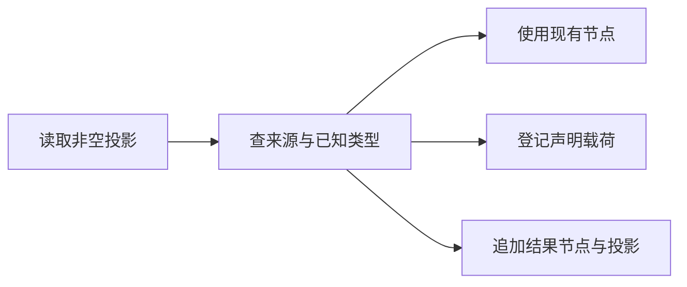

# RX 非空读取与投影回放自举

## Intent

从 `81d581097` 接续。将非空读取、待定投影和普通及最终求解轮的回放连到 Source。把单次登记、节点追加和图合并排在 RX 中，沿用物理列和源码跨度。

## Data

非空读取先查当前来源。已知现成的内层节点可直接返回，已声明但未登记的载荷需要登记，未知形状要生成结果节点并记录投影。最终轮在结果形状已知时可以反推来源为可选类型。[非空读取](../../packages/compiler/src/rx/analysis/inference/non_null.zig) · [扫描规则](../../packages/compiler/src/rx/analysis/inference/non_null/scan.zx)

## Edges

保留声明载荷的预算、登记顺序、原跨度和节点增长失败行为。回放按原行序合并并重新借用已更新的图和已知类型索引。最终轮保留以图修订判断是否重启。初始 seed 维持原路径。

## Answer

非空读取直接复用 Source 的护卫查询，按结果返回现有节点、登记声明载荷或追加待定投影。新投影沿原顺序先发布结果节点，再预留并写入投影的来源、结果和跨度，最后增加投影表的可见长度。声明载荷沿用原预算，写入保留使用点跨度。

普通和最终求解轮直接调用 Source 回放。回放区分已知类型登记、直接合并和反向推断。反向推断复用普通节点追加，成功合并后才重新借用图列与已知类型表。最终轮在回放前后比较原图修订。

撤下旧的非空求解转发、带布尔参数的复合回放接口，以及可选查询内原来的护卫分支。Zig 继续提供容量、视图和单次图操作。初始 seed 保留原写入及回放顺序。

### 行为与引导验证

- 非空读取和求解器定向生成通过，RX/ZX 格式和 lint 通过。读取和最终轮反推均复用普通节点发布。
- 由上一阶段 Source 引导，27 个构建步骤通过。主编译器、执行、宿主、集合和增长五份清单共 17,686 个生成文件逐字节一致。10 个常驻编辑和错误恢复场景的结果与上一批一致。
- 153 项正式 Zig 回归、17 项 CLI 集成和 39 项初始 seed 测试通过。既有回归覆盖可选参数推导、合并、跨模块登记和分配失败。
- 候选引导器 SHA-256 为 `af167063baf35ef8e12864ac08abb8431f8d261f39969c2084517aa3e5bcf5c1`。

### 性能

固定 705 个入口和 16 个分区，关闭常驻生成器，三轮交错取中位数。三套工具都由 Source 构建，并运行各自的 Source 分析与生成。候选与上一批的 9,894 个冻结生成文件及所有权 memo 一致。各工具冷、热生成输出分别一致。

| 对照     | 冷生成墙钟 | 冷生成 CPU | 冷进程树峰值 RSS | 冷系统记录峰值 RSS | 热生成墙钟 | 热生成 CPU |
| -------- | ---------: | ---------: | ---------------: | -----------------: | ---------: | ---------: |
| 固定基线 |     2.08 s |     8.96 s |         738.3 MB |           791.5 MB |     1.64 s |     6.41 s |
| 上一批   |     1.93 s |     9.49 s |         528.9 MB |           551.1 MB |     1.43 s |     6.26 s |
| 候选     |     1.95 s |     9.50 s |         526.2 MB |           547.6 MB |     1.44 s |     6.22 s |

较上一批，冷生成墙钟增加 0.02 秒、CPU 增加 0.01 秒，进程树峰值减少 2.7 MB，系统记录峰值减少 3.6 MB。热生成墙钟增加 0.01 秒、CPU 减少 0.04 秒，无修改生成墙钟同为 0.03 秒。较固定基线，冷生成墙钟减少 0.13 秒、CPU 累计增加 0.54 秒，进程树峰值减少 212.2 MB。本次对照覆盖引导生成阶段。
