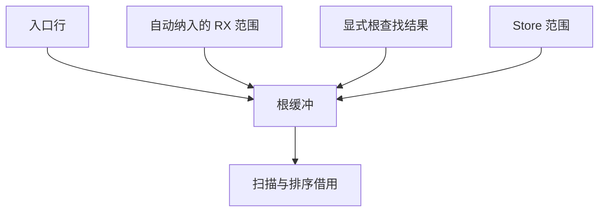

# RX 项目依赖根写入自举

## Intent

让正式混合项目的 Source 流程直接准备并写入依赖扫描的根列表。
保留入口、自动纳入的 RX 模块、显式根及 Store 根的顺序和诊断。

## Data

批首远端为 `4232a8e62`。从 `source_graph.build` 进入 Source 后，
根列表仍通过四个专用 Zig 接口分配、写连续区间、写显式根及结束。
区间写入还需要一次单独的引导生成入口。

## Edges

入口解析先于根列表分配，显式根逐个按原顺序解析。继续用同一索引和
宿主路径解析规则。根缓冲保留在结果区，扫描及拓扑排序直接借用。

## Answer

Source 用共有缓冲区能力分配并填写所有根，向扫描阶段交付额外根数量。
删除专用容量和写入接口，入口和显式根共用路径查找。初始 seed 保留自己的
区间写入，原生仍负责路径解析和目标字长的物理视图交付。

根列表和项目入口共用实际结果列，移除了原生入口行副本。正式路径退出
`allocateSourceGraphRoots`、`writeSourceGraphRootRange`、
`writeSourceGraphRoot`、`finishSourceGraphRoots` 和
`generated_source_graph_root_rows`。非 seed 包源码净减 33 行，
全仓 Zig 净减 34 行。

### 验证

批首 Source 引导器构建候选通过 30 个步骤和 39 项 RX 测试。初始 seed
构建引导器和解析器通过 52 个步骤，两条路径按同一份五阶段清单执行 Source
生成，17,719 个文件逐字节一致。候选正式编译器通过 113 个步骤、285 项
Zig 测试和 45 项 CLI 用例，覆盖 RX 项目构建、模块记录、表达式和 watch。

### 性能

批首和候选均由 Source 引导器生成并执行 Source。以固定 705 个入口、
16 分区和关闭常驻生成器的配置交错测三轮，9,894 个生成文件与所有权
memo 一致。冷墙钟均为 1.95 秒，CPU 从 9.49 降至 9.43 秒，进程树
峰值 RSS 从 529.3 降至 524.3 MB，单进程峰值增加 2.7 MB。相对固定
基线，冷墙钟减少 0.15 秒，CPU 增加 0.42 秒，进程树峰值 RSS 减少
213.5 MB。热墙钟从 1.45 变为 1.46 秒，无改动均为 0.03 秒。

两版 CLI 分别从入口检查 1,203 个模块，交错五轮的输出一致。中位墙钟
从 0.25 变为 0.26 秒，CPU 均为 0.25 秒，峰值 RSS 均约 78.9 MB。
