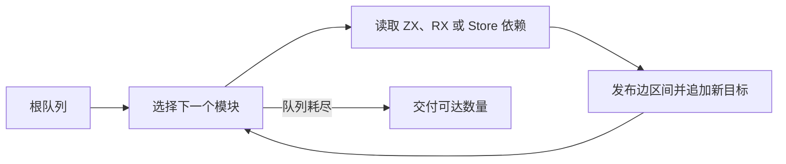
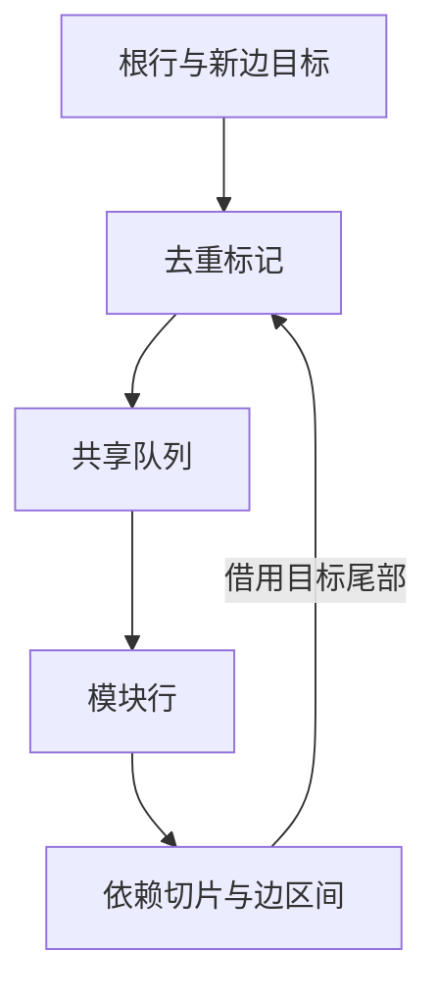

# RX 项目可达扫描自举

## Intent

让混合项目的 Source 可达扫描从根开始，顺序消费依赖边、记录范围并推进
待访问队列。兼容同一项目中的 ZX、RX 和 Store，保留已有错误顺序。

## Data

批首为 `14f8b4c16`。正式 `source_graph.build` 在收集每个模块的依赖后进入 Zig
`Scan.finish`，再调用单独生成的 `frontier.advance`，由 Zig 保存
队列游标、边尾和已达数量。起始根也经过同一 Zig 往返流程。每个模块的
边来源与解析版本由现有解析缓存交付。

## Edges

第一次入队按入口、额外根、Store 的原顺序，随后按每个模块的依赖遇见
顺序入队。去重使用同一张可写标记列。每轮消费新的目标尾部切片后才
进入下一模块，依赖收集临时区继续在同一轮释放。

## Answer

RX 使用 Loop 串联模块读取、依赖发布和队列推进。已有 ZX 规则继续处理
去重与选择。初始 seed 保留自己的队列算法，正式路径从宿主借物理列、解析
结果与新增目标切片。

正式路径退出 `firstSourceGraphVisit`、`finishSourceGraphVisit` 及
`generated_source_graph_frontier`。已知模块行直接用于发布起止位置，
省去在队列中回读旧行。生成的原生绑定直接返回目标尾部切片。
本批非 seed 包源码净减 39 行，全仓 Zig 净减 40 行。

### 验证

批首 Source 构建候选通过 30 个步骤和 39 项 RX 测试。初始 seed 构建引导器
和解析器通过 52 个步骤。两条路径执行相同的五阶段 Source 清单，17,710 个
生成文件逐字节一致。候选正式编译器通过 113 个步骤、285 项 Zig 测试和
45 项 CLI 用例，覆盖模块记录、混合项目构建、RX 路径及 watch。

### 性能

批首和候选都由 Source 引导器生成并执行 Source。固定清单包含 705 个
入口，使用 16 分区并关闭常驻生成器。同机交错三轮的 9,894 个生成文件和
所有权 memo 逐字节一致。冷墙钟从 1.97 变为 1.95 秒，CPU 从 9.53 降至
9.47 秒，进程树采样峰值 RSS 从 524.5 变为 530.0 MB，两个版本的观测范围
重叠。单进程峰值 RSS 从 548.1 降至 542.9 MB。相对固定基线，冷墙钟
减少 0.16 秒、CPU 增加 0.41 秒、进程树峰值 RSS 减少 207.9 MB。

热墙钟从 1.45 变为 1.47 秒，热 CPU 从 6.30 变为 6.33 秒。
两版无改动路径均为 0.03 秒。

两版 CLI 分别从入口检查 1,203 个模块，交错五轮的输出一致。墙钟与
CPU 中位数均为 0.25 秒，单进程峰值 RSS 中位数均为 78.7 MB。
