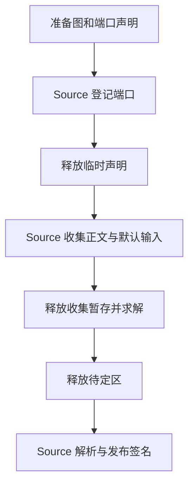

# RX 项目约束生命周期自举

## Intent

在一个 Source 项目入口中依次完成端口登记、正文约束收集、图求解和签名交付。
移除各阶段从 Zig 再启动生成代码的入口。把临时区释放放在可追踪的阶段边界。

## Data

批首为 `af1f69c54`。四个阶段已有 Source 实现，项目入口仍经原生阶段函数
创建请求并分别执行。签名和赋值校验已经复用节点解析及类型列发布。

## Edges

声明解析结果只活到端口写入。收集临时区在求解前释放。待定行活到图求解成功，
签名继续使用项目图、节点解析缓冲以及结果区的端口和绑定列。最后一次复制诊断
发生在项目所有者释放图及位置映射前。保留初始 seed 的原有执行顺序。

## Answer

沿正式 Source 入口核对调用及资源寿命，检查生成形态和绑定 ABI。集中运行
RX、CLI、seed 与固定清单对照，核验旧阶段入口退出后提交推送。

### 迁移结果

端口、正文约束、求解和签名四个阶段由项目 Source 入口直接调用。各阶段借用
同一项目的列，签名解析继续复用最终赋值校验使用的帧和值缓冲。端口声明区与正文
暂存区各自在阶段结束时释放。求解成功后释放求解器暂存和待定区，随后交付签名、
任务索引和类型表。项目错误统一在位置映射和诊断仍有效时交付。

移除四个独立生成入口及三处原生阶段转发。正式路径继续借用 Zig 提供的物理列、
分配器和诊断位置。Args 的声明解析与正文的语句帧调度仍有独立原生入口。
生成检查未发现为同一项目状态跨阶段调用新增临时装箱或整列复制。

### 行为与产物

- Source 引导构建 27 步通过，候选 SHA-256 为
  `f3ef586d51e8160adf3ab0a231134056086546fd94da2397e0d53fa5e6e07af1`。
- 153 项 Zig 回归、17 项 CLI 集成和 39 项 seed 回归通过。
- 五份引导清单的 17,651 个产物逐字节一致，10 项常驻编辑结果一致。
- 冻结性能清单的 9,894 个产物及所有权 memo 逐字节一致。

### 性能

705 个入口、16 个分区，关闭常驻生成器。三个工具均由 Source 构建并运行
Source 管线，交错三轮取中位数。时间为生成耗时，峰值为进程树 RSS。

| 版本     |  冷墙钟 |  冷 CPU |   冷峰值 |  热墙钟 |  热 CPU |
| -------- | ------: | ------: | -------: | ------: | ------: |
| 固定基线 | 2.09 秒 | 9.05 秒 | 737.6 MB | 1.65 秒 | 6.43 秒 |
| 批首     | 1.94 秒 | 9.49 秒 | 530.3 MB | 1.45 秒 | 6.27 秒 |
| 候选     | 1.95 秒 | 9.53 秒 | 530.2 MB | 1.45 秒 | 6.30 秒 |

较批首冷生成墙钟增加 0.01 秒、CPU 增加 0.04 秒，进程树峰值基本持平，
系统记录峰值减少 7.5 MB。较固定基线冷生成墙钟减少 0.14 秒、CPU 增加
0.48 秒、进程树峰值减少 207.4 MB。无改动路径墙钟仍为 0.03 秒。
