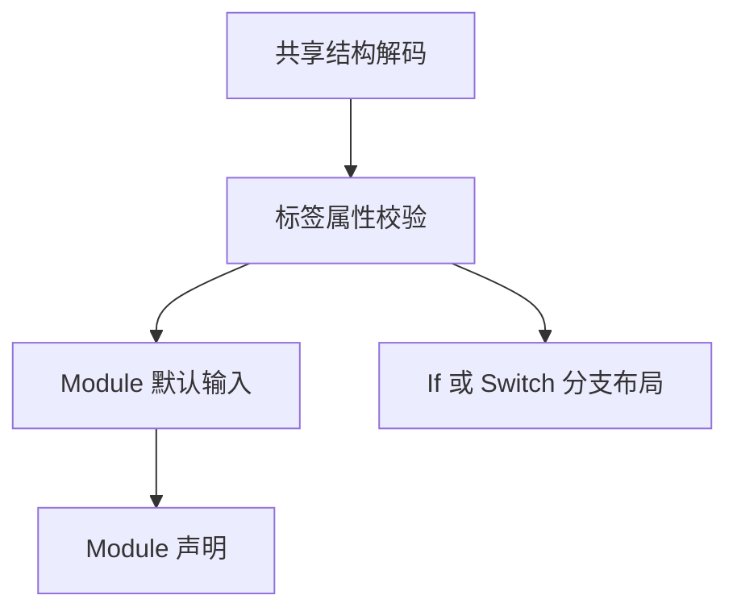
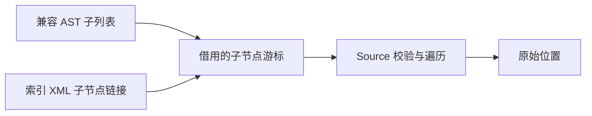

# RX 默认输入与分支校验自举

## Intent

让正式 Module、If 和 Switch 的默认输入、声明顺序与分支校验直接读取
兼容 AST 或索引化 XML，由 Source 运行规则及遍历。

## Data

批首为 `dd7d2b004`。默认输入在索引化入口使用已经生成的诊断或另一
套索引扫描，兼容树遍历仍在 Zig。Module 的声明以及 If、Switch 的
分支列需要由 Zig 遍历、分配并逐项准备。它们共享已经通过结构解码的子节点。

## Edges

保持先完成结构解码、再检查属性值、最后检查细化规则的顺序。
Module 的缺失输入先于声明诊断，重复 Type 优先于声明位置和重复
Store。Switch 的重复 Case 优先于重复 Default，文本与表达式各有
独立的键集合。位置仍指向原子节点或属性值。

## Answer

正式 Module、If 和 Switch 由同一个借用游标读取两个视图。Source 直接
运行默认输入遍历、声明顺序、重复键和分支位置规则。移除兼容树的 Zig
递归入口、索引视图的单独生成规则和 Zig 的声明及分支准备循环。

已索引的默认输入诊断继续直接使用。两种视图按相同的前序规则处理没有
索引结果的调用，Parallel 分支仍分别决定输入。Zig 保留视图绑定、
错误位置交付及通用 DSL 结果填充，自定义视图和初始 seed 沿用既有规则。

### 大量分支的工作空间

首版直接用了不可变的普通字节索引。生成代码在插入时逐次复制桶列，
2,500 个 Case 的样本将进程峰值 RSS 从约 13 MB 推到了约 167 MB。
Module 和 Switch 现在共用按需一次预留的桶列和借用字符串槽。
Source 在已有桶列中原位插入，独立区分两类键，并保持既有诊断优先级。

用同一文件对批首和候选 CLI 交错测五轮，输出一致。普通集合检查的
中位墙钟和 CPU 均为 0.02 秒，单进程峰值从 13.16 变为 13.24 MB。
索引视图 `lint` 墙钟均为 0.05 秒，CPU 从 0.04 变为 0.05 秒，
峰值从 12.63 变为 13.29 MB。

### 验证

批首 Source 构建候选通过 30 个步骤、39 项 RX 测试。初始 seed
构建引导器和解析器通过 52 个步骤。两条路径执行同一五阶段 Source
清单，17,751 个生成文件逐字节一致。

正式编译器通过 124 个步骤、423 项 Zig 测试，以及 112 项 CLI 和
lint 用例、55 次属性执行、6 项属性语义拒绝。两版 CLI 对 40 个既有
索引视图文件的退出码、输出和诊断逐字节一致。

### 固定清单性能

三个引导器均由 Source 生成并实际执行 Source。以 705 个入口、16 分区、
关闭常驻生成器的配置交错运行三轮。9,894 个生成文件与所有权 memo
逐字节一致。

| 版本     |  冷墙钟 |  冷 CPU | 冷进程树采样峰值 RSS |  热墙钟 |  热 CPU |
| -------- | ------: | ------: | -------------------: | ------: | ------: |
| 固定基线 | 2.08 秒 | 9.02 秒 |             737.3 MB | 1.63 秒 | 6.43 秒 |
| 批首     | 1.94 秒 | 9.48 秒 |             529.4 MB | 1.43 秒 | 6.26 秒 |
| 候选     | 1.95 秒 | 9.51 秒 |             532.0 MB | 1.44 秒 | 6.25 秒 |

较批首，冷墙钟增加 0.01 秒、CPU 增加 0.03 秒，进程树采样峰值 RSS
增加 2.6 MB、单进程峰值减少 1.4 MB。相对固定基线，冷墙钟减少
0.13 秒、CPU 增加 0.49 秒、进程树采样峰值 RSS 减少 205.3 MB。

两版 CLI 从同一入口检查 1,203 个模块，交错五轮，输出一致。中位墙钟及
CPU 均为 0.25 秒，单进程峰值约 78.8 MB。
