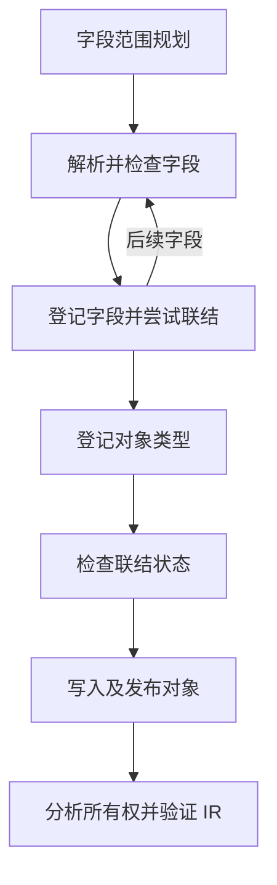

# Store 初始化器自举

## Intent

将 Store 初始值的字段范围推进、解析联结、错误处理和对象发布接入同一 Source
流程。移除手写字段循环和独立的对象生成调用。

## Data

批首是 `83d4e7de4`。字段范围和对象位置计算已由 ZX 完成，字段处理阶段仍由
Zig 推进。表达式联结已经迁入 Source，列预留与提交可复用通用列范围操作。

## Edges

保持字段声明次序，单个字段结束后释放解析和推导结果。字段诊断立即结束扫描。
联结失败后继续解析、验证和登记剩余字段，类型登记完成后再报告联结失败。
内存不足直接返回。对象写入完成后公布列长度并按原顺序分析所有权、校验 IR。

## Answer

对照同一引导输入和受影响的 Store 运行、库初值及失败回归。核对旧调用链退出，
按固定输入比较冷、热生成和内存，独立检查 seed。

### 迁移结果

正式 Store 初值入口通过 Source 扫描字段范围，推进字段下标，保留首次联结失败的
状态，并执行对象列预留、写入和长度发布。移除了原有 Zig 字段迭代、初值阶段表、
专用列尾适配和三个独立生成入口。Zig 仍持有解析结果的寿命、表达式分析接口以及
物理列的借用。每个字段成功后释放临时结果，提前失败时由最外层统一清理。
同一套通用列尾描述也由 RX 表达式联结复用。

### 行为与性能

- Source 引导构建 27 步通过，最终工具 SHA-256 为
  `2bed541dcd0bb641513915b99c70d87dd8f60dd3ecce412d4a6fc10e84d592d7`。清理已退出的阶段枚举后重新通过引导构建。
- 1,062 个构建步骤、1,313 项 Zig 回归及 66 项 CLI 用例通过，覆盖 Store 初值、
  多库复用、别名和失败清理。39 项初始 seed 回归通过。
- 五份 Source 清单共 17,667 个文件逐字节一致，10 项常驻编辑结果一致。
- 固定输入为 705 个入口和 16 分区。三版工具由 Source 生成并执行 Source，
  关闭常驻生成器，交错运行三轮取中位数。9,894 个生成文件与所有权 memo
  逐字节一致。

| 版本     |  冷墙钟 |  冷 CPU | 冷进程树峰值 RSS |  热墙钟 |  热 CPU |
| -------- | ------: | ------: | ---------------: | ------: | ------: |
| 固定基线 | 2.05 秒 | 8.96 秒 |         738.1 MB | 1.62 秒 | 6.40 秒 |
| 批首     | 1.92 秒 | 9.45 秒 |         524.8 MB | 1.44 秒 | 6.24 秒 |
| 候选     | 1.92 秒 | 9.43 秒 |         528.5 MB | 1.43 秒 | 6.17 秒 |

较批首，冷墙钟持平、CPU 减少 0.02 秒，采样的进程树峰值增加 3.8 MB，
系统记录的单进程峰值减少 4.9 MB。较固定基线，冷墙钟减少 0.13 秒，
CPU 增加 0.47 秒，进程树峰值减少 209.6 MB。无改动路径为 0.03 秒。
固定输入衡量整个生成工具，Store 初值正确性由正式 Store 和库回归验证。
候选生成的初值流程未增加跨阶段堆分配。

同一份已存在的 Store 库发布样例交错测三轮。冷构建墙钟由 4.43 秒变为
4.44 秒，CPU 同为 4.37 秒，系统记录的峰值 RSS 由 1,186,398,208 字节变为
1,186,349,056 字节。热构建两版均为 0.03 秒，14 个发布文件逐字节一致。

### 净变化

本批非 seed 包源码 Zig 新增 394 行、删除 275 行，净增 119 行。全仓 Zig
新增 443 行、删除 278 行，净增 165 行。列视图和仍由宿主保有的字段分析
状态抵消了旧调度和列写入的删除，未计为连续净减批次。
