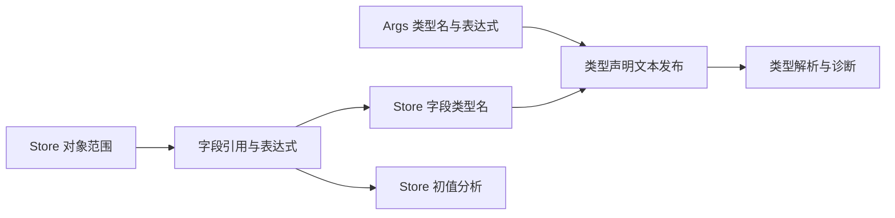
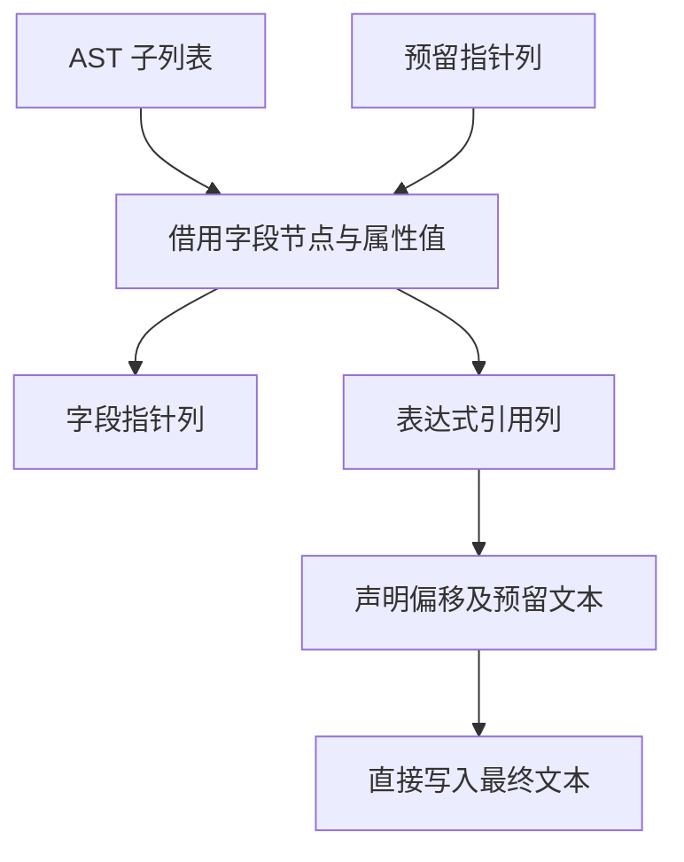

# Store 字段与 RX 类型文本发布自举

## Intent

让 Source 从已校验的 Store 分组直接发布字段引用和类型表达式，并与
Args 共用类型声明文本的容量计算和写入。保持下游类型解析、诊断及初值行为。

## Data

批首为 `3f0b4ea68`。Store 分组已交付对象范围。正式 `Layout.build`
仍逐字段写入原节点地址和类型文本引用，同时 Store 与 Args 各由 Zig
分配类型声明缓冲，再调用独立的生成写入入口。

## Edges

字段顺序沿用分组前的原对象和成员顺序。借用已解码的属性值，后续
诊断定位继续使用原 AST。共享文本保留原命名、分隔符、字节偏移和换行。
生成代码的普通 Zig 静态链接与应用运行时边界保持一致。

## Answer

沿正式入口移除 Zig 的字段遍历和两处类型声明写入编排。保留 seed 路径
和结果所属区。集中验证 Store 字段类型、诊断位置、初值执行、Args 类型
复用、引导文件一致性及大输入的时间和内存。

正式路径直接从已校验的片段范围写入字段节点指针和借用的属性文本。Store
和 Args 共用 Source 的偏移计算与最终字节缓冲写入，退出两处 Zig 文本
写入编排及单独的 Args 写入生成入口。旧字段遍历仅供初始 seed 使用。

- 423 项 Zig 回归、39 项 RX 回归、11 个 RX CLI 场景、46 项应用入口
  检查通过。40 个现有夹具的 lint 结果相同，Args 和 Store 两个现有
  执行入口生成的 Zig 逐字节一致。
- 初始 seed 与批首 Source 引导器生成的五组清单共 17,788 个文件一致。
  固定性能清单的 9,894 个生成文件及所有权 memo 在批首与本批一致。
- 固定输入由正式 Source 工具执行。冷生成用时 1.99 秒，CPU 9.51 秒，
  进程树峰值 525.5 MB。较批首分别增加 0.05 秒、0.03 秒、2.2 MB，
  单进程峰值增加 8.3 MB。较固定基线墙钟减少 0.10 秒、CPU 增加
  0.47 秒、进程树峰值减少 212.0 MB。暖生成的墙钟与 CPU 分别减少
  0.01 秒和 0.03 秒。
- 两个同名片段的 2,500 字段入口检查墙钟为 0.23 秒、CPU 为 0.22 秒，
  和批首相同。2,500 个单字段对象入口检查墙钟与 CPU 各增加 0.01 秒，
  单进程峰值均约 192 MB。两组输入的 lint 输出、墙钟和 CPU 一致。
