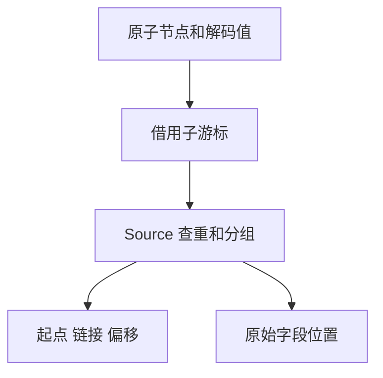

# Store 对象分组与字段校验自举

## Intent

让正式 Store 的别名校验、对象分组、字段范围和冲突定位直接读取已解码的
兼容 AST 或索引视图。分组结果供后续类型和初值分析继续借用。

## Data

批首为 `192e9e571`。Store 校验从 Zig 的标签、别名、对象名和字段名临时
列进入 Source。Object 的字段去重还会逐项复制名称描述符。分组结果含
对象起点、同名片段链接和字段偏移。

## Edges

单对象继续用静态分组。重复 Type 优先于 Type 位置和缺少 Object。
同组字段冲突指向首个冲突片段，片段内优先选择与最早先前片段重复的
字段，其次按成员顺序。不同组的字段名相互独立。

## Answer

分组列直接写入结果所属区，以临时区保留去重索引和游标。优先复用上批
的原位索引与两种子节点视图。集中核对 Store 诊断、分组后实际执行、
引导生成和大量片段的内存成本。

### 迁移结果

- Store 和 Object 在通过结构解码后直接借用原子节点。Source 校验别名、
  顺序与字段名，退出 Zig 的标签、别名、对象名、字段名收集以及二次
  冲突位置回查。
- Source 仅对多个对象写入分组起点、片段链接与字段范围，已有类型分析
  继续借用这些列。单对象仍使用静态起点和空链接，多个互异对象无需扫描
  字段冲突。
- 同名片段按组检查。去重表返回最初登记行，以便恢复同一片段内的诊断
  优先级。表项只持有原名称的切片，桶原位写入，冲突结果直接指向原字段。
- 初始 seed 与扩展视图沿用兼容校验。两处旧 Zig 分组收口为同一个
  兼容实现，正式编译器实际使用的两种 AST 视图由 Source 处理。

### 验证

批首 Source 构建候选通过 30 个步骤和 39 项 RX 测试。初始 seed
构建引导器和解析器通过 52 个步骤。两条路径执行同一五阶段 Source
清单，17,780 个生成文件逐字节一致。

正式编译器通过 124 个步骤、423 项 Zig 测试、112 项 CLI 和 lint
用例、55 次属性执行、6 项属性语义拒绝。覆盖同名分片、字段位置、
分配失败与 Store 状态执行。40 个既有索引视图文件的退出码、输出
及诊断一致。

### 固定清单性能

三个引导器均由 Source 生成并实际执行 Source。同机以 705 个入口、
16 分区和关闭常驻生成器的配置交错运行三轮。9,894 个生成文件及
所有权 memo 逐字节一致。

| 版本     |  冷墙钟 |  冷 CPU | 冷进程树采样峰值 RSS |  热墙钟 |  热 CPU |
| -------- | ------: | ------: | -------------------: | ------: | ------: |
| 固定基线 | 2.08 秒 | 9.00 秒 |             737.9 MB | 1.63 秒 | 6.42 秒 |
| 批首     | 1.94 秒 | 9.47 秒 |             524.8 MB | 1.44 秒 | 6.27 秒 |
| 候选     | 1.94 秒 | 9.45 秒 |             525.9 MB | 1.45 秒 | 6.27 秒 |

较批首，冷墙钟持平，CPU 减少 0.02 秒，进程树采样峰值 RSS 增加
1.1 MB，单进程峰值增加 5.5 MB。相对固定基线，冷墙钟减少 0.14 秒、
CPU 增加 0.45 秒、进程树采样峰值 RSS 减少 212.0 MB。

### 大量字段与对象

批首和候选 CLI 对每个样本交错运行五轮。两个同名片段合计 2,500
个互异字段，另一个样本含 2,500 个独立的单字段对象。两版输出一致，
下表为中位墙钟及单进程峰值 RSS。

| 输入         | 入口       | 墙钟              | 单进程峰值 RSS      |
| ------------ | ---------- | ----------------- | ------------------- |
| 两个同名片段 | `check-rx` | 0.31 秒 → 0.23 秒 | 434.0 MB → 125.9 MB |
| 两个同名片段 | `lint`     | 0.08 秒 → 0.04 秒 | 216.5 MB → 12.4 MB  |
| 2,500 个对象 | `check-rx` | 1.03 秒 → 0.97 秒 | 388.4 MB → 191.7 MB |
| 2,500 个对象 | `lint`     | 0.09 秒 → 0.06 秒 | 175.1 MB → 17.1 MB  |
