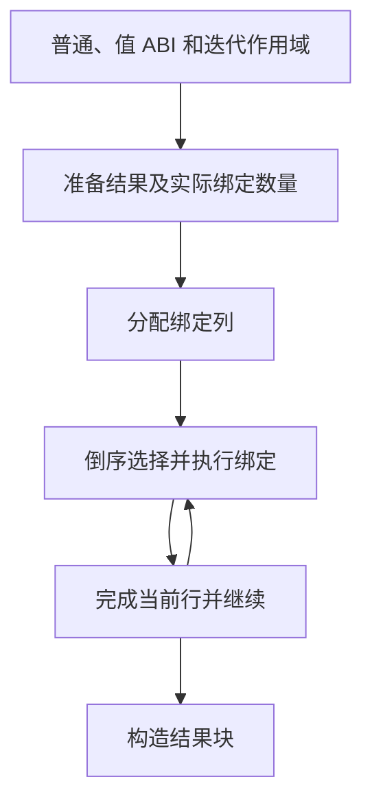

# genz 作用域绑定与写回自举

## Intent · 迁移三条作用域入口的绑定生命周期

从 `c3993d2bc` 起，普通、值 ABI 和迭代作用域共用 Source 的结果准备、
工作区交接、倒序绑定和写回。退出 Zig 的请求状态、逐项参数提取和独立
调度入口。

## Data · 正式入口

`scope.lowerMode` 和 `iteration_value.scope.lower` 进入同一执行层。
旧 `advanceScopeBinding` 按行把读视图交给 Source，再从请求槽中提取
操作数和类型。绑定结果先写 Zig 暂存槽，再在下一轮发布。

## Edges · 保持求值时机和借用

先处理结果消费，再按原规则分配实际绑定容量。倒序处理时从当前栈索引
读取成员，递归引起的扩容不会让后续绑定持有旧切片。迭代绑定先降低值，
再按符号使用情况降低类型。旧段的块写入、序列错误清理与名称撤销保持
现有资源归属。Zig 继续执行物理缓冲区分配、AST 节点写入和帧解绕。

普通绑定的宿主回调只在帧中交付当前 AST 区间。Source 在继续下一行前
把区间写入对应列，省掉跨轮回传的请求。同一帧借用原索引与列描述符，
递归后重新读取索引切片。正式的值入口及其 29 个生成调用体不含临时
对象分配，暂存列仍沿用原先的栈内和 arena 分配。

## Answer · 验收

沿三条入口核对旧请求槽和专用调度退出。复用阶段引导器，对照五份引导
清单及固定清单产物，运行作用域、迭代、聚合和 Task 回归，记录冷暖生成
的墙钟、CPU 和内存峰值。

- 复用 `c3993d2bc` 的 Source 引导器构建 ReleaseSmall 候选，保留 16 个主
  生成分区。372 项编译器测试通过。
- 批首与候选运行同一套 main、execution、host、collections 和 growth 清单。
  除编译器身份输入戳外，17,860 个文件逐字节一致。
- 作用域分支、值返回、迭代跨调用、聚合循环和 Task 生命周期回归均通过。
  应用回归共 358 项测试和 324 个构建步骤。迭代跨调用覆盖源码、编译库
  和 CLI 重新发布后的执行。

固定兼容清单沿用相同工具链、分区和缓存配置，关闭常驻生成后交错测量
三次。三个引导器本体均由 Source 生成，测量使用 Source 分析及生成。
下表为冷生成中位数。

| 引导器                             |   墙钟 |    CPU | 采样进程树峰值 RSS | 单进程峰值 RSS |
| ---------------------------------- | -----: | -----: | -----------------: | -------------: |
| 固定基线 `declaration-preparation` | 2.09 s | 9.01 s |          737.25 MB |      760.04 MB |
| 批首 `c3993d2bc`                   | 1.96 s | 9.48 s |          524.32 MB |      547.32 MB |
| 候选                               | 1.94 s | 9.49 s |          523.81 MB |      543.44 MB |

较批首，冷生成墙钟减少 0.02 秒，CPU 增加 0.01 秒，进程树峰值减少
0.51 MB，单进程峰值减少 3.88 MB。较固定基线，墙钟减少 0.15 秒，CPU
增加 0.48 秒，进程树峰值减少 213.43 MB。热生成墙钟保持 1.44 秒，CPU
从 6.24 秒到 6.25 秒。无修改生成保持 0.03 秒。冻结清单对照和冷暖对照
的 9,894 个产物均逐字节一致。
