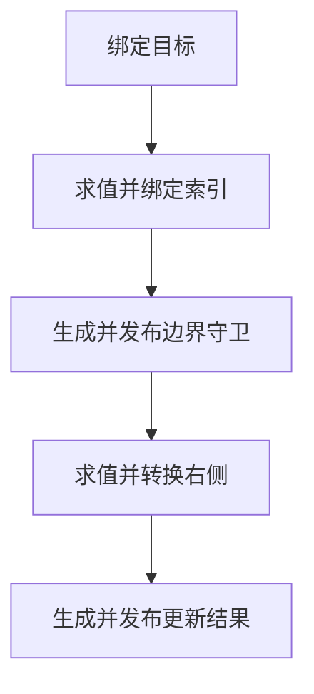

# genz 列表下标更新与 AST 发布自举

## Intent

从 `887143a1b` 接续，将列表下标更新的目标、索引、守卫、右侧和
写入顺序迁入 RX。列表操作、增长、下标更新与守卫复用 AST 发布接口。

## Data

下标更新的生成规则已在 ZX，正式入口仍由 Zig 控制求值顺序，分别
发布边界守卫与更新结果。列表操作和更新使用编号稀疏的语句列，增长
与守卫使用稠密列。列表操作拥有字段文本，更新和增长借用字段文本；
守卫借用表达式及语句的文本。

## Edges

保持守卫早于右侧副作用。字段发布顺序、文本持有、失败时已写的前缀
以及最后的序列号和分配器需求按原路径保留。宿主借用原始列，
负责物理写入和临时区释放。

## Answer

沿正式入口核对旧总控和重复发布桥退出。复用最近已验收的 Source
引导器，对照五份清单，验证列表更新、求值顺序、守卫及分配失败，
使用同一固定清单回测冷暖生成、CPU 和内存。

- 普通列表操作与下标更新共用目标裁剪、绑定和列表读取。下标更新
  的 RX 入口按索引、守卫、右侧和写入的顺序连接原有生成阶段。
- 增长、列表操作、下标更新和前置条件统一调用 Source 发布流程。
  RX 负责有效性校验、字段相对语句的发布顺序及最后的状态写回；
  Zig 继续处理稠密与稀疏行写入和文本的实际持有。移除增长的专用
  发布桥、列表操作的独立发布器和守卫的重复发布逻辑。
- 以 `887143a1b` 的 Source 引导器生成 ReleaseSmall 候选，
  主清单使用 16 个分区。372 项编译器回归通过，含逐一注入分配失败。
- 五份相同清单除编译器输入戳外，17,879 个文件逐字节一致。
- 八组应用回归通过，共 343 个构建步骤、1,042 项 Zig 测试。
  源码和编译库的下标更新回归均检查了越界时跳过右侧原生调用，
  同时覆盖迭代缓冲、不可变列表、reduce、前置条件和错误捕获。

三个工具均由 Source 引导，运行时使用 Source 分析与生成。测量沿用
同一个冻结清单、Zig 0.17.0 和 16 个分区，关闭常驻生成，交错运行
三次。下表是冷生成中位数。

| 引导器                             |   墙钟 |    CPU | 采样进程树峰值 RSS | 单进程峰值 RSS |
| ---------------------------------- | -----: | -----: | -----------------: | -------------: |
| 固定基线 `declaration-preparation` | 2.11 s | 9.06 s |          737.87 MB |      760.17 MB |
| 批首 `887143a1b`                   | 1.99 s | 9.48 s |          523.67 MB |      552.76 MB |
| 候选                               | 2.02 s | 9.53 s |          517.28 MB |      547.62 MB |

较批首，冷生成墙钟增加 0.03 秒、CPU 增加 0.05 秒，进程树峰值
减少 6.39 MB，单进程峰值减少 5.14 MB。较固定基线，墙钟减少
0.09 秒、CPU 增加 0.47 秒，进程树峰值减少 220.59 MB。热生成
墙钟和 CPU 各减少 0.01 秒，无修改生成墙钟保持 0.03 秒。冻结
清单冷暖及批首对照的 9,894 个文件逐字节一致。
