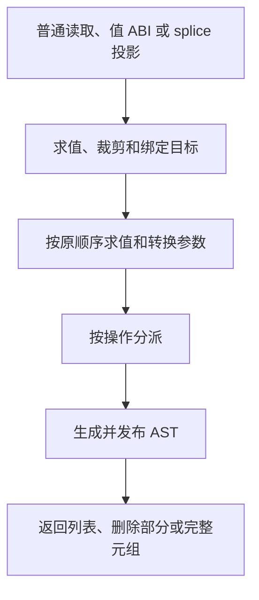

# genz 列表操作编排自举

## Intent

从 `0dc90a0ca` 接续，迁移普通表达式、值 ABI 和 splice 删除结果
投影共用的列表操作编排。RX 决定操作数求值、表示方式、分派与返回；
ZX 继续承担各操作的 AST 生成。初始 seed 保留独立实现。

## Data

现有 `collections.zig` 计算目标、逐个求值并绑定参数、调用各操作的
Source 生成器，然后交接元组转换、类型构造和 AST 发布。append、
splice、reverse、sort 和 slice 共享 AST 资源及发布形状，旧桥各自
建立输入和暂存区。pop 的元素转换使用已有转换列。
[批首实现](../../packages/genz/src/zx/collections.zig)

## Edges

保留目标先于参数、参数从左到右、切片路径和已缓存投影的短路。
发布后才转换常规返回元组。借用参数及 AST 表，保留原有的文本复制、
列缓冲、异常释放和比较函数登记时机。初始 seed 可独立执行。

## Answer

沿正式入口核对旧总控、每操作 AST 生成桥及参数规划入口。对照五份
引导清单、所有权与列表应用回归、固定清单冷暖生成时间和 RSS。

- 普通读取、值 ABI 和 splice 删除部分投影均进入
  `workflow/run.rx`。初始 seed 的算法留在 `collections_seed.zig`，
  正式路径的旧总控和每操作桥退出。
- 追加、拼接、重排和切片使用同一个 AST 生成入口和暂存区。
  pop 的元素读取与结果元组转换继续使用既有转换能力。实体列写入、
  嵌套 AST 资源准备和物理资源释放仍由原生层提供。
- 首轮分配失败测试发现标量输出的 RX 会物化跨阶段的嵌套值描述符。
  展平共同输入，把短寿命描述符与 AST 生成合并到同一个栈优先暂存区。
  借用原 IR 参数切片和 AST 表，取消原 Zig 为求值结果分配的参数数组。
- 以批首 Source 引导器构建 ReleaseSmall 候选，主清单使用 16 个分区。
  372 项编译器回归通过，包含逐一注入分配失败的集成测试。
- 候选与批首对照 main、execution、host、collections、growth 五份
  清单。除编译器输入戳外，17,871 个生成文件逐字节一致。
- 使用默认初始 seed 执行 `bootstrap-lexer`，22 个构建步骤通过，
  初始 seed 仍能从当前主清单生成产物。
- 九组列表回归全部通过，共 538 个构建步骤、14,081 项测试。覆盖
  源码与编译库的不可变列表、列表所有权、pop、reverse、splice、
  排序、索引失败、求值顺序、迭代缓冲及脱离原列表的读取。

对照工具均由 Source 构建，运行时使用 Source 分析和生成。三组使用
同一个冻结清单、Zig 0.17.0 和 16 个分区，关闭常驻生成并交错测量
三次。下表记录冷生成中位数。

| 引导器                             |   墙钟 |    CPU | 采样进程树峰值 RSS | 单进程峰值 RSS |
| ---------------------------------- | -----: | -----: | -----------------: | -------------: |
| 固定基线 `declaration-preparation` | 2.09 s | 9.02 s |          737.51 MB |      771.29 MB |
| 批首 `0dc90a0ca`                   | 1.95 s | 9.51 s |          529.10 MB |      550.85 MB |
| 候选                               | 1.94 s | 9.47 s |          528.97 MB |      559.48 MB |

较批首，冷生成墙钟减少 0.01 秒，CPU 减少 0.04 秒，进程树峰值减少
0.13 MB，单进程峰值增加 8.63 MB。较固定基线，墙钟减少 0.15 秒，
CPU 增加 0.45 秒，进程树峰值减少 208.54 MB。热生成墙钟与 CPU
分别保持 1.45 秒和 6.26 秒，无修改生成墙钟保持 0.03 秒。冻结清单
冷暖及批首对照的 9,894 个文件逐字节一致。
