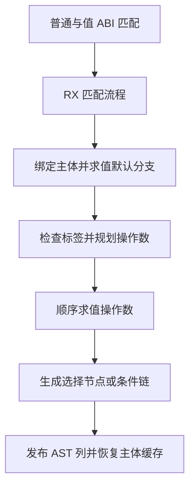

# genz 匹配分支求值与发布自举

## Intent · 收口匹配表达式的正式降低链

从 `eb9ce8860` 起迁移普通与值 ABI 的匹配表达式。两路共用同一
Source 流程，依次完成主体缓存绑定、默认表达式、分支计划、操作数求值
及 AST 片段构造。移除负责串接三个生成入口的 Zig 桥。

## Data · 当前执行路径

`match.lowerMode` 调用 Source 降低主体和默认值，后续经
`lowerMatchArms` 返回 Zig，由 `bridge.plan`、`lowerArms` 与
`bridge.emit` 依次调用三个独立入口。匹配字面量校验、请求顺序及
两种 AST 片段的构造已有 Source 实现，可以原样连接。

## Edges · 保持求值与发布契约

默认分支先降低，普通链的分支逆序处理，快速选择仍使用既有标签判定。
主体缓存由同一个宿主作用域恢复，包括失败和无分支路径。读取 AST 基址
发生在所有操作数写完后。原生层继续借用列、提供真实分配器及写入最终
AST 存储。分支标记、求值顺序和片段内容全部由 RX/ZX 决定。

候选 ReleaseSmall 应用回归曾在操作数求值阶段返回越界，引导清单仍能生成。
加入诊断后，四个操作数均可读写，说明同一写入路径受缓冲区描述符传递
方式影响。操作数现在使用已有的自有缓冲区分配方式，切片描述符与数据
一次分配，分配返回初始化好的句柄。求值完成后以只读视图读取原数据。
缓冲区仍由本次降低的暂存区释放。

## Answer · 验收

- 复用 `fcde84a9f` 阶段验收的 Source 引导器构建候选，使用 ReleaseSmall 和
  16 个主生成分区。编译器 372 项测试通过。匹配类型、跨模块匹配、标量选择
  及对象 reduce 的源码与编译库副作用场景共 41 项测试通过。
- 批首与候选两套 Source 引导器使用相同的 main、execution、host、collections
  和 growth 清单生成，除编译器身份输入戳外，17,874 个文件逐字节一致。

固定兼容清单在相同工具链、分区及关闭常驻生成的条件下交错测量三次。
以下为中位数，三个引导器本体均由 Source 生成，测量均启用 Source
分析和生成。冷、热生成和无修改输入按各自缓存条件测量。

| 冷生成                             |   墙钟 |    CPU | 采样进程树峰值 RSS | 单进程峰值 RSS |
| ---------------------------------- | -----: | -----: | -----------------: | -------------: |
| 固定基线 `declaration-preparation` | 2.12 s | 9.04 s |          737.39 MB |      759.66 MB |
| 批首 `project-file-targets`        | 1.96 s | 9.49 s |          528.81 MB |      546.59 MB |
| 候选                               | 2.00 s | 9.48 s |          529.09 MB |      548.90 MB |

较批首，冷生成墙钟增加 0.04 秒，CPU 减少 0.01 秒，进程树和单进程峰值
分别上升 0.28 MB 和 2.31 MB。较固定基线，墙钟减少 0.12 秒，CPU 增加
0.44 秒，进程树和单进程峰值分别下降 208.31 MB 和 210.76 MB。
热生成墙钟 1.46 秒，CPU 6.28 秒，较批首分别减少 0.01 秒和增加 0.04 秒。
无修改生成保持 0.03 秒。冻结清单冷、热及批首对照的 9,894 个文件一致。
