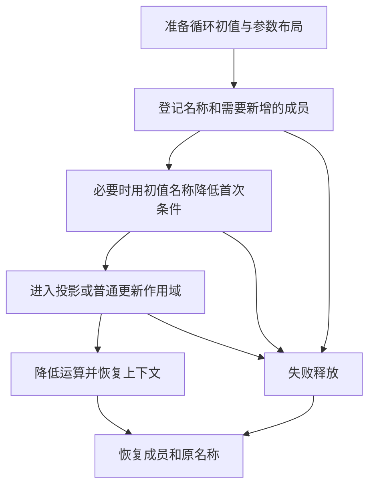

# genz 循环参数与更新作用域自举

## Intent · 接管 Loop 参数的完整生命周期

从 `1d5313f83` 起，迁移正式 Loop 的参数进入、初次条件命名、
投影或普通更新作用域切换，以及正常退出和错误释放。移除参数进入、
重命名及恢复三个独立生成入口。

## Data · 正式调用链

普通、值 ABI、弃用结果和循环消费共用 `iteration.lowerMode`。
旧参数对象把计划、名称、成员新增标记和上下文保存到 Zig，
首次条件、更新和释放经回调恢复这些信息。

## Edges · 保持释放顺序与资源归属

现有名称与成员要在正式参数绑定之前读取。相同符号只登记一次。
若预留成员失败，依靠已保存的标记恢复名称，并只移除实际存在的新成员。
运算子继续借用现有 IR，投影与普通更新分别保存不同的宿主上下文。
Zig 持有物理索引分配、上下文快照和失败时调用 Source 释放的资源边界。

保存槽由 Loop 帧提供，键和桶视图借用索引的当前切片描述符。释放时由
Source 直接读取计数并写回删除后的值。普通路径和释放共用这些借用，
正式生成的参数操作沿用空暂存分配器。

## Answer · 验收

复用现有 Source 引导器，核对常用、值 ABI、投影、缓冲及失败路径。
对照五份引导清单和固定清单产物，运行受影响的 Loop、迭代跨调用和
聚合回归，记录生成的 CPU、墙钟和峰值内存。

- 复用 `1d5313f83` 的 Source 引导器构建 ReleaseSmall 候选，保留 16 个主
  生成分区。372 项编译器测试通过。
- 批首和候选运行相同的 main、execution、host、collections、growth 清单。
  除编译器身份输入戳外，17,840 个文件逐字节一致。
- 使用批首引导器生成这批源码的应用回归工具。五组 Loop、跨调用、
  普通缓冲、嵌套缓冲及跨模块回归通过，覆盖名称遮蔽及编译、执行分配失败。
  共 293 个构建步骤、384 项 Zig 测试和 6 项 CLI 检查通过。

沿用固定兼容清单、工具链和分区数，在关闭常驻生成的条件下交错测量
三次。三个引导器均由 Source 生成，测量使用 Source 分析和生成。
下表为冷生成中位数。

| 引导器                             |   墙钟 |    CPU | 采样进程树峰值 RSS | 单进程峰值 RSS |
| ---------------------------------- | -----: | -----: | -----------------: | -------------: |
| 固定基线 `declaration-preparation` | 2.09 s | 8.99 s |          738.36 MB |      760.04 MB |
| 批首 `1d5313f83`                   | 1.94 s | 9.48 s |          529.22 MB |      541.66 MB |
| 候选                               | 2.01 s | 9.50 s |          530.48 MB |      545.36 MB |

较批首，冷生成墙钟增加 0.07 秒，CPU 增加 0.02 秒，进程树峰值增加
1.26 MB，单进程峰值增加 3.70 MB。较固定基线，墙钟减少 0.08 秒，CPU
增加 0.51 秒，进程树峰值减少 207.88 MB。热生成墙钟和 CPU 分别增加
0.01 秒、0.02 秒，无修改生成维持 0.03 秒。冻结清单冷暖以及批首对照
的 9,894 个文件均逐字节一致。
